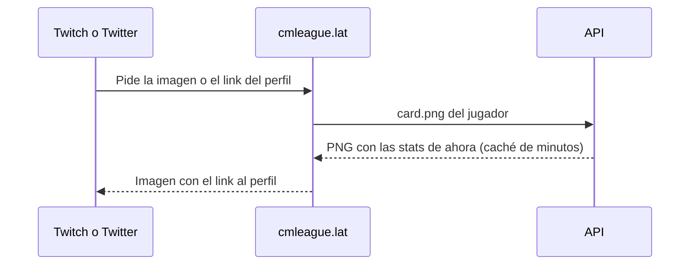

# Guía: widget para la bio (prototipo)

## Verlo

1. Levantar el frontend nuevo con la configuración `frontend-mm-ejemplo` (puerto 5173).
2. Abrir `http://localhost:5173/demo/bio`.

## Cambios respecto del plan

- `features/export/card.ts` ahora exporta sus ayudantes de dibujo (`SANS`, `MONO`, `loadImage`, `levelColors`, `roundRect`, `fitFont` y `Palette`) para no duplicarlos. La tarjeta de "Exportá tus stats" no cambia.
- La firma sumó una segunda opción, una imagen con link, para las páginas que no aceptan iframes.

## Pasar a la versión real

## Notas

- No toca el plugin: no hay nada que subir al servidor real ni a RBK.
- No tiene `CHANGELOG_DISCORD.txt`: se escribe cuando Esteban lo publique.
- **Revertir:** borrar `features/bio/` y `routes/demo.bio.tsx`, y sacar los `export` de los ayudantes en `card.ts`.
