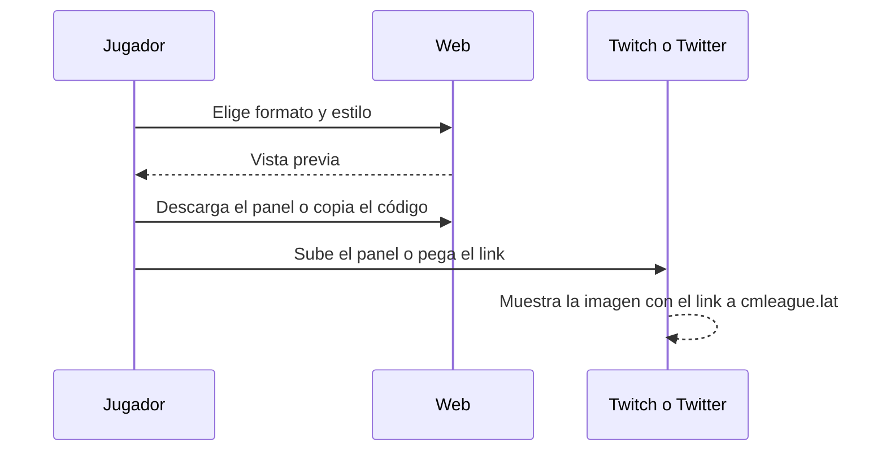

# Plan: Widget embebible para tu bio de Twitch y Twitter (VIP)

> Planeación original. Estado: **propuesta**, prototipo para pasarle a Daniel (backend) y a Esteban (frontend).

## Decisiones tomadas

| Tema | Decisión | Por qué |
|---|---|---|
| Qué es | Distinto del widget para OBS (`2026-10-29-widget-streamers`): es para la bio, no para encima del stream | Twitch y Twitter no aceptan iframes en la bio |
| Twitch | Imagen de panel de 320 × 160 (la medida que pide Twitch) con el link al perfil | Los paneles de Twitch son una imagen con un link |
| Twitter/X | La bio solo acepta un link: la tarjeta que aparece al pegar `cmleague.lat/tuNick` (Open Graph, 1200 × 630) y una imagen para el tweet fijado | Es lo único que Twitter muestra |
| Webs, Linktree, Discord | Un `<iframe>` de 400 × 120 con la firma | Sirve para cualquier página que acepte HTML |
| Cómo se dibuja | En canvas, como la tarjeta de "Exportá tus stats" | Lo que se ve es lo que se descarga |
| Que se actualice solo | En la versión real, la imagen la genera el backend en una URL fija (`/api/v1/players/{nick}/card.png`) | Así no hay que volver a subir el panel de Twitch |
| Sin VIP | Vista previa con marca de agua; descargar y copiar el código, con candado | Muestra el beneficio |

## 1. El flujo

## 2. Lo que tendría que hacer cada uno

- **Daniel:** la imagen dinámica del jugador (un PNG en una URL fija, con caché de unos minutos), las etiquetas Open Graph del perfil público y la página del iframe.
- **Esteban:** el generador en el perfil, al lado del widget para OBS.

## 3. Orden de implementación

1. `features/bio/draw.ts`: el dibujo de los tres formatos.
2. `features/bio/BioWidget.tsx` y `routes/demo.bio.tsx`.
