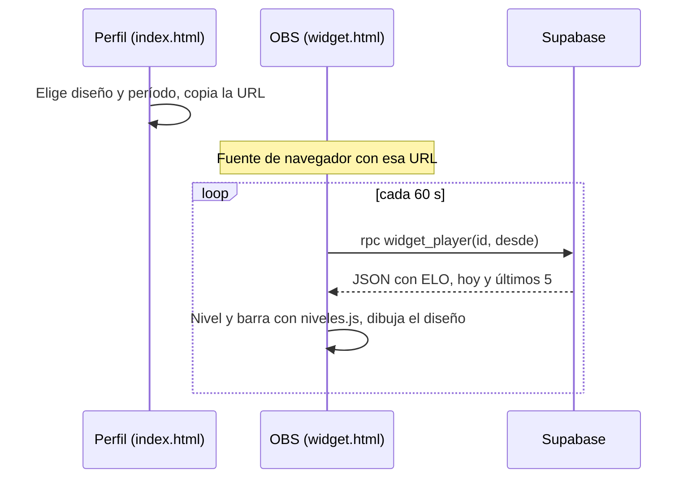
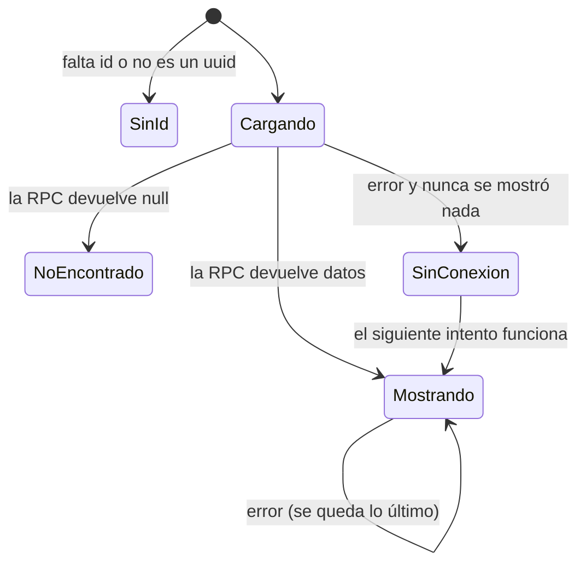

# Widget de CM League para streamers: documentación

## Qué hace

Los streamers pueden mostrar en OBS (o en Streamlabs) un recuadro con su nivel, su ELO, cuánto les falta para el siguiente nivel y cómo les fue en los mixes del día. Es una página aparte, `widget.html`, con fondo transparente, que se agrega como **fuente de navegador** y se actualiza sola cada minuto.

La URL se genera desde el perfil de cualquier jugador, con el botón **"Widget para stream"**. No hace falta iniciar sesión, ni para generarla ni para que el widget funcione, porque todos los datos que muestra ya son públicos en la web.



## La URL

`widget.html?id=<players.id>&d=<diseño>&v=<período>`

| Parámetro | Valores | Por defecto |
|---|---|---|
| `id` | El uuid de la ficha del jugador (`players.id`). Obligatorio | — |
| `d` | `mini`, `compacto` o `completo` | `compacto` |
| `v` | `hoy` (desde la medianoche de la PC del streamer) o `24h` (las últimas 24 horas) | `hoy` |
| `bg` | `1` pone un fondo gris, para verlo en el navegador o en la vista previa | Sin fondo (transparente) |
| `demo` | `1` muestra datos de ejemplo sin consultar la base (no hace falta `id`) | Datos reales |

Si cambia el nick del jugador, la URL sigue funcionando, porque usa el id.

## Diseños

| Diseño | Qué muestra | Tamaño en OBS |
|---|---|---|
| `mini` | Insignia de nivel y ELO | 160 × 60 |
| `compacto` | Insignia, tag del equipo y nick, ELO, barra al siguiente nivel con "faltan X ELO", V-D(-E) del período y ±ELO del período | 350 × 150 |
| `completo` | Lo del compacto, más el K/D del período, el rating total, el pico de ELO y los últimos 5 mixes (V verde, D rosa, E gris; al pasar el mouse se ve el ±ELO) | 410 × 180 |

Los colores de nivel son los mismos de la web (`LV` en `niveles.js`).

## Estados



Los textos son "Falta el jugador en la URL", "Jugador no encontrado" y "Sin conexión, reintentando…".

## Reglas de los datos

- **Mixes que cuentan:** `matches.kind = 'mix'`, `status = 'finished'` y una fila del jugador en `match_player_stats` con `team` 1 o 2. La fila es del jugador si tiene su `player_id` **o** su `steam_id`, porque hay filas viejas que solo tienen el SteamID.
- **Resultado:** gana si `matches.winner` es su equipo (`team1` para el equipo 1, `team2` para el 2). Si `winner` es `null`, es empate. Es la regla de `elo_apply_match`.
- **Período:** `coalesce(played_at, starts_at) >= p_desde`. El navegador calcula `p_desde` con su hora local, así no hace falta guardar zonas horarias.
- **ELO del período:** la suma de `elo_delta`. Un mix donde no recibió ELO (pocas rondas) suma 0, pero igual cuenta como V/D/E.
- **K/D del período:** kills / deaths sumados en esos mixes. Sin muertes muestra las kills, y sin nada, "-".
- **Totales:** `kd` y `rating` son los de `players`, los mismos que muestra el perfil.
- **Sin ELO todavía:** si no hay fila en `player_elo`, se usa `elo_config.start_elo` y 0 mixes.
- **Equipo:** el `tag` del primer equipo `official` (por nombre) que tiene al jugador en `members`. No se muestran los equipos `MIX` de los mixes.

## `widget_player(p_player uuid, p_desde timestamptz)`

Migración `20261029120000_widget_streamers.sql`. Es `stable` y `security invoker`: solo lee tablas que ya tienen lectura pública (`players`, `teams`, `matches`, `match_player_stats`, `player_elo` y `elo_config`), y tiene `grant execute` a `anon` y `authenticated`. Si `p_desde` no se pasa, usa las últimas 24 horas.

Devuelve `null` si el jugador no existe. Si existe, devuelve:

```json
{
  "nick": "Alfa", "team_tag": "ALF",
  "elo": 987, "peak_elo": 1028, "matches": 3,
  "kd": 0.79, "rating": 0.77,
  "hoy": { "v": 1, "d": 1, "e": 1, "elo": -13, "kills": 33, "deaths": 42 },
  "ultimos": [ { "r": "E", "elo": 6 }, { "r": "D", "elo": -47 }, { "r": "V", "elo": 28 } ]
}
```

`ultimos` son los 5 mixes terminados más recientes, de cualquier fecha, del más nuevo al más viejo.

## Generador en el perfil

En la pestaña Info del perfil, debajo de las estadísticas, hay un botón **"Widget para stream"** que abre un diálogo con:

- El selector de diseño y el de período.
- La vista previa: un `iframe` de `widget.html` con `bg=1`.
- La URL y el botón **Copiar URL**. Si el navegador no deja copiar, selecciona el texto para copiarlo con Ctrl+C.
- Los pasos para OBS y el tamaño recomendado del diseño elegido.

La URL se arma con la dirección actual de la web (`new URL('widget.html', location.href)`), así que sirve igual en producción y en local.

## Dónde está cada cosa

| Qué | Archivo / ubicación |
|---|---|
| Página del widget | `widget.html` |
| Niveles compartidos (`LV`, `lvlOf`) | `niveles.js`, cargado por `index.html` y `widget.html` |
| Generador (`openWidget`, `wdUrl`, `wdSync`) y diálogo `#wdl` | `index.html` |
| Función de la base | `supabase/migrations/20261029120000_widget_streamers.sql` |
| Pruebas de la función | `docs/bitacora/2026-10-29-widget-streamers/pruebas/pruebas_widget.sql` |
