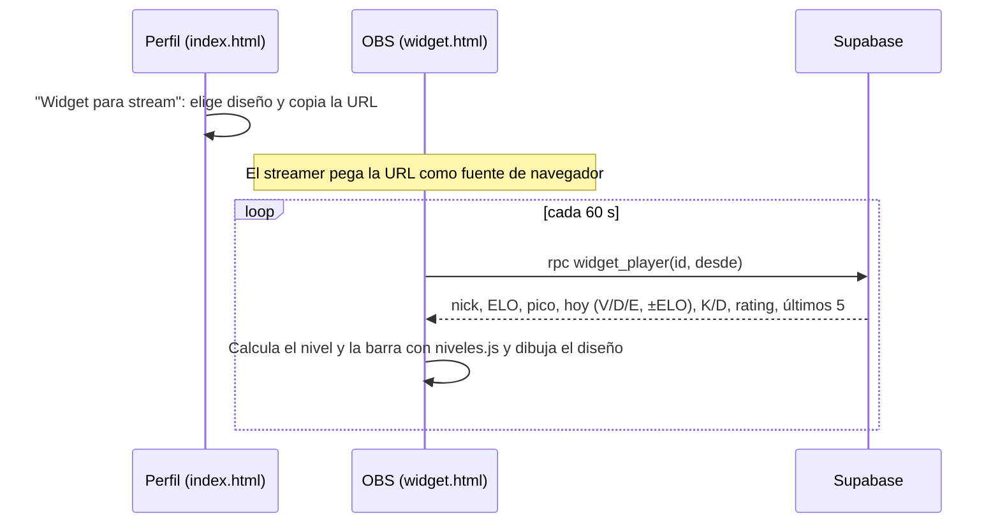

# Plan: widget de CM League para streamers (OBS)

> Planeación original. Estado: **propuesta**, pendiente de aprobación de Daniel o Kyan.

Kyan pidió un widget para que los streamers de CM League muestren su nivel, ELO y resultados del día en el stream, como el [widget de FACEIT de Strugly](https://strugly.com/faceit-widget). El streamer copia una URL desde su perfil y la agrega en OBS (o Streamlabs) como **fuente de navegador**. El widget se actualiza solo.

Casi todos los datos ya existen y son de lectura pública: `player_elo` (ELO y pico), `match_player_stats` (`elo_delta`, `team`, kills, deaths, rating) y `matches` (`winner`, `played_at`). Los niveles y la barra "faltan X ELO" ya están en `index.html` (`LV`, `lvlOf`, `ppBar`). Lo que falta es una página liviana para OBS, una función en la base que junte todo en una llamada y el botón para generar la URL.

No toca el plugin ni los servidores: **no hay despliegue al servidor real ni a RBK**.

## Decisiones tomadas

| Tema | Decisión | Por qué |
|---|---|---|
| Dónde va | **Web actual** (`index.html` + una migración en Supabase), no la rama `feat/backend-api-fase-1` | Los streamers lo pueden usar ya, sin esperar el corte. En el corte se porta la función al replanteo usando `elo_key()` (ver sección 6) |
| Página | Un archivo aparte, `widget.html`, en la raíz | La SPA carga todo (155 KB, menú, sesión). OBS necesita algo chico, con fondo transparente y sin login |
| Cómo se identifica al jugador | `?id=<players.id>` (uuid) | El nick puede cambiar o repetirse; el id no. La URL la genera el botón, nadie la escribe a mano |
| Datos | Una RPC, `widget_player(p_player uuid, p_desde timestamptz)`, que devuelve un JSON | Una sola llamada cada minuto, en vez de 4 consultas. Usa solo datos que ya son públicos, así que es `security invoker` y con `grant execute` a `anon` |
| "Hoy" | El widget manda `p_desde`, que calcula con la hora local de la PC del streamer: medianoche (`v=hoy`, por defecto) o hace 24 h (`v=24h`) | No hace falta guardar zonas horarias. Un stream que pasa la medianoche puede usar `24h` |
| Victoria, derrota y empate | Se cuentan los mixes `finished` donde el jugador estuvo en el equipo 1 o 2. Gana si `matches.winner` es su equipo (`team1` para el 1, `team2` para el 2) y empata si `winner` es `null` | Es la misma regla que usa `elo_apply_match` |
| ELO del día | La suma de `elo_delta` de esos mixes. Si jugó pocas rondas, su `elo_delta` es `null` y suma 0 | Coincide con lo que muestra el perfil |
| Niveles | Se pasan `LV` y `lvlOf` a un archivo compartido, `niveles.js`, que cargan `index.html` y `widget.html` | Si se cambian los cortes de nivel, no quedan dos copias distintas |
| Actualización | Polling cada **60 s** a la RPC. Si falla, se mantiene lo último que se mostró | Un mix dura más de 30 minutos, y la web no usa Realtime en ningún lado. Con 60 s alcanza |
| Diseños | 3 diseños para empezar: `mini`, `compacto` y `completo` (sección 4) | Cubren los usos de Strugly. Los animados y los de ranking quedan para después |
| Ranking regional o por país | **Fuera de este requerimiento** | No guardamos el país del jugador |
| Quién genera la URL | Cualquiera, desde cualquier perfil. El botón se ve en todos los perfiles | Los datos ya son públicos. Así un caster o un amigo también puede armarlo |

## 1. El flujo completo



## 2. Base de datos: migración `20261029120000_widget_streamers.sql`

Una función nueva. No crea tablas ni cambia las que existen.

```sql
create or replace function public.widget_player(p_player uuid, p_desde timestamptz default now() - interval '24 hours')
returns jsonb language sql stable security invoker set search_path = public as $$ … $$;
grant execute on function public.widget_player(uuid, timestamptz) to anon, authenticated;
```

Devuelve `null` si el jugador no existe. Si existe, devuelve:

| Campo | De dónde sale |
|---|---|
| `nick`, `team_tag` | `players` y el equipo donde figura en `teams.members` |
| `elo`, `peak_elo`, `matches` | `player_elo` por `players.steam_id`. Sin fila: `elo_config.start_elo` y 0 mixes |
| `hoy.v`, `hoy.d`, `hoy.e` | Mixes `finished` con `played_at >= p_desde` donde jugó (regla de la tabla de decisiones) |
| `hoy.elo` | `sum(coalesce(elo_delta, 0))` de esos mixes |
| `hoy.kills`, `hoy.deaths` | Suma de esos mixes, para el K/D del día |
| `kd`, `rating` | Los totales de `players` (los que mantiene `recompute_player_stats`) |
| `ultimos` | Los últimos 5 mixes terminados (de cualquier fecha): `'V'`, `'D'` o `'E'`, con su `elo_delta` |

El jugador de un mix se busca por `match_player_stats.player_id = p_player` **o** por `steam_id = players.steam_id`, porque hay filas viejas que solo tienen el SteamID. Se usan los índices que ya existen (`match_player_stats_player_idx`, `match_player_stats_steam_idx` y `matches_mix_played_idx`).

## 3. `widget.html` y `niveles.js`

- **`niveles.js`** (raíz): `LV` y `lvlOf(elo)`, sacados de `index.html` sin cambios. `index.html` lo carga con `<script src="niveles.js">` y borra su copia.
- **`widget.html`** (raíz):
  - HTML, CSS y JS en un solo archivo, sin dependencias aparte de `@supabase/supabase-js` (la misma versión que usa `index.html`), `config.js` y `niveles.js`.
  - `body` con fondo **transparente**. Con `bg=1` se pone un fondo oscuro para verlo en el navegador.
  - Parámetros: `id` (obligatorio), `d` (`mini`, `compacto` o `completo`; por defecto `compacto`) y `v` (`hoy` o `24h`).
  - Si falta el `id` o el jugador no existe, muestra un texto chico: "Jugador no encontrado".
  - El `.htaccess` no hace falta tocarlo: como `widget.html` existe como archivo, se sirve tal cual.

## 4. Diseños

| Diseño | Muestra | Tamaño sugerido en OBS |
|---|---|---|
| `mini` | Insignia de nivel y ELO | 220 × 60 |
| `compacto` | Insignia, nick, ELO, barra al siguiente nivel ("faltan X ELO") y hoy: V-D y ±ELO | 360 × 110 |
| `completo` | Lo del compacto más el K/D del día, el rating total, el pico de ELO y los últimos 5 mixes como cuadraditos V/D/E | 420 × 200 |

Los colores de nivel son los de `LV`, igual que `lvlBadge`. Para la tipografía y el tema se usan los de `csstv-theme.css`.

## 5. Generador en el perfil (`index.html`)

- Un botón **"Widget para stream"** en la página del perfil, junto a las estadísticas.
- Abre un modal con:
  - El selector de diseño y el de período (`hoy` o `24 h`).
  - Una vista previa (un `<iframe>` de `widget.html` con `bg=1`).
  - La URL con un botón **Copiar**.
  - Tres pasos para OBS: Fuente → Navegador → pegar la URL y poner el tamaño de la tabla.

## 6. Al hacer el corte al backend nuevo

En el replanteo, `widget_player` tiene que:

- Buscar el ELO con `elo_key()`, porque allá una ficha puede tener varios SteamID.
- Excluir los mixes borrados (`mix_deletions`).

Queda anotado en `docs/PENDIENTES.md` para no perderlo.

## 7. Requisitos antes de empezar

- Acceso al SQL Editor de Supabase para la migración. Lo corre Daniel o Kyan.
- Acceso al hosting de la web para subir `widget.html`, `niveles.js` e `index.html`.
- OBS instalado en alguna PC para la prueba final.

## 8. Orden de implementación

1. Migración `widget_player` y `pruebas/pruebas_widget.sql`, que compara el resultado con un par de mixes reales: V/D, ±ELO y los últimos 5, contra lo que muestra el perfil.
2. `niveles.js` y el cambio en `index.html` para que lo use. Comprobar que el perfil y la tabla de jugadores muestren lo mismo que antes.
3. `widget.html` con los 3 diseños, probado en el navegador con `bg=1`.
4. Generador en el perfil.
5. Prueba en OBS como fuente de navegador: fondo transparente y que se actualice después de un mix.
6. Desplegar: migración, después la web. Sin plugin, así que no hay nada que subir al servidor real ni a RBK.
7. `DOCUMENTACION.md`, `GUIA_IMPLEMENTACION.md`, `CHANGELOG_DISCORD.txt` y actualizar `docs/PENDIENTES.md` (el punto del corte).
