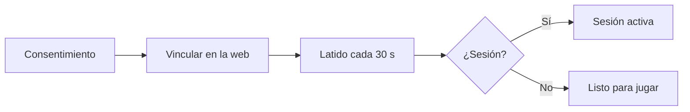

# CMLeague Anticheat, la aplicación: documentación

## Qué hace

Es la aplicación visible para Windows. Pide consentimiento, vincula la PC con la cuenta de `cmleague.lat`, manda un latido cada 30 segundos y muestra el estado. **Esta versión no captura pantalla ni lista procesos:** solo busca por nombre si `CMLauncher.exe` está abierto, sin guardar ni enviar la lista.

## Pantallas

| Pantalla | Cuándo |
|---|---|
| Antes de empezar | Primera vez: qué envía y qué no hace |
| Vincula tu cuenta | Sin tokens |
| Confirma en la web | Muestra el código y abre `cmleague.lat` |
| Listo para jugar | Vinculada, sin sesión |
| Sesión activa | El Bridge abrió la sesión |
| Sin conexión | Falla la red; avisa que un mix puede expulsarlo |

Cerrar la ventana la deja en la bandeja, con su ícono visible; "Salir" está en el menú del ícono.

## Datos locales

| Qué | Dónde |
|---|---|
| Programa | `%LOCALAPPDATA%\Programs\CMLeagueAC` |
| Tokens (cifrados con DPAPI), consentimiento y registro | `%LOCALAPPDATA%\CMLeagueAC` |

DPAPI protege frente a otros usuarios de la PC, no frente al propio jugador. El registro nunca incluye tokens, pero sí el código de vinculación.

## Interfaz

Colores oficiales `#ff6900` y `#0a0a0a`. Es una ventana compacta con un estado grande y las comprobaciones debajo. Kyan pidió una mezcla de Gamers Club, FACEIT, Esportal y Akros: **solo se encontró documentación de FACEIT, y de los otros tres no se pudo ver la interfaz.** Falta que Kyan la compare.

## Dónde está cada cosa

| Qué | Archivo |
|---|---|
| Ventana y trabajo en segundo plano | `agent/src/main.cpp` |
| Dibujo | `agent/src/ui.cpp` |
| HTTP | `agent/src/net.cpp` |
| Datos e instalación | `agent/src/store.cpp` |
| Compilar | `agent/build.bat` |
