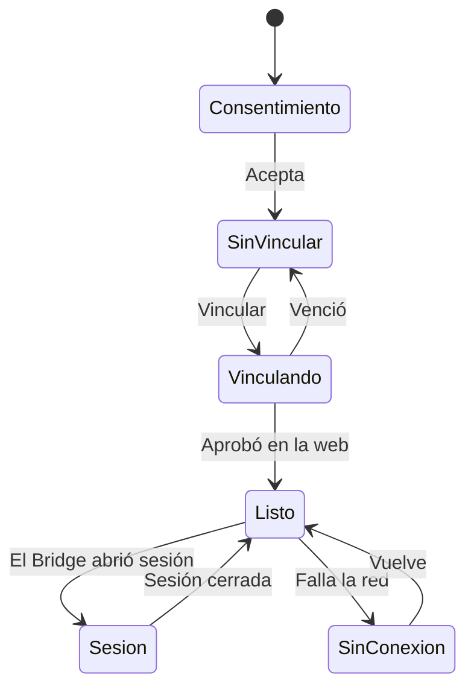

# Plan: CMLeague Anticheat, la aplicación (etapa 2)

> Planeación original. Estado: **aprobado por Kyan** el 2026-10-30 ("hace todo"). Sigue a [`2026-10-30-anticheat-backend`](../2026-10-30-anticheat-backend/).

## Decisiones tomadas

| Tema | Decisión | Por qué |
|---|---|---|
| Nombre | **CMLeague Anticheat**, ejecutable `CMLeagueAC.exe`. "FRAG" queda como nombre interno | Decisión de Kyan |
| Tecnología | C++ con Win32, WinHTTP y GDI+, 64 bits, sin dependencias externas | El brief pide dependencias mínimas. El SDK de WebView2 no estaba en la PC y descargarlo necesitaba aprobación de Kyan, que no estaba |
| Interfaz | Ventana compacta oscura con un estado grande y una lista de comprobaciones. Colores oficiales `#ff6900` y `#0a0a0a` | Pedido de Kyan: mezcla de Gamers Club, FACEIT, Esportal y Akros. Solo se encontró documentación de FACEIT: hay que revisarla con Kyan |
| Instalador | Integrado en el ejecutable, por usuario y sin administrador | Sin instalar herramientas nuevas |
| Inicio con Windows | **No** | El brief pide no persistir fuera de lo informado |
| Tokens | Cifrados con DPAPI | Protege frente a otros usuarios, no frente al propio jugador |
| Recopilación | **Ninguna en esta etapa:** ni procesos ni capturas | El brief las deja para las etapas 3 y 4, y antes hace falta la revisión legal |
| Sistemas | Windows 10 y 11 de 64 bits | Sale de la auditoría |

## 1. El flujo completo

## 2. Qué incluye

- Aplicación visible, con ícono en la bandeja y sin ocultarse.
- Consentimiento antes de vincular.
- Vinculación, latido cada 30 segundos, renovación de tokens y detección de ClientMod.
- Instalador y desinstalador, que borra los datos locales.
- Bridge y página de vinculación: se agregan aparte, cada uno en su commit y su bitácora.

## 3. Requisitos antes de empezar

Build Tools 2026 con C++ y el SDK de Windows, ya instalados.

## 4. Orden de implementación

1. Aplicación e imágenes de cada estado, para revisar la interfaz sin abrir ventanas.
2. Prueba de punta a punta contra la API local.
3. Instalar y desinstalar, y comprobar que no quede nada.
4. Documentar y subir solo a `kyan/anticheat-backend`.
