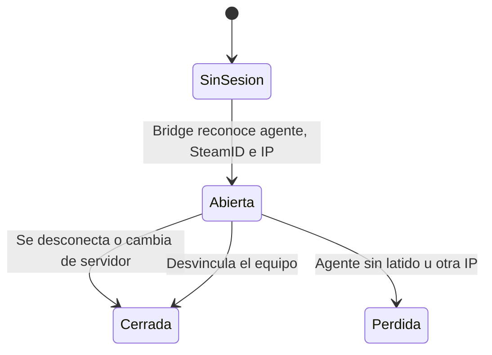

# Backend del anticheat FRAG: documentación

## Qué hace

Es la base del anticheat en el servidor: vincula el agente con la cuenta de `cmleague.lat`, abre y cierra sesiones, le dice al Bridge si deja jugar a alguien y guarda en el perfil el estado público. **Todavía no recibe procesos ni capturas.**

El jugador abre el agente, este abre la web, y el jugador aprueba un código con su sesión. El agente nunca ve la contraseña. Después manda latidos, y el Bridge pregunta por cada jugador.

## Cuándo se expulsa

El Bridge llama a `ac_bridge_player` y recibe `action`.

| `reason` | Significa | En un mix | Fuera de un mix |
|---|---|---|---|
| `ok` | Agente activo, SteamID de su ficha, misma IP | `allow` | `allow` |
| `no_profile` | El SteamID no tiene ficha con cuenta | `kick` | `allow` |
| `no_agent` | La cuenta no tiene equipo vinculado | `kick` | `allow` |
| `agent_stale` | Sin latido hace más de 90 segundos | `kick` | `allow` |
| `ip_mismatch` | La IP del jugador no es la del agente | `kick` | `allow` |

Para que haya `kick`, deben cumplirse todas estas condiciones:

- El servidor tiene fila en `ac_server_policy` con `protected` y `enforce_mixes` activos. **Por defecto están apagados.** Un servidor sin fila, como RBK, no se protege.
- `p_in_mix` es verdadero.
- Un admin no abrió los mixes (`POST /api/v1/admin/anticheat/open`).

**Expulsar no es una sanción:** no crea ban ni antecedente. Quien tenga IP distinta entre el juego y el agente, por ejemplo con VPN en uno solo, queda afuera. Hay que medirlo en la beta.

## Seguridad

| Punto | Cómo está resuelto |
|---|---|
| IP del agente | Solo la informa la API, con `AC_API_SECRET`. Directo con la anon key: rechazado |
| Tokens | Acceso de 15 minutos; el de renovación rota. En la base, solo hashes |
| Tablas | RLS en todas y sin permisos por defecto. Cada usuario ve sus sesiones y equipos, sin hashes |
| Perfil público | Solo `agent_linked`, `sessions_30d` y `last_session_at`. Sin SteamID, IP ni equipo |
| Staff | `ac_can_review()` es solo admin. Cada lectura de sesiones queda en `ac_admin_actions` |
| Evidencia | Bucket `ac-evidence` privado, sin subidas todavía |

**Límite conocido:** el agente corre en un equipo que controla el jugador. Una sesión abierta prueba que hubo un agente con esa cuenta y esa IP, no que el jugador esté limpio. La IP tampoco distingue dos PC de una misma casa: alguien podría correr el agente en otra PC de su red.

## Dónde está cada cosa

| Qué | Archivo / ubicación |
|---|---|
| Base | `supabase/replanteo/39_anticheat.sql` |
| Inversa | `docs/bitacora/2026-10-14-replanteo-modelo-datos/reversas/39_anticheat.sql` |
| Rutas | `web/backend/src/routes/anticheat.ts` |
| Contrato | `web/backend/src/schemas/anticheat.ts` |
| Pruebas | `web/backend/test/integration/anticheat.test.ts` |
