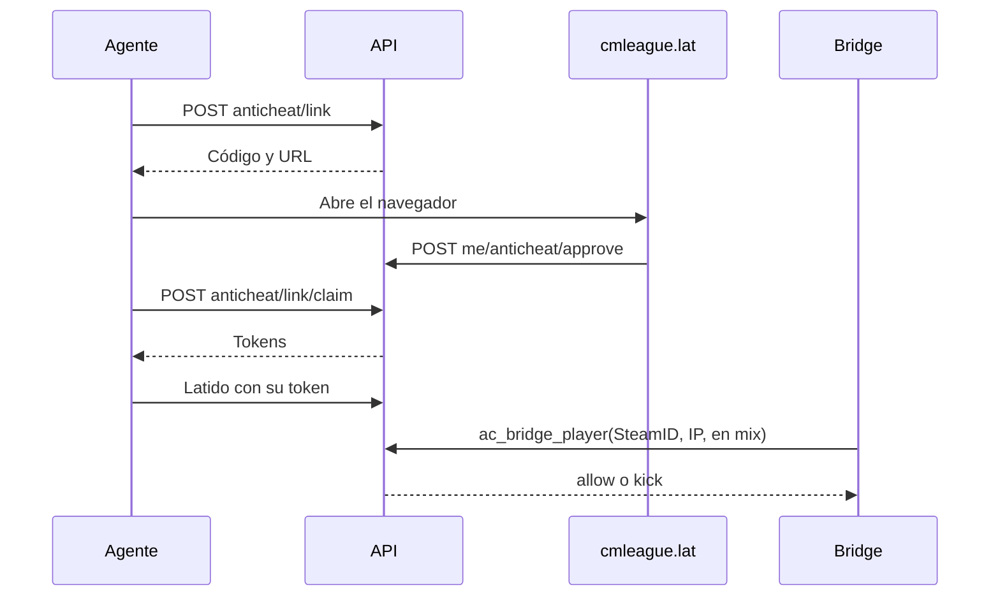

# Plan: backend del anticheat FRAG (etapa 1)

> Planeación original. Estado: **aprobado por Kyan** el 2026-10-30. Sale de la auditoría de la etapa 0, en la rama `kyan/pruebas`.

## Decisiones tomadas

| Tema | Decisión | Por qué |
|---|---|---|
| Rama | `kyan/anticheat-backend`, creada desde `feat/backend-api-fase-1`, sin subir nada a la de Daniel | Pedido de Kyan |
| Inicio de sesión | El agente abre `cmleague.lat`, el jugador entra y aprueba un código | Como FACEIT; el agente nunca ve la contraseña |
| Identidad | SteamID vinculado a la ficha, más IP igual a la del agente | Decisión de Kyan. El SteamID solo no alcanza |
| Sin agente | Obligatorio en mixes: el Bridge recibe `kick` | Decisión de Kyan. Reemplaza lo del brief de no bloquear en la v1. Expulsar no es sanción: no hay ban ni registro disciplinario |
| Servicio caído | Por defecto se frena; un admin abre los mixes por un tiempo | Decisión de Kyan |
| Activación | Por servidor y apagada por defecto | Permite dejar afuera a RBK y evita cortar mixes por sorpresa |
| Perfil público | Solo el estado | Decisión de Kyan |
| Evidencia | Solo admins, y cada lectura queda registrada | Más delicado que moderar |
| Retención | 30 días, guardado como configuración | Decisión de Kyan; el borrado llega con las capturas. Falta revisión legal |
| Vía de migración | `supabase/replanteo/39_anticheat.sql` | Necesita `is_moderator`/`steam_owner` y otras piezas del replanteo. No se aplica en producción |
| Bridge | Llama a RPC con el token del servidor, como los otros plugins | La IP del jugador la informa el servidor, no el agente |
| Agente | Pasa por la API, con un secreto compartido entre API y base | La anon key es pública: sin esto, cualquiera podría informar una IP falsa llamando directo a la RPC |
| Credenciales del agente | Token de acceso de 15 minutos y token de renovación que rota; en la base solo hashes | El brief pide evitar tokens permanentes |
| Fuera de esta etapa | Procesos, capturas, firmas, panel, aplicación y plugin | Etapas 2 a 6 |

## 1. El flujo completo

## 2. Base de datos

Tablas: `ac_config`, `ac_server_policy`, `ac_link_requests`, `ac_devices`, `ac_sessions`, `ac_admin_actions`. Bucket privado `ac-evidence`, sin subidas hasta la etapa 4.

Con respecto al brief: las demás tablas (`ac_process_*`, `ac_screenshots`, `ac_evidence`, `ac_integrity_logs`) entran con su etapa, y `ac_agents` y `ac_devices` son una sola.

## 3. API

| Ruta | Quién |
|---|---|
| `POST /api/v1/anticheat/link`, `/link/claim`, `/token`, `/heartbeat` | Agente |
| `POST /api/v1/me/anticheat/approve`; `GET` y `DELETE /api/v1/me/anticheat/devices` | Jugador con sesión |
| `GET /api/v1/players/{id}/anticheat` | Público |
| `GET /api/v1/admin/anticheat/sessions`; `POST /api/v1/admin/anticheat/open` | Admin |

## 4. Interfaz de la aplicación (etapa 2)

Kyan pidió una mezcla de las de Gamers Club, FACEIT, Esportal y Akros. Se toma como referencia su forma de uso, sin copiar marcas ni diseños, y con la identidad de CM League.

## 5. Requisitos antes de empezar

Docker Desktop corriendo y Supabase local. Nada toca producción.

## 6. Orden de implementación

1. `39_anticheat.sql` y su inversa.
2. Rutas y esquemas.
3. Pruebas de integración contra la Supabase local.
4. Documentar y subir solo a `kyan/anticheat-backend`.
