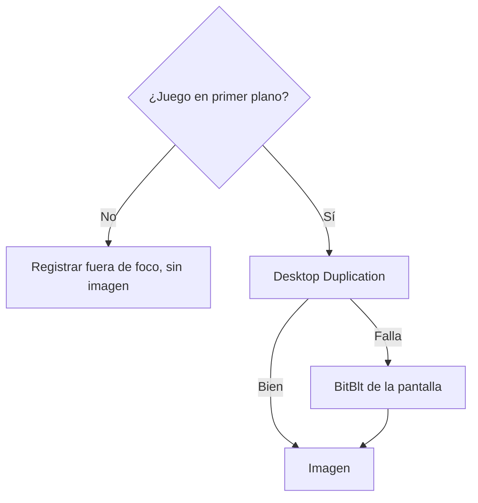

# Prueba de captura (etapa 0b): documentación

## Qué hace

Comprueba si se puede capturar ClientMod desde un programa externo, sin hooks, sin inyección y sin leer memoria. Es una prueba descartable, no el agente.

**Resultado:** se puede, en pantalla completa exclusiva, en una PC. El riesgo principal de la auditoría queda descartado para ese caso. Falta medir si capturar provoca tirones.

## Resultados

Medidos el 2026-10-30, con 47 tomas registradas: Windows 10 19045, RTX 2060, ClientMod desde `C:\CSSv34_ClientMod`, 1440x1080, sin servicio de EAC instalado. Windows informó pantalla completa exclusiva (`quns=3`) en todas.

| Método | Resultado | Tiempo | Decisión |
|---|---|---|---|
| Desktop Duplication | Imagen correcta y actual | Unos 200 ms | **Método principal** |
| `BitBlt` de la pantalla | Imagen correcta y actual | Unos 25 ms | **Respaldo** |
| `BitBlt` de la ventana | **Imagen vieja y congelada** | Unos 7 ms | **Prohibido** |
| `PrintWindow` | Negra | Unos 3 ms | Descartado |

- **`BitBlt` de la ventana engaña:** en la misma toma mostró el reloj en 3:35 mientras los otros dos métodos marcaban 0:00, y sus números parecían buenos. Para evidencia, una imagen creíble de otro momento es peor que ninguna. **Medir "no está negra" no alcanza:** las pruebas del agente tienen que comparar contra un método que muestre el momento actual.
- **Los dos métodos válidos muestran el presente:** coinciden en la escena y el reloj, y el contador de FPS cambia entre ambos (562 y 569).
- **Los tiempos** solo cuentan tomar la imagen. Desktop Duplication prepara la captura desde cero en cada toma, así que en el agente puede bajar. Eso todavía no se midió.
- **Tamaño:** unos 143 KB por JPEG, con la calidad por defecto de .NET. Con 15 capturas por hora son unos 2 MB por hora por jugador y unos 21 MB por hora en un 5v5.

## Otros hallazgos

- **El juego corre dentro de `CMLauncher.exe`** (32 bits), sin un `hl2.exe` aparte. La ventana se titula "CS:S v34 ClientMod" en el launcher y en el juego. Solo el tamaño la distingue en esta prueba: minimizada mide 160x28. El agente necesita una forma más firme de identificarla.
- **Sin administrador no se obtuvo la ruta de `CMLauncher.exe`:** `Get-Process` y WMI la devolvieron vacía. Probablemente el launcher corre elevado, sin confirmar. Afecta al monitor de procesos: sin ruta no hay hash ni firma de ese proceso.
- **Primer cuadro vacío:** Desktop Duplication puede devolver un primer cuadro negro con `LastPresentTime` en 0. Hay que descartarlo y esperar otro.
- **Fuera de foco:** con el juego minimizado no se guardó ninguna imagen. Es una sola comprobación; falta probar un Alt+Tab real.

## Sin probar

Quedan para las pruebas de campo, al final (decisión de Kyan, 2026-10-30):

| Qué | Por qué importa |
|---|---|
| Tirones al capturar: `pruebas/Ritmo.cs`, listo pero **nunca ejecutado** | Si se notan en partida, hay que cambiar de método o de momento |
| Alt+Tab en pantalla completa | Para no capturar nada privado |
| Modos ventana y sin bordes | Kyan los dejó para después de pantalla completa |
| Windows 11 y otras placas de video | Solo se probó una PC |

**EAC queda fuera:** FRAG es independiente de él y no se hacen pruebas con EAC (decisión de Kyan). Kyan informa que no frena a quienes hacen trampa y que vuelve más lento el juego; eso es su experiencia, no algo medido aquí.

## Dónde está cada cosa

| Qué | Archivo / ubicación |
|---|---|
| Capturador de prueba | `pruebas/CapturaPrueba.cs` |
| Medición de tirones | `pruebas/Ritmo.cs` |
| Imágenes y registros | Fuera del repo, en una carpeta temporal de esa PC |
