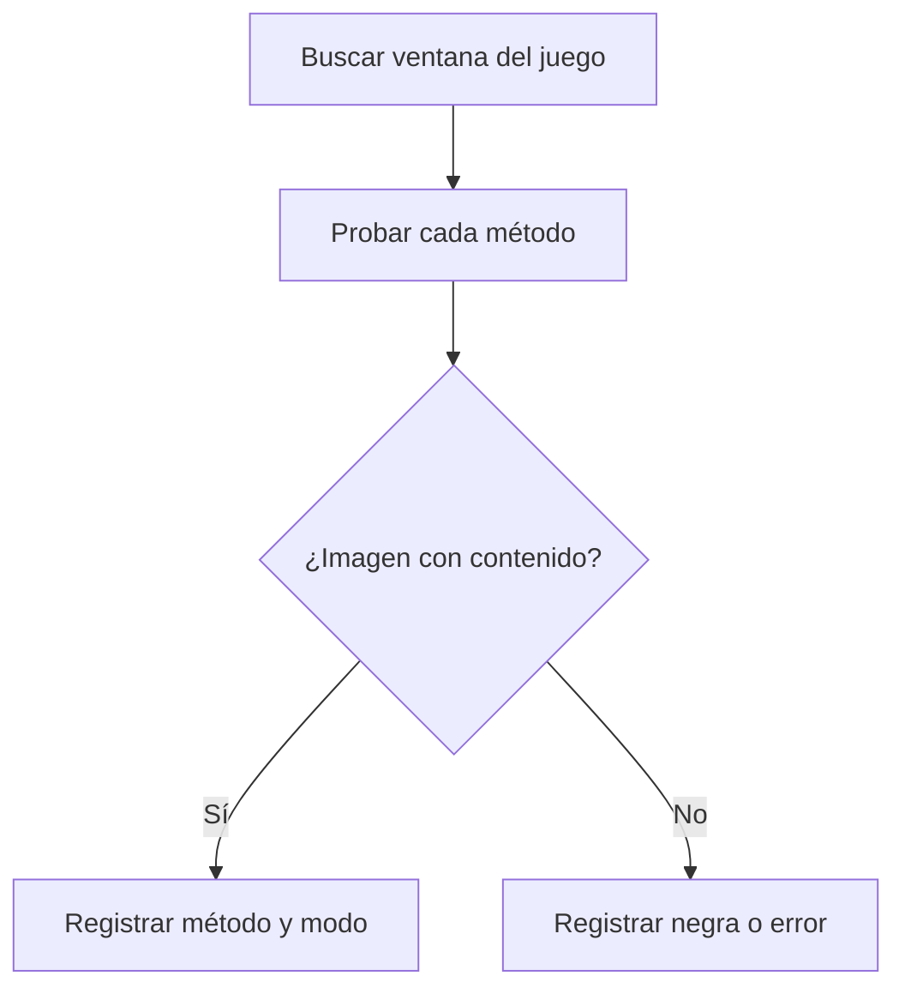

# Plan: prueba de factibilidad de la captura (etapa 0b)

> Planeación original. Estado: **aprobado por Kyan** el 2026-10-30. Programa descartable: no es el agente.

## Decisiones tomadas

| Tema | Decisión | Por qué |
|---|---|---|
| EAC | **FRAG es independiente de EAC:** no se integra ni depende de él | Lo pidió Kyan el 2026-10-30. Solo se comprueba que puedan convivir si el launcher lo abre |
| Herramienta | C# compilado con el `csc.exe` de Windows | No hace falta instalar nada |
| Métodos | `BitBlt` de la pantalla, `BitBlt` de la ventana, `PrintWindow` y Desktop Duplication | Ninguno inyecta ni lee memoria del juego |
| Graphics Capture | Solo si los anteriores fallan | Es mucho más trabajo desde .NET Framework |
| Imágenes | Se guardan fuera del repo, y solo con el juego en primer plano | Pueden mostrar datos personales |
| Red | Nada se sube | Es una prueba local |

## 1. El flujo completo

## 2. Qué se mide

Por cada modo (pantalla completa, ventana, sin bordes): resultado de cada método, luminancia media, colores distintos, si el juego estaba en primer plano y si Windows informa pantalla completa exclusiva.

## 3. Requisitos antes de empezar

El juego abierto en cada modo: lo abre una persona, porque es su sesión.

## 4. Orden de implementación

1. Validar la herramienta contra el launcher.
2. Probar cada modo con el juego.
3. Documentar el resultado, incluido lo que no se pudo probar.
