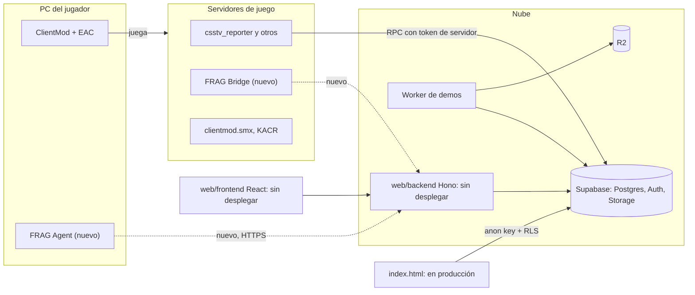
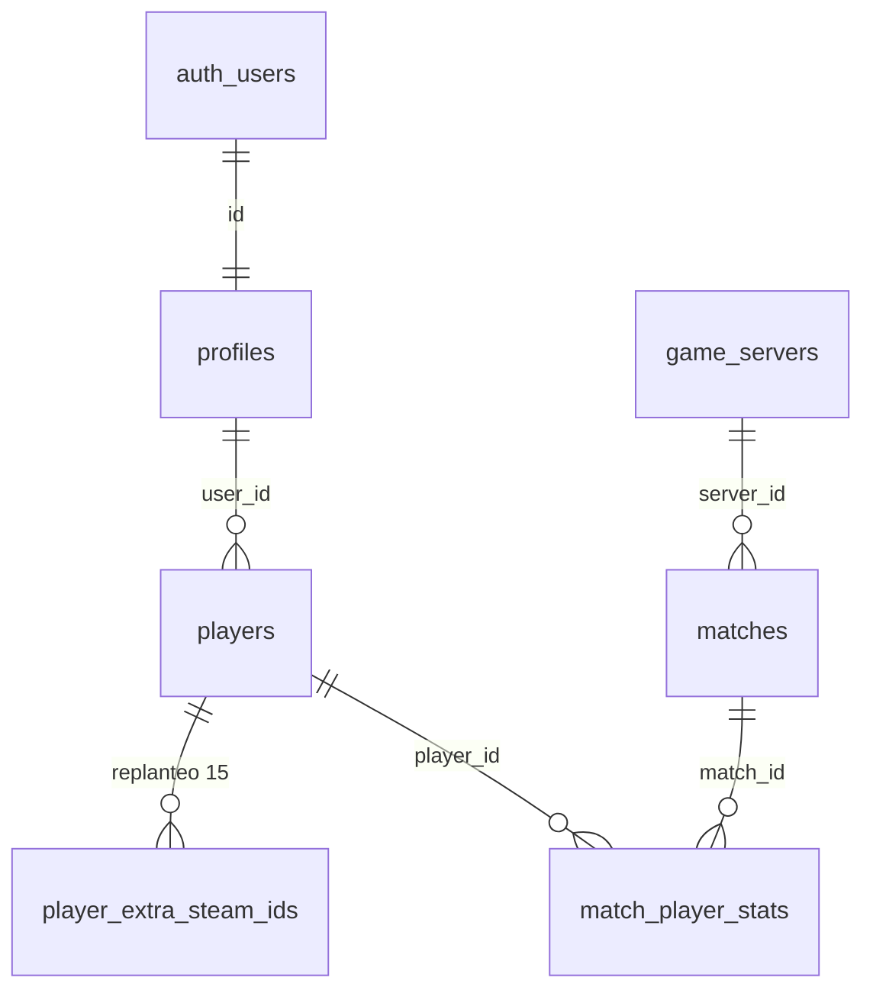

# Anticheat v34FRAGNATION, etapa 0: informe de auditoría

Auditoría del 2026-10-30 para el brief `v34FRAGNATION_brief_para_Claude.md`. No se tocó producción ni se implementó nada.

**Cómo leer las evidencias:**

| Marca | Significa |
|---|---|
| **[repo]** | Leído en el código o los documentos, en la rama indicada |
| **[local]** | Medido en esta PC (`D:\CSSv34_ClientMod`, `C:\Users\Agus\Downloads\cssds`) |
| **[doc]** | Documentación pública, con enlace en la sección de fuentes |
| **[sin verificar]** | Conocimiento general o inferencia: hay que probarlo antes de apoyarse en esto |

**Lo que esta auditoría no pudo ver:**

- No se consultó la Supabase real. El esquema sale del volcado `supabase/schema/` de `feat/backend-api-fase-1`, con base `20261014120000`, y las migraciones posteriores se leyeron aparte.
- No se entró a ningún servidor de juego. Las versiones vienen de inventarios escritos.
- No se leyó el `.env`.

## Conclusiones principales

1. **ClientMod ya trae Easy Anti-Cheat, y el repo no lo menciona.** Hay que saber qué protege antes de decidir cuánto de FRAG hace falta (sección 5).
2. **`main` no es la base real.** El trabajo vivo está en `feat/backend-api-fase-1` y `feat/frontend-fase-1`, y el backend nuevo todavía no está desplegado (sección 1).
3. **La captura es el mayor riesgo técnico.** Sin hooks ni inyección, capturar un juego DirectX 9 en pantalla completa puede dar imágenes negras. Conviene probarlo antes de construir el backend (sección 7).
4. **Ya hubo una etapa 0 con otro enfoque:** `origin/feat/anticheat-etapa-0` (mchssj, 2026-10-20) propone telemetría en el servidor, no un agente en la PC del jugador (sección 1).
5. **Un agente sin bloqueo no frena a nadie:** en la v1 quien hace trampa puede no abrirlo. Sirve como evidencia solo si la comunidad define qué pasa con quien juega sin él (sección 7).

## 1. Estado actual del proyecto

| Rama | Último cambio | Relación con `origin/main` | Reporter | Qué tiene |
|---|---|---|---|---|
| `origin/main` | 2026-10-17 | | 2.1.1 | Web vieja (`index.html`) y migraciones |
| `kyan/pruebas` (la actual) | 2026-10-30 | 42 adelante, 10 atrás | **1.8.0** | Prototipos, retake, 2v2 |
| `origin/feat/backend-api-fase-1` | 2026-10-30 | 172 adelante, 10 atrás en el conteo de esta auditoría | **2.6.1** | API Hono, replanteo 01 a 38, más plugins |
| `origin/feat/frontend-fase-1` | 2026-10-30 | No medido | | Frontend React, Vite y Tailwind |
| `origin/feat/matchmaking-5v5` | 2026-10-12 | Sin merge | 1.3.0 | Único lugar con `csstv_matchmaking_dispatcher.sp` |
| `origin/feat/anticheat-etapa-0` | 2026-10-20 | 7 commits sobre `main` | | Plan, checklist y plugin de telemetría |

- **`docs/PENDIENTES.md` de `kyan/pruebas` no refleja el estado completo.** El de la rama del backend lista las versiones 2.3 a 2.5 del reporter ya desplegadas y el "corte" pendiente. Antes de planear despliegues hay que leer ese.
- **Orden decidido por Daniel (2026-10-15):** primero la web y los plugins al final, con excepciones como plugins aparte. El Bridge sería otra excepción y necesita su aprobación.
- **La etapa 0 anterior** es complementaria, no un antecedente directo: su plugin es telemetría de disparos y daño, su checklist nunca se ejecutó y el plugin no consta como compilado. Se puede reutilizar la sección A de la checklist (versiones del servidor). No hace falta hacer merge de esa rama para seguir con este brief.

## 2. Mapa de componentes y dependencias

| Componente | Tecnología | Estado | Notas para FRAG |
|---|---|---|---|
| Web vieja | HTML/JS sin build, anon key directa | Producción | No conviene agregarle el panel |
| Backend | Node 24, Hono, Zod/OpenAPI, Supabase JS, pnpm | Sin desplegar; hosting decidido en VPS | No usa `service_role`: actúa con la anon key y el JWT del usuario, y valida en la base. Tiene `lib/ratelimit.ts` |
| Frontend nuevo | React, Vite, Tailwind, TanStack Query | Sin desplegar | Lugar natural del panel. Es área de Esteban |
| Plugins | SourcePawn con System2 | Producción | El Bridge va aparte: el brief prohíbe tocar el reporter |
| Worker y R2 | Cloudflare | Producción | Almacenamiento privado ya operativo, candidato para evidencias |

El dominio `csstv.gamer.ad` del brief no aparece en los documentos revisados, salvo en la `url` del plugin de la rama anticheat. Falta confirmar si sigue siendo el definitivo, porque el plan del VPS habla de "dominio propio".

## 3. Modelo de usuarios, jugadores, servidores y partidas

| Concepto | Dónde vive | Detalle |
|---|---|---|
| Cuenta web | `auth.users`, `profiles` | `profiles.role`. En producción existe `admin`; `moderator` llega con el replanteo 31 |
| Jugador | `players` | `steam_id` SteamID64 único, `user_id` opcional. El replanteo 15 suma varios SteamID por ficha |
| Stats | `match_player_stats` | Por `steam_id`, con `player_id` opcional: **hay jugadores sin ficha** |
| Servidor | `game_servers` | `token_hash`, `active`, `allowed_ip`, `last_ip`, `plugin_version`, licencia. Autenticado con `csstv_auth(token)` |
| Partida | `matches` | `external_id` único = `match_uid` que arma el plugin (`<tag>-<fecha>-<hex>`), `server_id`, `kind = mix` |

**Hallazgos para el diseño:**

- **El SteamID no sirve como prueba de identidad.** En el cliente hay un `rev.ini` y en el servidor de pruebas un `clientmod_emulator.smx` **[local]**, y `GUIA_SERVIDOR.md` advierte sobre SteamID inestables por el emulador **[repo]**. El brief acierta al no usarlo como único factor.
- **El `match_uid` nace al empezar la partida**, no al conectarse. Una sesión anticheat puede existir sin partida, así que `match_id` tiene que admitir null y completarse después.
- **El reclamo `!claim` (replanteo 15 y `claim_with_code`) es el patrón a copiar:** un código de un solo uso generado en la web, escrito en el juego.

## 4. Estado de Supabase

Volcado con base `20261014120000` **[repo]**:

| Qué | Resultado |
|---|---|
| Tablas en `public` | 26 |
| Tablas sin `ENABLE ROW LEVEL SECURITY` | **Ninguna** en el volcado |
| Funciones | 52, de las cuales 43 aparecen como `SECURITY DEFINER` |
| Políticas en `public` | 57 |
| Buckets | `photos`, `avatars`, `proofs`: **todos públicos**. No hay ninguno privado |
| Realtime | Sin publicaciones en el volcado, ni uso en `web/backend/src`, `web/frontend/src` o `supabase/replanteo`. El volcado de `public` podría no incluirlas, así que hay que confirmarlo en el panel |
| Edge Functions | No hay carpeta `supabase/functions` en las ramas revisadas |

**Otros puntos:**

- **Migraciones divididas:** `supabase/migrations/` para producción y `supabase/replanteo/` para el corte, con inversas en la bitácora. Las `ac_*` tienen que elegir una de las dos vías.
- **`matchmaking_*`:** las 4 tablas y sus funciones siguen en el volcado, y el replanteo 03 las revisa. FRAG no debería depender de ellas.
- **`player_ips`:** existe una migración de IP de jugadores en otra rama (`20261029180000_ips_jugadores.sql`). Sirve como señal al vincular, pero su fecha coincide con otra migración local (`20261029180000_tienda.sql`) y hay que ordenarlas al mezclar.
- **Almacenamiento inmutable:** Supabase Storage no ofrece WORM hasta donde se pudo saber **[sin verificar]**. R2 tiene bloqueo de objetos por bucket **[sin verificar]**: es el candidato a investigar en la etapa 5.

## 5. Estado de SourceMod y ClientMod

**SourceMod [repo]:** 1.10.0.6490 en el servidor real y en RBK, según inventarios del 2026-10-14. El servidor real cambió a MVZG después, así que hay que reconfirmarlo con `sm version`.

**ClientMod API [repo, local]:**

- `clientmod.smx` 1.7.1, según `GUIA_SERVIDOR.md`.
- Lo que el proyecto usa y documenta: `CM_GetClientModAuth` (1 original, 2 actualizado, 3 desactualizado), las cvars `clientmod_private` y `clientmod_client_version_min`, y los datos `_client_version` y `~clientmod`, que **manda el propio cliente y por lo tanto son falsificables**.
- No hay `clientmod.inc` en el repo. La página oficial enlaza un repositorio "Server Api", pero la URL probada dio 404, así que **la API completa no se pudo leer**.
- No se encontró ninguna interfaz para ver procesos o archivos del cliente. El Bridge no debería contar con eso.
- `clientmod.smx` mide 24516 bytes en `cssds` y 24515 en el inventario del servidor real. Una diferencia así también aparece en `clientmod_deathnotice.smx` (12010 y 12008). No se comprobó si son la misma versión.

**Easy Anti-Cheat dentro de ClientMod [local]:**

| Archivo en `D:\CSSv34_ClientMod` | Dato medido |
|---|---|
| `ClientModEAC.exe` | Firma válida de **EasyAntiCheat Oy**; el encabezado PE declara versión de sistema 10.0 |
| `EasyAntiCheat\EasyAntiCheat_EOS_Setup.exe` | Instalador de EAC para Epic Online Services |
| `EasyAntiCheat\Settings.json` | Trae `productid`, `sandboxid` y `deploymentid`: hay un producto configurado |
| `CMLauncher.exe` | Launcher 1.5.14, 32 bits; su firma da `UnknownError` en `Get-AuthenticodeSignature` |

**No se sabe:** si EAC está activo siempre o según el servidor, qué ve un servidor nuestro de su resultado, y si le molesta un proceso externo que capture la pantalla. Ningún documento del repo lo menciona. **Esto cambia el diseño:**

- FRAG no compite con EAC en detección: aporta evidencia revisable y control propio.
- Cualquier técnica de captura con hooks queda descartada también por compatibilidad, no solo por el brief.
- Conviene preguntarle al equipo de ClientMod si hay integración con el servidor antes de construir una paralela.

**Otros anticheats en servidor [repo]:** KACR activo y SMAC en `disabled`, sin relación con FRAG.

## 6. Matriz de compatibilidad Windows

**Solo Windows 10 Pro 19045 tiene evidencia directa, y solo de instalación.** El resto queda sin confirmar: la página de ClientMod no publica requisitos **[doc]**.

| Sistema | ClientMod | Captura sin inyección | Procesos | Decisión propuesta |
|---|---|---|---|---|
| Windows 11 | Sin probar | Graphics Capture y Desktop Duplication disponibles | Toolhelp/WMI; ETW con administrador | Soporte objetivo, a probar en la beta |
| Windows 10 (build 19045) | **Instalado en esta PC** **[local]**; sin probar con el agente | Igual | Igual | Soporte objetivo. Sin soporte de Microsoft desde 2025-10-14 **[sin verificar]**, pero es lo que hay |
| Windows 10 anterior a 1803 | Sin probar | Solo Desktop Duplication: Graphics Capture aparece en 1803 **[doc]** | Igual | Fuera, salvo que la beta muestre demanda |
| Windows 8 y 8.1 | Sin probar. `ClientModEAC.exe` declara 10.0, lo que sugiere que no aplica, sin ser prueba | Desktop Duplication **[doc]** | Toolhelp/WMI | No soportado hasta probar |
| Windows 7 | Sin probar; mismo indicio | Solo GDI **[sin verificar]** | Toolhelp/WMI | No soportado hasta probar |

**Decisión:** arrancar con Windows 10 y 11 de 64 bits. Si el agente no puede cumplir en un equipo, lo informa como capacidad faltante y no degrada en silencio. Para cerrar la matriz hace falta probar ClientMod y el agente en máquinas o VM de cada sistema, incluida una con EAC activo.

## 7. Riesgos

### Técnicos

| Riesgo | Impacto | Mitigación |
|---|---|---|
| **Captura negra en pantalla completa exclusiva.** Sin hooks, GDI y `PrintWindow` suelen fallar con DirectX 9 **[sin verificar]** | Alto: anula la función principal | Prueba de factibilidad antes de todo, con EAC activo y en 4:3 estirado, como se juega (`mat_aspectratio_mode 1.33` **[local]**) |
| Graphics Capture puede mostrar un borde amarillo o pedir permiso **[sin verificar]** | Medio | Medirlo en la misma prueba |
| EAC interfiere con el agente | Alto | La misma prueba; consultar a ClientMod |
| El backend no está desplegado y depende del corte | Alto para el calendario | Decisión pendiente (ver `GUIA_IMPLEMENTACION.md`) |
| Antivirus y SmartScreen tratan al agente como espía: captura pantalla y lista procesos | Alto para la adopción | Certificado de firma, instalador claro, código abierto como opción |
| Costo de almacenamiento. Estimación: 15 capturas por hora × 10 jugadores × 200–400 KB = 30–60 MB por hora de partida (tamaño supuesto, sin medir) | Medio | Retención corta, compresión, medir en la beta |
| En esta PC no hay `cl`, `cmake`, `msbuild` ni `spcomp` en el PATH | Bloquea compilar | Lo instala Kyan o Daniel, según `CLAUDE.md` |
| Servidores externos: la regla de despliegue obliga a llevar el Bridge a RBK en la misma tanda | Medio | Definirlo por escrito, o declararlo excepción como el retake |

### Seguridad

| Riesgo | Mitigación |
|---|---|
| El agente corre en un equipo que controla el jugador: puede falsear procesos, capturas y firmas | Mostrar "integridad verificada" separado de "origen no verificable", como pide el brief. Una clave por dispositivo solo prueba qué dispositivo firmó |
| Trampas por DMA, en kernel o con un proceso renombrado no se ven desde el modo usuario | Documentarlo como límite; no presentar FRAG como detección |
| Una solicitud de captura manual abusada por un admin | Aviso visible, registro en `ac_admin_actions`, límite por frecuencia, rol específico |
| Fuga de evidencias, con capturas y procesos de personas identificadas | Bucket privado, URLs firmadas cortas, auditoría de lecturas. No usar los buckets actuales: todos son públicos |
| Vinculación robada: alguien usa el código de otro | Código corto de un solo uso, entrada dentro del juego (como `!claim`), comparación de IP como señal extra |
| Cola local "cifrada" con la clave en la misma PC | Sirve frente a otros usuarios (DPAPI), no frente al propio jugador. Decirlo así |

### Privacidad

- **Datos sensibles indirectos:** la lista de procesos revela programas de salud, trabajo o VPN aunque no se lea su contenido. Hay que minimizar: guardar rutas solo cuando haga falta y ocultar la parte del usuario.
- **Capturas fuera del juego:** con Alt+Tab o una notificación, la captura puede mostrar información privada. **Solo capturar con el juego en primer plano y, si no, registrar "fuera de foco" sin imagen.** Es la única forma razonable de cumplir "no capturar contraseñas": detectar campos sensibles no es factible.
- **Menores:** una comunidad de juego puede incluirlos, y eso endurece el consentimiento.
- **Jurisdicciones:** hay jugadores de Latinoamérica y España, de modo que pueden aplicar la ley argentina 25.326, otras locales y el RGPD. **Esto necesita asesoría legal; esta auditoría no la reemplaza.**
- **Terceros:** con servidores como RBK hay que aclarar quién responde por los datos y quién los puede ver.
- **Faltan definir:** responsable, retención, derecho a borrado y apelación.

### Eficacia

Sin bloqueo en la v1, quien hace trampa simplemente no abre el agente. La medida mínima compatible con el brief es **mostrar el estado** ("jugó sin FRAG") sin sancionar, y que la comunidad decida después cuándo exigirlo.

## 8 y 9. Plan y archivos

Están en [`PLAN.md`](PLAN.md).

## Fuentes

- [Página oficial de ClientMod](https://clientmod.ru)
- [Microsoft: Desktop Duplication API](https://learn.microsoft.com/en-us/windows/win32/direct3ddxgi/desktop-dup-api)
- [Microsoft: GraphicsCapturePicker](https://learn.microsoft.com/en-us/uwp/api/windows.graphics.capture.graphicscapturepicker)

## Dónde está cada cosa

| Qué | Archivo / ubicación |
|---|---|
| Informe | Este archivo |
| Propuesta de siguientes etapas | `PLAN.md` |
| Estado, cómo repetir la auditoría y decisiones pendientes | `GUIA_IMPLEMENTACION.md` |
| Etapa 0 anterior | Rama `origin/feat/anticheat-etapa-0`, carpeta `docs/bitacora/2026-10-20-anticheat-v34fragnation/` |
| Esquema volcado | Rama `origin/feat/backend-api-fase-1`, `supabase/schema/` |
