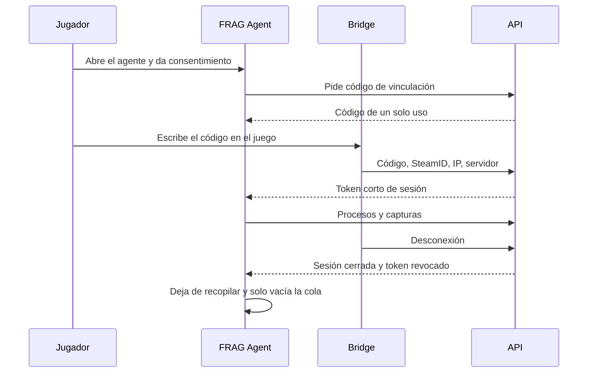

# Plan: anticheat v34FRAGNATION, ajustado a lo que existe

> Planeación original. Estado: **propuesta**, pendiente de aprobación. Sale de la auditoría de [`DOCUMENTACION.md`](DOCUMENTACION.md). No se implementó nada de esto.

## Decisiones tomadas

Son propuestas de esta auditoría. Las que dependen de otra persona están en `GUIA_IMPLEMENTACION.md`.

| Tema | Decisión | Por qué |
|---|---|---|
| Rama | `kyan/*`, no `main` | `CLAUDE.md` lo exige; el brief pedía partir de `main` |
| Formato de bitácora | `PLAN`, `DOCUMENTACION` y `GUIA_IMPLEMENTACION` | Es la plantilla del proyecto; el brief pedía `README.md` y aceptaba respetar la existente |
| Orden | **Primero una prueba de factibilidad de la captura** | Si la captura no anda sin hooks, cambia todo el alcance |
| API | Rutas nuevas en `web/backend` | Ya tiene auth, validación y rate limit. Depende del corte |
| Base | Migraciones `ac_*` nuevas, reversibles, sin tocar tablas existentes | Se pueden aplicar con independencia del replanteo |
| Tiempo real | **Sin Realtime al principio:** el agente consulta solicitudes cada pocos segundos y el panel refresca por consulta | El proyecto no usa Realtime hoy; se suma después si hace falta |
| Evidencias | Bucket privado, con R2 como candidato para retención inmutable | Los buckets actuales son públicos |
| Vinculación | Código de un solo uso mostrado en el agente y escrito en el juego | Reutiliza el patrón de `!claim`; el SteamID solo no alcanza |
| Sistemas | Windows 10 y 11 de 64 bits | Único rango con indicios; el resto queda sin soporte hasta probarlo |
| Panel | En `web/frontend`, no en `index.html` | La web vieja se reemplaza con el corte |
| Etapa 0 anterior | No hacer merge; reutilizar su checklist de versiones | Resuelve otro problema: telemetría en el servidor |

## 1. El flujo completo

## 2. Etapas

| Etapa | Qué | Criterio para pasar | Pide aprobación por |
|---|---|---|---|
| **0b. Factibilidad** (nueva) | Programa mínimo y descartable, sin subir nada: captura de ClientMod en pantalla completa, ventana y sin bordes, con y sin EAC. Consulta al equipo de ClientMod | Imagen correcta en Windows 10 y 11, o decisión documentada de cambiar el alcance | Instalar compilador |
| 1. Backend y base | Migraciones `ac_*`, rutas de enrolamiento y sesión, RLS con pruebas, bucket privado, auditoría | Agente de prueba crea y cierra sesión; sin acceso de terceros, probado en Supabase local | Migraciones, infraestructura |
| 2. Agente mínimo y Bridge | Aplicación visible, instalador, desinstalador, vinculación, cierre. Bridge en `frag_anticheat_bridge.sp` | Sin recopilación fuera de la sesión; bots en `cssds` más prueba con un admin | Plugin en servidores |
| 3. Procesos | Inventario, eventos, reconciliación, hash, firma, cola | Eventos correctos sin duplicados | Comportamiento sensible |
| 4. Capturas | Solo con el juego en primer plano; política automática; manual con aviso | Captura ligada a la sesión correcta y visible solo para autorizados | Comportamiento sensible |
| 5. Integridad | Cadena de hashes, manifiestos, verificación, retención | Una alteración se detecta y queda registrada | Retención |
| 6. Panel | Vistas, filtros, permisos, exportación auditada | Nada expuesto a no autorizados | Permisos |
| 7. Beta | Matriz real, red, consumo, manipulación | Partida auditada de punta a punta | Producción |

**Antes de la etapa 3, además:** texto de consentimiento y política de privacidad revisados legalmente.

## 3. Archivos para la siguiente etapa

**Etapa 0b:** todo fuera del repo o en `docs/bitacora/<fecha>-anticheat-captura/pruebas/`. No toca código del proyecto.

**Etapa 1, a crear:**

| Archivo | Para qué |
|---|---|
| `supabase/migrations/<fecha>_anticheat_base.sql` y su reversa | Tablas `ac_*`, RLS, bucket privado |
| `web/backend/src/routes/anticheat.ts`, `admin-anticheat.ts` | Enrolamiento, sesiones, ingesta, solicitudes |
| `web/backend/src/schemas/anticheat.ts`, `services/anticheat.ts` | Validación y lógica |
| Pruebas de rutas y de RLS con roles reales | Criterio de aceptación |
| `docs/bitacora/<fecha>-anticheat-backend/` | Bitácora |

**Etapa 1, a modificar:** `web/backend/src/app.ts` (registrar rutas), `web/backend/src/db/types.ts` (regenerado), `docs/bitacora/README.md` y `docs/PENDIENTES.md`.

**No se tocan:** `csstv_reporter.sp`, dispatcher de matchmaking, tablas existentes.

## 4. Ajustes al modelo de datos del brief

- `ac_sessions.match_id` admite null: la partida puede empezar después de la sesión.
- `ac_sessions` guarda `steam_id` además de `player_id`, porque hay jugadores sin ficha.
- `ac_agents` y `ac_devices` se pueden unir en una sola tabla en la v1: sin varios agentes por equipo, separarlas no aporta.
- Permisos con una función propia (por ejemplo `ac_can_review()`), no `is_admin()` a secas. Ver evidencias es más delicado que administrar la web.

## 5. Requisitos antes de empezar

- Respuestas a las preguntas de `GUIA_IMPLEMENTACION.md`.
- Compilador de C++ y `spcomp` instalados por Kyan o Daniel.
- Windows 11 para probar, y jugadores con EAC activo.

## 6. Orden de implementación

1. Etapa 0b y consulta a ClientMod.
2. Decidir alcance con ese resultado.
3. Etapas 1 a 7, cada una con su bitácora y su aprobación.
