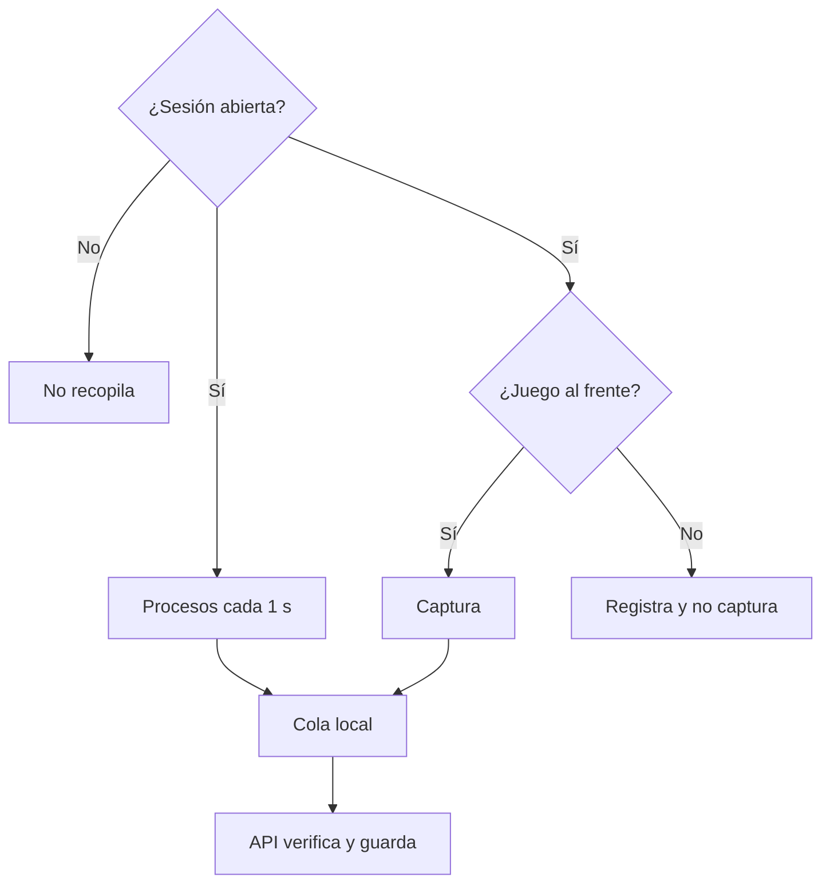

# Procesos, capturas y Bridge del anticheat: documentación

## Qué hace

Durante una sesión, la aplicación envía el inventario de procesos, sus cambios y capturas de la ventana del juego. Al cerrarse la sesión deja de recopilar y solo termina de subir lo pendiente. El Bridge expulsa de los mixes a quien no tenga sesión válida. El staff revisa hechos observados: **el sistema no concluye ni sanciona**.

## Qué se guarda

| Dato | Detalle |
|---|---|
| Procesos (`ac_process_events`) | Inventario, inicio y fin: PID, nombre, ruta, SHA-256 hasta 128 MB, firma, editor. La carpeta del usuario se reemplaza por `%USERPROFILE%` |
| Capturas (`ac_screenshots`) | JPEG en el bucket privado, con hash, tamaño, método y hora |
| Solicitudes (`ac_capture_requests`) | Motivo y resultado. El jugador ve el aviso; se pide una por minuto como máximo |

`catalog_member` significa que el archivo está en un catálogo de Windows: no se comprueba ese catálogo, así que queda "No verificable" y no "Sin firma".

## Reglas del Bridge

- Pregunta al entrar y cada minuto. En un mix, si la respuesta es `kick`, avisa y vuelve a comprobar a los 20 segundos.
- `cml_ac_mix` lo ponen `live.cfg`, `end.cfg` y `warmup.cfg`.
- `sm_ac_open <minutos>` funciona aunque la red esté caída, solo en ese servidor. Queda en el registro de SourceMod.

## Límites conocidos

- **Todo lo que informa el equipo del jugador se puede manipular.** El panel lo aclara: un hash prueba que el archivo no cambió desde la subida, no que refleje la verdad.
- **Trampas externas, en kernel o con nombres cambiados** no se ven desde aquí.
- **Una superposición sobre el juego** (Discord o una notificación) sale en la captura, aunque el juego esté al frente. En pantalla completa exclusiva no debería aparecer; está sin probar.

## Dónde está cada cosa

| Qué | Archivo |
|---|---|
| Base | `supabase/replanteo/40_anticheat_evidencia.sql` |
| API | `web/backend/src/routes/anticheat-evidence.ts` |
| Aplicación | `agent/src/evidence.cpp` |
| Bridge | `server/addons/sourcemod/scripting/cml_anticheat_bridge.sp` |
| Página y panel | Rama `kyan/anticheat-web` |
