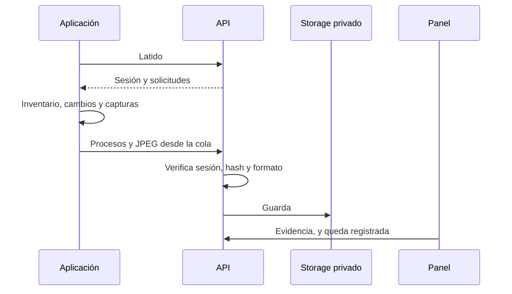

# Plan: procesos, capturas y Bridge del anticheat

> Planeación original. Estado: **aprobado por Kyan** el 2026-10-30 ("hace todo"). Se escribió junto con la implementación, en una misma tanda.

## Decisiones tomadas

| Tema | Decisión | Por qué |
|---|---|---|
| Captura | Desktop Duplication y, si falla, `BitBlt` de la pantalla. `BitBlt` de la ventana queda prohibido | Resultado de la prueba de captura: devolvía imágenes congeladas |
| Cuándo captura | Solo con sesión abierta y el juego al frente | Una prueba sin esa regla capturó otra cosa de la pantalla |
| Intervalo | Al azar, 3 a 5 minutos, configurable en `ac_config` | Brief |
| Procesos | Consultar sin administrador cada 10 s y comparar el estado completo | Reconciliar no pierde eventos. ETW necesita administrador |
| Datos faltantes | Se registran como `note`; no son indicio de nada | Brief |
| Subida | Por la API, que recalcula el SHA-256 y exige JPEG. La clave de servicio queda solo en el backend | El agente no recibe credenciales amplias |
| Offline | Cola en disco, con reintentos e idempotencia, y sin recopilar sin contacto | Brief |
| Opciones de prueba | Solo en `CMLeagueAC_test.exe` (`AC_TEST`) | La versión real no puede saltarse la regla de primer plano |
| Mix | `cml_ac_mix`, que ponen `live.cfg`, `end.cfg` y `warmup.cfg` | El brief prohíbe tocar el reporter |
| Servicio caído | No corta a quien se verificó hace menos de 5 minutos; después expulsa, salvo `sm_ac_open` | "Se frena y decide un admin", sin cortar de golpe una partida |
| Web | Rama aparte `kyan/anticheat-web`, desde `feat/frontend-fase-1` | El frontend es otra rama de trabajo |

## 1. El flujo completo

## 2. Requisitos antes de empezar

Backend de la etapa 1.

## 3. Orden de implementación

1. Replanteo `40` y rutas.
2. Procesos y capturas en la aplicación.
3. Prueba con el ejecutable real.
4. Bridge, página de vinculación y panel.
