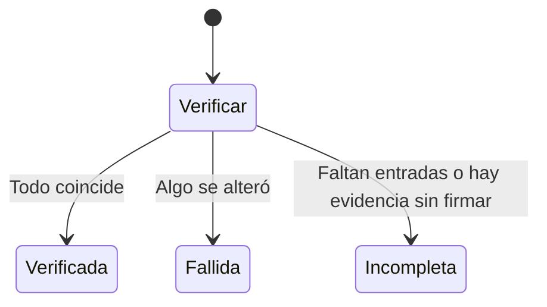

# Integridad y retención del anticheat: documentación

## Qué hace

Cada lote de procesos y cada captura se agrega a una cadena firmada por el equipo. La verificación recalcula todo y detecta si después se alteró una fila, un archivo o una entrada. **Prueba que nada cambió desde el envío, no que el equipo del jugador dijera la verdad.**

## La entrada

`v1|sesión|posición|tipo|hash del contenido|hash de la entrada anterior|fecha`, firmada por el equipo. La primera usa 64 ceros como hash anterior.

## Resultados

| Resultado | Cuándo | Ejemplos |
|---|---|---|
| `verified` | Todo coincide | |
| `failed` | Algo no coincide | `bad_signature`, `chain_broken`, `file_modified`, `process_modified`, `entry_modified` |
| `incomplete` | Falta algo, sin contradicción | `missing_entry`, `no_entries`, `process_not_in_chain`. Normal si aún hay subidas pendientes |

Cada verificación y cada firma rechazada quedan en `ac_integrity_logs`.

## Retención

`pnpm anticheat:tick`, una vez al día con la clave de servicio, borra archivos y filas de las sesiones cerradas con más de 30 días (`ac_config.retention_days`). No toca las abiertas ni las conservadas por un caso abierto.

## Límites conocidos

- **Quien controle la base y la clave de servicio** no puede falsificar la firma, pero sí borrar el final de una cadena sin que se note: no hay anclaje externo.
- **Un jugador con acceso a su clave** puede firmar datos falsos. Por eso el origen es "no verificable".
- **No hay almacenamiento inmutable real.**

## Dónde está cada cosa

| Qué | Archivo |
|---|---|
| Base | `supabase/replanteo/41_anticheat_integridad.sql` |
| API | `web/backend/src/routes/anticheat-evidence.ts` |
| Cron | `web/backend/src/jobs/anticheat-retention.ts`, `scripts/anticheat-tick.mts` |
| Firma | `agent/src/evidence.cpp` |
| Demo local | `web/backend/scripts/anticheat-demo.mts`, `agent/demo.bat` |
