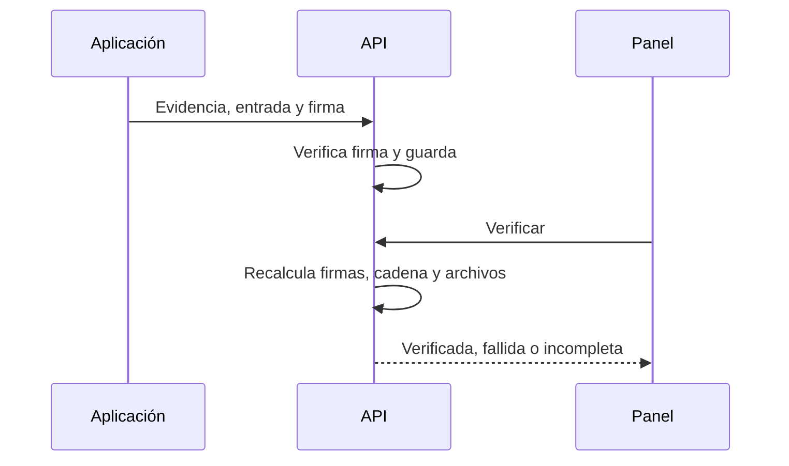

# Plan: integridad y retención del anticheat (etapa 5)

> Planeación original. Estado: **aprobado por Kyan** el 2026-10-30 ("hace lo que puedas"). Se escribió junto con la implementación.

## Decisiones tomadas

| Tema | Decisión | Por qué |
|---|---|---|
| Firma | ECDSA P-256 con una clave por equipo, cifrada con DPAPI | Sin dependencias: BCrypt en Windows y WebCrypto en la API |
| Clave | Se fija una sola vez por vinculación | Cambiarla exige volver a vincular |
| Cadena | Cada entrada lleva el hash de la anterior | Detecta alteraciones y huecos |
| Verificación | A pedido, en la API, y queda registrada | Lee los archivos: no conviene hacerlo en cada lectura |
| Lenguaje | "Integridad verificada" separado de "origen no verificable" | Brief: el equipo es del jugador |
| Retención | Cron diario `anticheat:tick`, 30 días, salvo casos conservados | Kyan decidió 30 días y la aplicación lo promete |
| Inmutabilidad real (WORM) | **No se hace ahora** | Hay que investigar R2 con bloqueo de objetos; Supabase Storage no consta que lo ofrezca |

## 1. El flujo completo

## 2. Requisitos antes de empezar

Replanteo `40`.

## 3. Orden de implementación

1. Replanteo `41`, rutas y cron.
2. Firma y cadena en la aplicación.
3. Prueba con el ejecutable real, alterando filas, archivos y entradas.
4. Panel.
