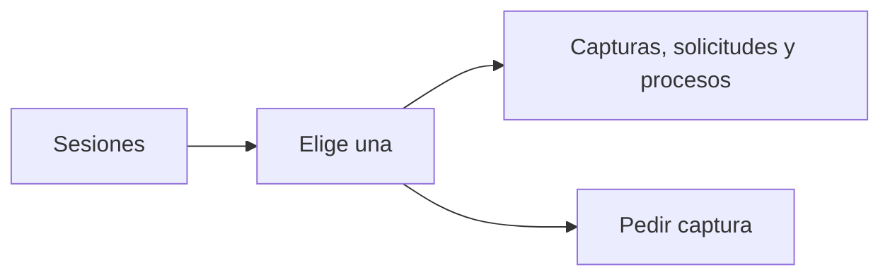

# Vinculación y panel del anticheat: documentación

## Qué hace

**`/anticheat/vincular`:** el jugador compara el código con el de la aplicación y lo aprueba. También resume qué se recopila.

**`/admin/anticheat`:** sesiones por estado, evidencia de cada una, pedir una captura y abrir los mixes. Muestra hechos y aclara que el origen no es verificable.

## Dónde está cada cosa

| Qué | Archivo |
|---|---|
| Página de vinculación | `web/frontend/src/routes/_app/anticheat.vincular.tsx` |
| Panel | `web/frontend/src/features/admin/anticheat/AdminAnticheatPage.tsx` |
| Llamadas a la API | `web/frontend/src/features/anticheat/queries.ts` |
