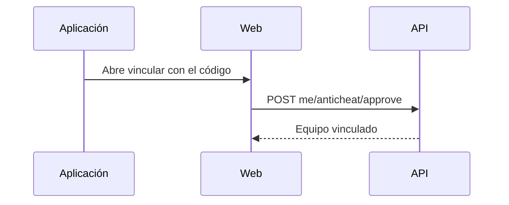

# Plan: vinculación y panel del anticheat en la web

> Planeación original. Estado: **aprobado por Kyan** el 2026-10-30 ("hace todo"). Se escribió junto con la implementación.

## Decisiones tomadas

| Tema | Decisión | Por qué |
|---|---|---|
| Rama | `kyan/anticheat-web`, desde `feat/frontend-fase-1`, sin merge | Solo se sube a ramas de Kyan |
| Vinculación | `/anticheat/vincular?code=...`, con sesión | La abre la aplicación CMLeague Anticheat |
| Panel | `/admin/anticheat`, solo admin | Decisión de Kyan: la evidencia es para staff |
| Lenguaje | Hechos observados; nunca "limpio" ni "cheater" | Brief |
| Tipos | A mano en `features/anticheat/queries.ts` | Las rutas están en `kyan/anticheat-backend`; `schema.d.ts` no se edita a mano |
| Actualización | Sesiones cada 15 s, sin Realtime; evidencia a pedido | Cada lectura de evidencia queda registrada |

## 1. El flujo completo

## 2. Requisitos antes de empezar

Las rutas de `kyan/anticheat-backend`.

## 3. Orden de implementación

1. Página de vinculación.
2. Panel.
3. Probar en el navegador contra la API local.
