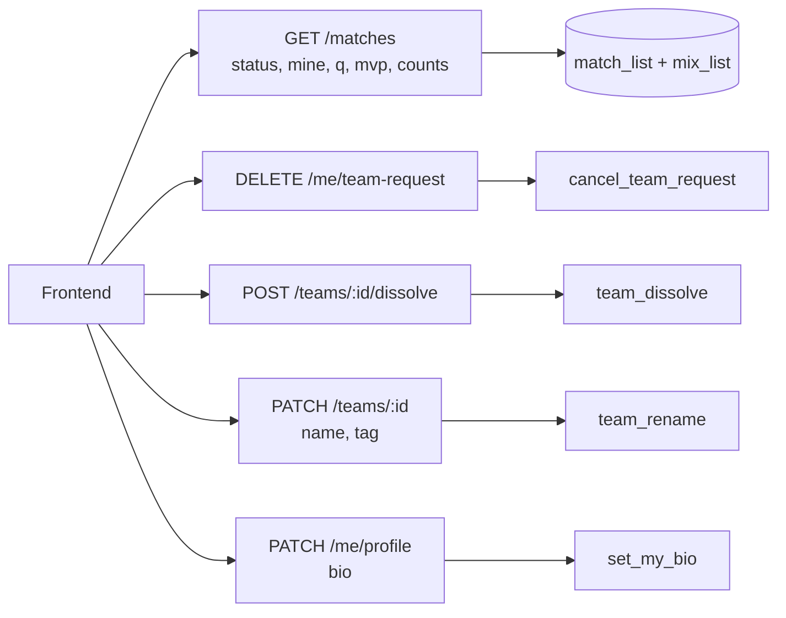
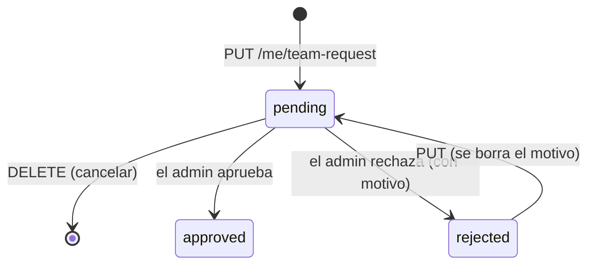
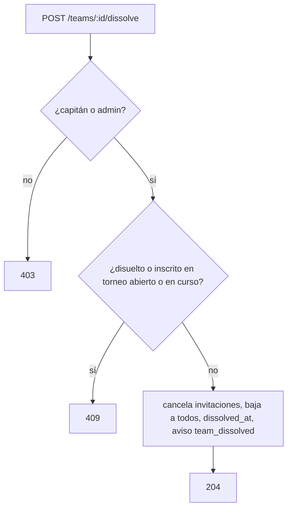

# Pendientes de la API para el frontend (E9 a E20): documentación

## Qué hace

El frontend (`feat/frontend-fase-1`) tenía botones deshabilitados con "Próximamente" y algunos rodeos porque la API no los soportaba. Esta tanda cubre los once pedidos de `pendientes-backend-cmleague.md` (E9 a E18 y E20; E19, la búsqueda global, queda para más adelante).

- **Partidas:** `GET /api/v1/matches` filtra por varios estados, por "donde jugué" y por nick, y trae el MVP de los mixes y cuántas partidas hay de cada tipo.
- **Equipo:** el usuario cancela su solicitud de equipo nuevo y ve cuándo la mandó y por qué se la rechazaron. El capitán cambia el nombre y la sigla (una vez cada 30 días) y puede disolver el equipo.
- **Perfil:** el jugador escribe su biografía. El historial de equipos y los títulos traen el logo, y cada temporada trae su cierre y cuántos jugadores tuvieron puesto.

La base suma el replanteo `39_pendientes_frontend.sql` (no va a producción antes del corte).

## Partidas (`GET /api/v1/matches`)

| Parámetro o campo | Qué hace |
|---|---|
| `status=finished,cancelled` | Uno o varios estados separados por comas. Uno inválido da `400` |
| `mine=true` | Solo las partidas donde jugó la ficha de la sesión (también en los mapas de una serie). Sin sesión, `401`; sin ficha, lista vacía |
| `q` | Busca en equipos, bandos y torneo (columna `search`) **o** en los nicks de los que jugaron (columna nueva `player_search`: nombre en el juego y alias) |
| `mvp` en cada fila | En los mixes, el de mejor rating, igual que en `/mixes` (`player_id`, `alias`, `game_nick`, `elo`, `level`, `rating`). `null` en el resto |
| `counts` | `{ all, mix, pcw, official }` con todos los filtros salvo `kind` |

`player_search` se arma con dos subconsultas que usan índices: los jugadores de la partida y, solo en torneo y PCW, los de sus mapas (índice parcial `matches_parent_match` sobre `parent_match_id`).

Los contadores salen de consultas `count` en paralelo (`head: true`) con los mismos filtros. El tipo que ya pidió la página no se vuelve a contar: es el `total`. El MVP se lee de `mix_list` solo para los mixes de la página.

## Solicitud de equipo nuevo (E9)

- `team_requests.created_at`: cuándo se envió. El trigger `team_requests_fechas` lo pone cada vez que queda `pending` (al enviarla o al volver a enviarla) y borra `reject_reason`. Las solicitudes viejas tienen `null`.
- `team_requests.reject_reason`: lo escribe el admin al rechazar (`POST /api/v1/admin/team-requests/{userId}/reject` con `{ reason }`, opcional, hasta 300 caracteres).
- `DELETE /api/v1/me/team-request` llama a `cancel_team_request()`: borra la pendiente y devuelve su logo, que la API borra del bucket. Sin solicitud, `404`; aprobada o rechazada, `409`.

## Disolver un equipo (E10)

`POST /api/v1/teams/{id}/dissolve` (capitán o admin) llama a `team_dissolve`:

1. Rechaza un equipo inscrito en un torneo con inscripciones abiertas o en curso (`409`), o ya disuelto (`409`).
2. Cancela las invitaciones y los pedidos abiertos.
3. Da de baja a todos los miembros, también al capitán. Esas bajas no mandan `team_removed`.
4. Marca `teams.dissolved_at` y `dissolved_by`.
5. Avisa con `team_dissolved` (categoría `team`) a los que estaban en el plantel, salvo a quien lo disolvió.

Un equipo disuelto:

| Dónde | Qué pasa |
|---|---|
| `GET /teams` (y Buscar equipo) | No sale |
| Ranking de equipos (`team_ranking`) | No sale; las posiciones, la actual y la de hace 30 días, se calculan sin él |
| `GET /teams/{id}` | Sigue, con `dissolved_at`, su récord y su historial |
| "Mi perfil" (`teams`) | No sale aunque el usuario siga como capitán o dueño |
| Miembros, invitaciones e inscripciones | Los triggers `*_disuelto` los rechazan (`409`) |
| `team_update` y `team_rename` | Rechazan (`409`) |
| Nombre y sigla | Quedan libres para otro equipo |

## Nombre y sigla (E11)

`PATCH /api/v1/teams/{id}` acepta `name` y `tag` (además de `looking_for`). Si llega alguno de los dos, llama a `team_rename` antes de tocar `looking_for`, así que un rechazo no guarda nada.

| Regla | Error |
|---|---|
| Nombre de 2 a 40 y sigla de 1 a 6 (en mayúsculas) | `400` |
| Sin palabras bloqueadas (las frena `teams_rules`; el admin pasa) | `400` |
| Únicos entre los equipos oficiales activos, sin distinguir mayúsculas | `409` |
| El capitán, una vez cada 30 días (`teams.name_changed_at`). El admin no espera ni reinicia la espera | `409` con `details.next_change_at` |
| No mientras el equipo juega un torneo en curso | `409` |
| Sin cambios reales: no hace nada y no cuenta | — |

El detalle del equipo trae `name_changed_at` y `next_name_change_at` (`null` si ya puede cambiarlo).

## Biografía (E12)

`PATCH /api/v1/me/profile` con `bio` llama a `set_my_bio`. La biografía va en `players.bio` (la misma que edita el admin):

- Hasta 500 caracteres, con saltos de línea (`\r\n` pasa a `\n`) y sin espacios al principio ni al final. Vacía o `null` la borra.
- No acepta caracteres de control, salvo el salto de línea.
- Las palabras bloqueadas se buscan **palabra por palabra**. `name_blocked` sobre el texto entero junta las palabras y daría falsos positivos ("mala palabra" contra "malapalabra").
- Sin jugador vinculado, `409`.

`GET /me/profile` trae `player.bio`.

## Perfil público (E13 y E20)

- `GET /players/{id}/teams`: `team.logo_url` sale de `team_members_view.team_logo_url`.
- `GET /players/{id}/titles`: `team.logo_url` sale de una consulta a `teams` con los equipos de la página.
- `GET /players/{id}/seasons`: `season.ended_at` (`seasons.closed_at`) y `season.players` (filas de `season_standings` con puesto) salen de `player_season_list`.

## Errores nuevos

| SQLSTATE | API | Uso |
|---|---|---|
| `V3901` | `409 CONFLICT` | Choque con el estado actual. Si el `detail` es un objeto JSON, va en `details` (por ejemplo, `next_change_at`) |
| `P0002` | `404 NOT_FOUND` | No existe lo que se pidió (solicitud, equipo) |

## Dónde está cada cosa

| Qué | Archivo / ubicación |
|---|---|
| Migración | `supabase/replanteo/39_pendientes_frontend.sql` |
| Inversa | `docs/bitacora/2026-10-14-replanteo-modelo-datos/reversas/39_pendientes_frontend.sql` |
| Pruebas SQL | `docs/bitacora/2026-10-14-replanteo-modelo-datos/pruebas/39_pendientes_frontend.sql` |
| Listado de partidas | `web/backend/src/routes/matches.ts`, `src/schemas/matches.ts` |
| Solicitud de equipo | `web/backend/src/routes/account.ts`, `src/routes/admin-teams.ts`, `src/schemas/teams.ts`, `src/schemas/admin.ts` |
| Disolver, nombre y sigla | `web/backend/src/routes/teams.ts`, `src/schemas/teams.ts` |
| Biografía | `web/backend/src/routes/me.ts`, `src/schemas/profile.ts` |
| Logos y temporadas | `web/backend/src/routes/players.ts`, `src/routes/seasons.ts`, `src/schemas/seasons.ts` |
| Errores | `web/backend/src/lib/errors.ts` |
| Pruebas de integración | `web/backend/test/integration/pendientes-frontend.test.ts` |
| Contrato del frontend | `docs/frontend/contrato/` (`README.md`, `api.md`, `cuenta.md`, `equipos.md`, `jugadores.md`, `partidas.md`, `admin.md`, `notificaciones.md`) |
