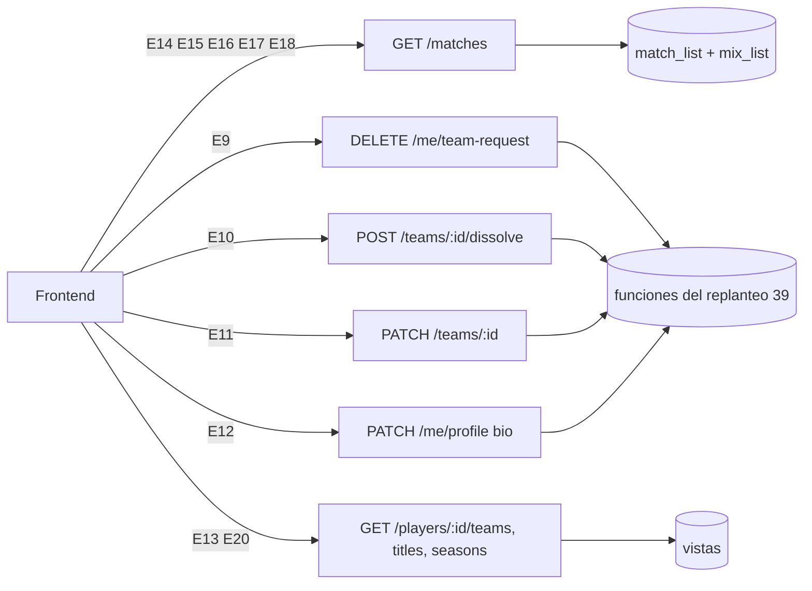
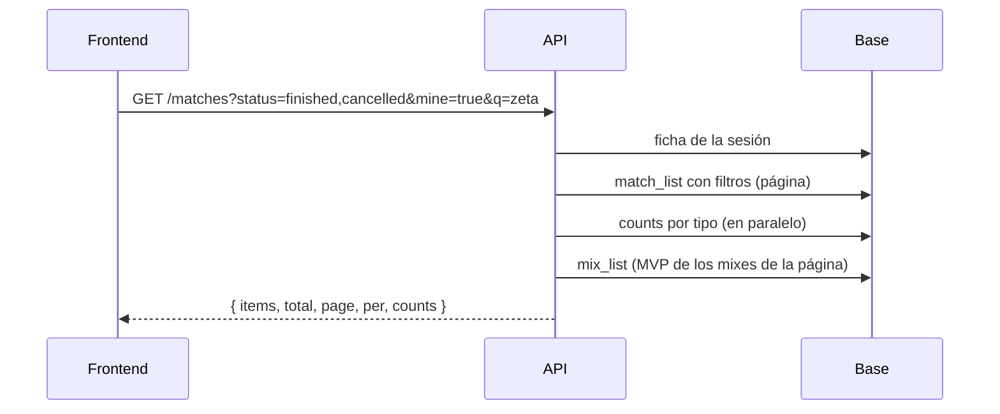
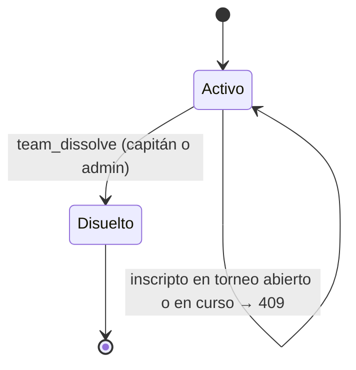

# Plan: pendientes de la API para el frontend (E9 a E20)

> Planeación original. Estado: **aprobado** por Daniel el 2026-10-30 ("empieza con el orden sugerido").

El frontend (`feat/frontend-fase-1`) pidió en `pendientes-backend-cmleague.md` once cambios de la API (E9 a E18 y E20). E19 (búsqueda global ⌘K) queda para más adelante. Este plan los cubre en el orden que sugirió el frontend.

## Decisiones tomadas

| Tema | Decisión | Por qué |
|---|---|---|
| Base de datos | Un solo replanteo nuevo, `39_pendientes_frontend.sql`, con su inversa y sus pruebas | Igual que los anteriores: no va a producción antes del corte |
| Errores `409` desde SQL | SQLSTATE propio `V3901` → `409 CONFLICT`, con el `detail` (JSON) como `details` | Los `raise` comunes dan `400 BUSINESS_RULE`; el frontend pidió `409` en varios casos |
| E14 `status` | Lista separada por comas, validada contra los cuatro estados | Sin romper a quien manda uno solo |
| E15 `mine` | Igual que en `/mixes`: pide sesión; sin ficha, lista vacía | Misma regla en los dos listados |
| E16 `counts` | Siempre en la respuesta. Se calculan con consultas `count` en paralelo (`head`), con los mismos filtros salvo `kind` | Sin vista nueva. El `total` de la consulta principal se reutiliza para el chip que ya está pedido |
| E17 `mvp` | Se lee de `mix_list` (ya lo calcula) para las filas `mix` de la página | Sin migración; una consulta más solo si hay mixes en la página |
| E18 nick | `match_list` suma `player_search` (alias y nombre en el juego de los que jugaron, también en los mapas de una serie). `q` busca en `search` o en `player_search` | `search` queda como está |
| E12 biografía | `set_my_bio(p_bio)`: hasta 500 caracteres (como el admin), saltos de línea, `""` o `null` la borra. Las palabras bloqueadas se buscan **palabra por palabra** | `name_blocked` sobre el texto entero junta palabras y daría falsos positivos |
| E12 lectura | `MyProfile.player` suma `bio` | "Mi perfil" necesita mostrar la actual |
| E9 cancelar | `cancel_team_request()` borra la solicitud pendiente y devuelve el logo, que la API borra del bucket. Sin solicitud: `404`; no pendiente: `409` | La RLS solo deja borrar al admin |
| E9 fechas y motivo | `team_requests.created_at` (las viejas quedan en `null`) y `reject_reason`. Enviarla de nuevo los renueva. `reject_team_request(p_user, p_reason)` con el motivo opcional (hasta 300) | Firma nueva: la de un argumento se borra |
| E10 disolver | `teams.dissolved_at` y `dissolved_by`. `team_dissolve(p_team)` (capitán o admin): da de baja a todos, cancela invitaciones y pedidos abiertos y avisa con `team_dissolved` | Archivado, no borrado: conserva partidas y títulos |
| E10 cuándo | Se permite siempre (no solo cuando no hay a quién ceder). `409` si está inscripto en un torneo en inscripciones o en curso | Más simple; el frontend pide confirmación |
| E10 después | El equipo disuelto no sale en `/teams` ni en el ranking (posiciones sin él), pero `GET /teams/{id}` sigue y trae `dissolved_at`. Nadie entra, se invita ni se inscribe; el capitán ya no lo edita | "Equipo disuelto" en la vista pública |
| E11 nombre y sigla | `team_rename(p_team, p_name, p_tag)`: 2 a 40 y 1 a 6, sigla en mayúsculas, palabras bloqueadas, únicos entre los equipos oficiales activos (sin distinguir mayúsculas), un cambio cada 30 días (`teams.name_changed_at`, `details.next_change_at` en el `409`), bloqueado con un torneo en curso. El admin no tiene espera | Lo que pidió el frontend |
| E13 logos | `/players/{id}/teams` lee `team_logo_url` de `team_members_view` (ya existe); `/titles` busca los logos con una consulta | Sin migración |
| E20 temporadas | `player_season_list` suma `ended_at` (`closed_at`) y `players` (cuántos tienen puesto) | Barato |

## 1. El flujo completo

## 2. Partidas (`GET /api/v1/matches`)

- **E14:** `status=finished,cancelled` → `.in('status', …)`.
- **E15:** `mine=true` → ficha de la sesión → `contains('player_ids', [id])`.
- **E16:** `counts: { all, mix, pcw, official }` con los filtros de la consulta salvo `kind`.
- **E17:** `mvp` (`PlayerLine` corto como en `MixItem`: `player_id`, `alias`, `game_nick`, `elo`, `level`, `rating`) en `MatchSummary`; `null` fuera de los mixes.
- **E18:** `q` busca también en `player_search`.

## 3. Equipo

- **E9:** `DELETE /api/v1/me/team-request` → `204`. `TeamRequest` suma `created_at` y `reject_reason`. `POST /admin/team-requests/{userId}/reject` acepta `{ reason? }`.
- **E10:** `POST /api/v1/teams/{id}/dissolve` → `204`.

- **E11:** `PATCH /teams/{id}` acepta `name` y `tag` (además de `looking_for`). `TeamDetail` suma `name_changed_at`, `next_name_change_at` y `dissolved_at`.

## 4. Perfil público

- **E12:** `PATCH /me/profile` acepta `bio`; sin ficha, `409`.
- **E13:** `logo_url` en `/players/{id}/teams` y `/players/{id}/titles`.
- **E20:** `season.ended_at` y `season.players` en `/players/{id}/seasons`.

## 5. Base de datos: replanteo 39

- `team_requests.created_at`, `reject_reason`; `cancel_team_request()`; `reject_team_request(uuid, text)`.
- `teams.dissolved_at`, `dissolved_by`, `name_changed_at`; `team_dissolve(uuid)`; `team_rename(uuid, text, text)`; `team_update` rechaza un equipo disuelto; triggers que no dejan sumar miembros, invitar ni inscribir a un disuelto.
- Aviso `team_dissolved` (categoría `team`); la baja de los miembros al disolver no manda `team_removed`.
- `set_my_bio(text)`.
- Vistas: `team_overview` suma `dissolved_at` y `name_changed_at`; `team_ranking` sin los disueltos; `match_list` suma `player_search`; `player_season_list` suma `ended_at` y `players`.

## 6. Requisitos antes de empezar

- Supabase local con Docker (`pnpm db:reset`) para las pruebas SQL y de integración.

## 7. Orden de implementación

1. E14 y E15 (API).
2. Replanteo 39 con su inversa y pruebas.
3. E12 y E9.
4. E10.
5. E13, E16, E17 y E18.
6. E11 y E20.
7. Contrato (`docs/frontend/contrato/`), tipos (`pnpm db:types`), pruebas unitarias e integración, documentación.
