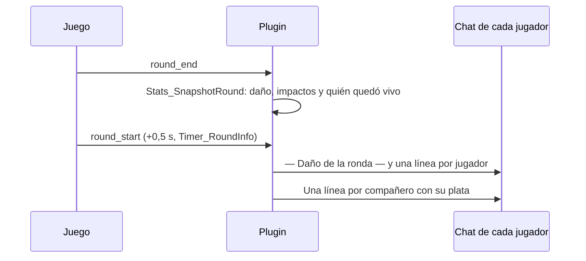

# Colores del chat: documentación

## Qué hace

Normaliza los colores del chat del reporter según la propuesta del artifact "Colores del chat de CMLeague" (https://claude.ai/artifact/LLSoJi2p1UaF7t72hdJghw). Cada color significa una sola cosa y se colorea el valor, no la etiqueta.

Cambian dos mensajes que salen al empezar cada ronda en vivo, medio segundo después del `round_start`: el reporte de daño de la ronda anterior y la plata de cada compañero de equipo.



## La paleta

| Etiqueta | Con ClientMod | Sin ClientMod | Significa |
|---|---|---|---|
| `{#normal}` | `\x01` | `\x01` | El texto y las etiquetas |
| `{#verde}` | `\x073EFF3E` | `\x04` | A tu favor: daño hecho, compra completa, éxito |
| `{#rojo}` | `\x07FF4040` | `\x01` | En tu contra: daño recibido, eco, errores |
| `{#amarillo}` | `\x07FFD700` | `\x01` | Dato a mirar: rival vivo, media compra, nombres, mapas |
| `{#gris}` (nuevo) | `\x079A9A9A` | `\x01` | Lo secundario: ceros, "muerto", títulos |
| `{#ct}` / `{#t}` | `\x0799CCFF` / `\x07EAB93D` | `\x01` | Los lados |

El prefijo `[CMLeague]` es `\x04` fijo. `{#gris}` solo existe en `qol.inc` (reporter). Los otros plugins (sell, password, calladmin) no lo usan.

## Reporte de daño

```
— Daño de la ronda —
Dado 117 en 1 · Recibido 11 en 1 · Dennis muerto
Dado 0 · Recibido 142 en 3 · Kevin vivo
```

- Sale solo si `csstv_damage_report 1` y si hubo daño en algún sentido; si no, no sale ni el título.
- Una línea por jugador con daño dado o recibido (incluye compañeros si hubo daño entre ellos).
- El daño dado va en verde y el recibido en rojo. El cero va en gris y sin "en N".
- `vivo` (amarillo) o `muerto` (gris) es cómo terminó la ronda ese jugador: `g_bPrevAlive`, que se llena en `Stats_SnapshotRound` con `IsPlayerAlive` en el `round_end`.

## Plata del equipo

```
Kevin $5.200
Dennis $4.650
Adrian $3.100
Tú $1.400
```

- Sale si `csstv_team_money 1`, solo a los jugadores de cada equipo.
- Ya no hay línea con el total ni prefijo.
- Una línea por jugador, de mayor a menor. La de quien lo lee dice `Tú`.
- Color del monto: verde desde $4.500, amarillo de $2.500 a $4.499, rojo por debajo de $2.500 (`ColoredMoney`).

## Dónde está cada cosa

| Qué | Archivo / ubicación |
|---|---|
| Paleta (`g_sColorTag`, `g_sColorRgb`, `g_sColorBasic`) | `server/addons/sourcemod/scripting/csstv/qol.inc` |
| Reporte de daño (`Qol_DamageReport`, `DamageAmount`) | `server/addons/sourcemod/scripting/csstv/qol.inc` |
| Plata del equipo (`Qol_TeamMoney`, `ColoredMoney`) | `server/addons/sourcemod/scripting/csstv/qol.inc` |
| Vivo al terminar la ronda (`g_bPrevAlive`) | `server/addons/sourcemod/scripting/csstv/stats.inc` |
| Propuesta con simulaciones | https://claude.ai/artifact/LLSoJi2p1UaF7t72hdJghw |
