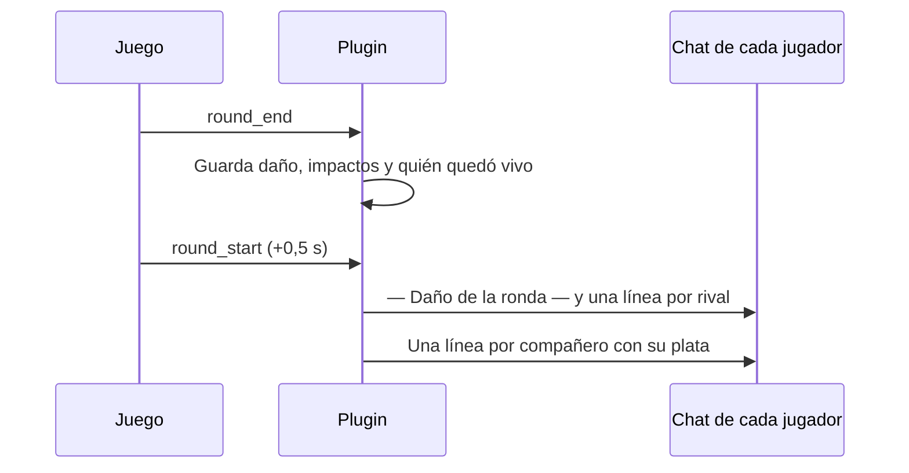

# Plan: colores del chat (reporte de daño y plata del equipo)

> Planeación original. Estado: **aprobado por Daniel (2026-10-30)** sobre el artifact "Colores del chat de CMLeague" (https://claude.ai/artifact/LLSoJi2p1UaF7t72hdJghw), que nació de la captura del plugin de retake de kyan (`cm league text plugin colors.png`).

## Decisiones tomadas

| Tema | Decisión | Por qué |
|---|---|---|
| Paleta | La de `qol.inc` más una etiqueta nueva, `{#gris}` (`\x079A9A9A`; sin ClientMod, color normal) | Hace falta un color para lo secundario (ceros, "muerto", títulos) |
| Regla | Se colorea el valor, no la etiqueta. Verde = a tu favor, rojo = en tu contra, amarillo = dato a mirar, gris = secundario. Como mucho tres colores por línea | Normalizar con el retake de kyan |
| Reporte de daño | Una línea por jugador con daño en algún sentido, en español: `Dado 117 en 1 · Recibido 11 en 1 · Dennis muerto`. El cero va en gris y sin "en N". Al final, `vivo` en amarillo o `muerto` en gris, según cómo terminó la ronda. Arriba, `— Daño de la ronda —` en gris | Hoy son dos líneas por rival, en inglés, con la etiqueta en color |
| Vivo o muerto | Se guarda al terminar la ronda (`Stats_SnapshotRound`), porque el reporte sale al empezar la siguiente | Al empezar la ronda ya reaparecieron todos |
| Plata del equipo | Sin la línea del total. Una línea por compañero, de mayor a menor: `Kevin $5.200`. Verde desde $4.500, amarillo de $2.500 a $4.499, rojo por debajo. La línea propia dice `Tú` | Pedido por Daniel en el artifact |
| Prefijo | Las líneas del daño y de la plata van sin `[CMLeague]`, como en el artifact | Son bloques de varias líneas; el prefijo en cada una mete ruido |
| Cvars | Sin cambios (`csstv_damage_report`, `csstv_team_money`) | No hay que tocar el cfg de ningún servidor |
| Retake de kyan | Fuera de este cambio: es su plugin. Se le pasa el artifact | No está en el repo |
| Versión | Reporter 2.7.2 | 2.7.1 es la desplegada |

## 1. El flujo

## 2. Cambios en el plugin

- `csstv/qol.inc`:
  - `{#gris}` en `g_sColorTag`, `g_sColorRgb` y `g_sColorBasic`.
  - `Qol_DamageReport`: el formato nuevo.
  - `Qol_TeamMoney`: sin total, una línea por jugador con el color según el monto y `Tú` para quien lo recibe.
- `csstv/stats.inc`: `g_bPrevAlive[]`, que llena `Stats_SnapshotRound`.
- `csstv_reporter.sp`: `PLUGIN_VERSION` 2.7.2.

## 3. Pruebas

- Compilar.
- Con bots en el servidor local (`csstv_send 0` y cola vacía): jugar rondas y mirar el chat con y sin ClientMod.

## 4. Despliegue

En el real (`.smx` genérico) y en flow (build licenciado), en la misma tanda y en un cambio de mapa. Solo cuando Daniel lo pida.

## 5. Orden de implementación

1. Etiqueta `{#gris}`.
2. `g_bPrevAlive` en `stats.inc`.
3. Reporte de daño.
4. Plata del equipo.
5. Versión, compilar y probar.
