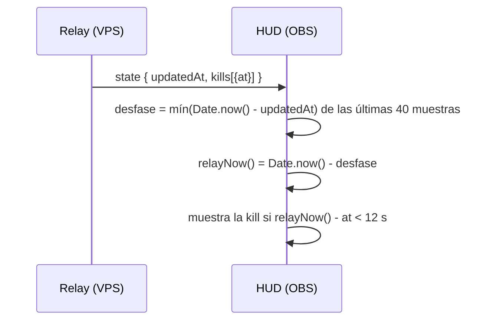

# El kill feed del HUD dura lo que tiene que durar: documentación

## Qué hace

Cada kill queda **12 segundos** (lo recomendó kyan) en el kill feed del HUD de OBS, aunque el reloj de la PC del streamer no coincida con el del VPS. El reloj de la ronda y el cartel "… gana la ronda" también se corrigen.

Las horas del estado (`kills[].at`, `lastEnd.at`, `phaseEndsAt` y `updatedAt`) son del reloj del relay. Antes, la página las comparaba con el reloj de la PC. La PC de Daniel estaba unos 4 s adelantada, así que una kill de 5 s se veía cerca de 1 s.

## Cómo se estima el desfase

- El relay pone `updatedAt` al soltar cada paquete retrasado y manda el estado en el mismo momento.
- `Date.now() - updatedAt` es el desfase de los relojes más la demora de la red. La demora solo suma, así que el **mínimo** de las últimas 40 muestras es la mejor estimación.
- El estado inicial al conectarse puede ser viejo (sin partida). Da una muestra más grande, y el mínimo la descarta apenas llega un paquete nuevo. Un estado sin `updatedAt` (`0`) no se cuenta.

## Dónde está cada cosa

| Qué | Archivo |
|---|---|
| `relayNow()`, desfase y `KILL_MS = 12000` | `hud/relay/public/hud.js` |
| Versión 2.2.1 | `hud/relay/src/main.ts`, `hud/relay/package.json` |
