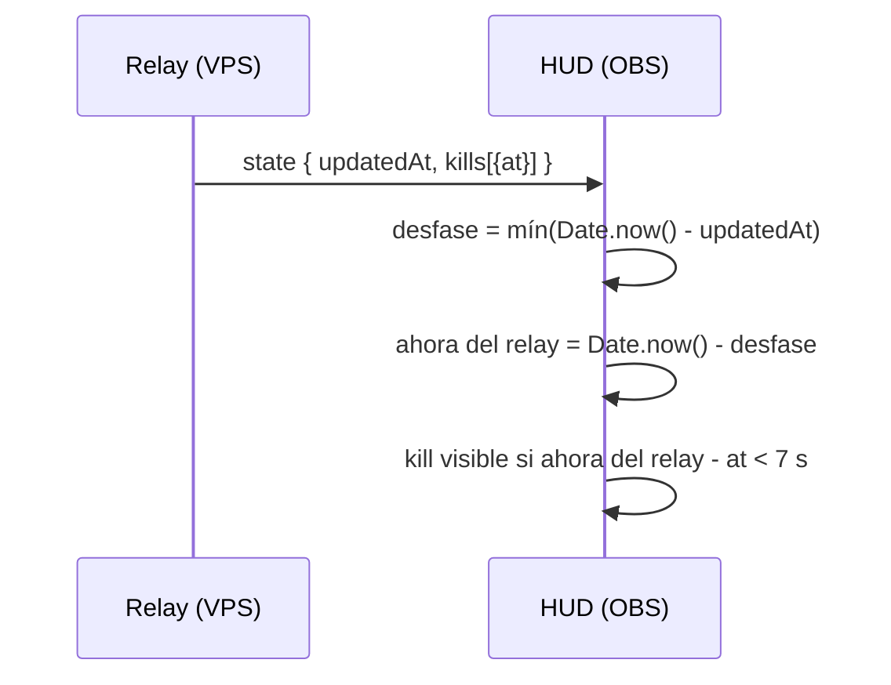

# Plan: el kill feed del HUD dura lo que tiene que durar

> Planeación original. Estado: **propuesta**, pedida por Daniel el 2026-10-30 ("la killfeed dura demasiado poco").

## Decisiones tomadas

| Tema | Decisión |
|---|---|
| Causa | El relay sella cada kill con su hora (`at`, `Date.now()` del VPS) y la página la compara con la hora de la PC del streamer. La PC de Daniel estaba unos 4 s adelantada: cada kill de 5 s se veía cerca de 1 s. El reloj de la ronda y el cartel de fin de ronda tienen el mismo desfase. |
| Corrección | La página estima la diferencia entre su reloj y el del relay con `updatedAt` de cada estado (el relay lo pone al soltar el paquete y lo manda en el acto). Se toma el mínimo de las últimas 40 muestras: la demora de la red solo suma, así que el mínimo es la mejor estimación. Todas las comparaciones con horas del relay usan esa hora corregida. |
| Duración | `KILL_MS` pasa de 5 s a 7 s, un poco más que el kill feed del juego (6 s), para que en el stream se alcance a leer. |
| Versión | Relay 2.2.1. Solo cambian las páginas (`public/hud.js`); el protocolo y la base no cambian. |

## 1. El flujo

## 2. Cambios

- `hud/relay/public/hud.js`: `relayNow()` con el desfase estimado; `renderKills`, `renderBanner` y `tick` lo usan. `KILL_MS = 7000`.
- `hud/relay/src/main.ts` y `package.json`: versión 2.2.1.

## 3. Orden de implementación

1. Cambiar `hud.js` y la versión.
2. Correr las pruebas del relay.
3. Desplegar en el VPS con `deploy/vps/desplegar.sh` (con el visto bueno de Daniel) y verlo en OBS.
