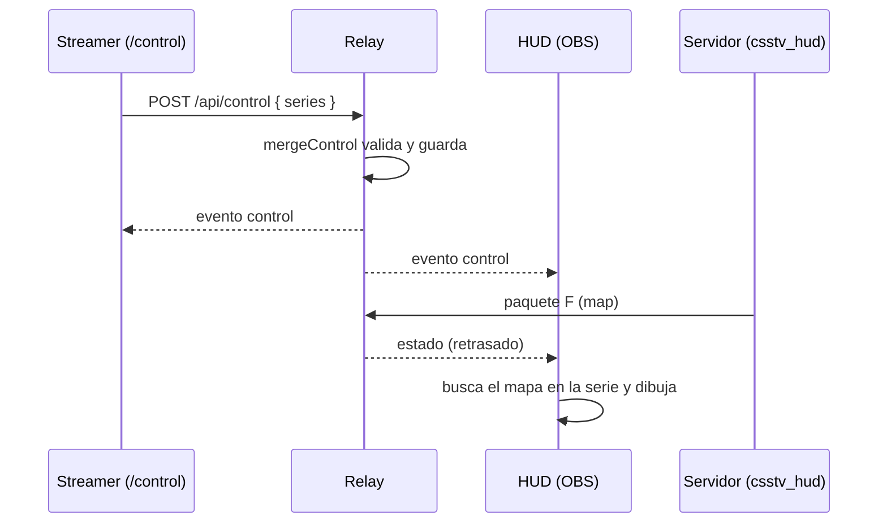

# Serie de mapas en el HUD: documentación

## Qué hace

El streamer carga en `/control` la serie que se está jugando: el formato (BO1, BO3 o BO5) y, por cada mapa, cuál es, quién lo eligió y quién lo ganó.

El HUD muestra arriba a la izquierda `CMLEAGUE | BO3 | Jugando en de_dust2 | Pick de FLUXO`. El mapa lo toma del servidor (paquete `F` de `csstv_hud`) y lo busca en la lista para saber quién lo eligió. Sobre el nombre de cada equipo del marcador hay rayitas con los mapas ganados.

No cambia el plugin: todo vive en el relay y en las páginas que sirve.



## La caja de arriba a la izquierda

| Caso | Texto |
|---|---|
| El mapa del servidor está en la serie y lo eligió un equipo | `CMLEAGUE \| BO3 \| Jugando en de_dust2 \| Pick de FLUXO` (el nombre, con el color de su lado) |
| El mapa es el decider | `CMLEAGUE \| BO3 \| Jugando en de_dust2 \| Decider` |
| El mapa no está en la serie (o está en un renglón fuera del formato, por ejemplo el 2 en BO1) | `CMLEAGUE \| BO3 \| Jugando en de_dust2` |
| "Serie" apagado en "Qué se muestra" | `CMLEAGUE \| de_dust2` |

El mapa se compara sin distinguir mayúsculas. La caja se oculta junto con el marcador (interruptor "Marcador").

## Rayitas de mapas ganados

- Tantas como mapas hacen falta para ganar: 2 en BO3 y 3 en BO5. En BO1 no hay.
- Se pintan con el color del lado en que juega el equipo ahora (azul CT, rojo T). Van encima del equipo, pegadas al marcador.
- Salen de la columna "Ganó" de la serie.

## Los datos (`Control.series`)

```ts
series: {
  bo: 1 | 3 | 5;
  maps: { map: string; pick: "" | "ct" | "t" | "decider"; win: "" | "ct" | "t" }[]; // siempre 5
}
showSeries: boolean;
```

- `pick` y `win` se guardan por lado. "Intercambiar" da vuelta los nombres y también `ct`/`t` en picks y ganadores, así que siguen al equipo. Cambiar el nombre de un equipo no rompe la serie.
- Siempre hay 5 renglones: pasar de BO5 a BO3 no borra lo cargado en el 4 y el 5.
- `mergeControl` acepta cambios parciales (`{ series: { bo } }` o `{ series: { maps: [{}, { win: "ct" }] } }`, donde `{}` deja el renglón igual) y descarta lo inválido. El mapa se limpia a `[A-Za-z0-9_.-]` y 64 caracteres.
- Se guarda con el resto del control: `relay-control.json` en el modo local y `control.json` (uno por streamer) en el VPS.

## La página de control

Sección "Serie", entre "Equipos" y "Jugador enfocado":

- Botones BO1, BO3 y BO5. Al pasar a BO3 o BO5, el último mapa queda como decider si no tenía pick.
- Un renglón por mapa del formato: el mapa (campo de texto con las sugerencias del `mapcycle.txt`; se puede escribir otro), "Pick de" (los dos equipos o Decider) y "Ganó".
- El renglón del mapa que corre en el servidor dice "en juego".
- Debajo, el resultado de la serie (`Serie: FLUXO 1 – 1 Arena Pro`).
- Mientras el streamer edita la tabla, no se redibuja; se redibuja al salir de ella.
- En "Qué se muestra", el botón "Serie".

## Dónde está cada cosa

| Qué | Archivo / ubicación |
|---|---|
| Modelo, validación e intercambio | `hud/relay/src/control.ts` |
| Pruebas | `hud/relay/test/relay.test.ts` (describe `control`) |
| Sección "Serie" del control | `hud/relay/public/control.html` y `control.js` |
| Caja y rayitas del HUD | `hud/relay/public/hud.js` (`infoParts`, `seriesPips`) y `hud.css` (`#info`, `#score .pips`) |
| Guía del streamer | `hud/relay/README.md` |
