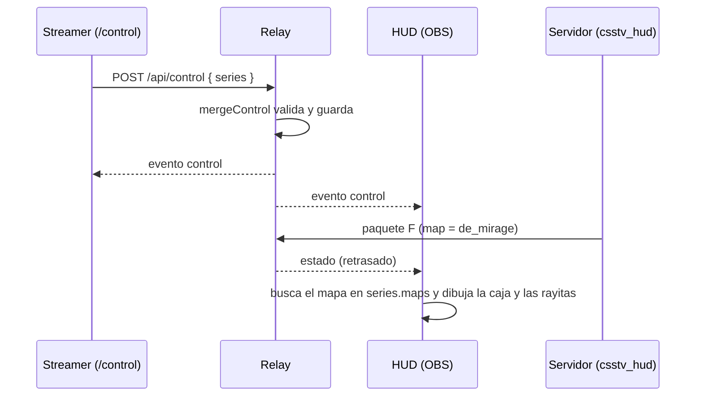

# Plan: serie de mapas en el HUD (BO1, BO3, BO5)

> Planeación original. Estado: **aprobado** por Daniel el 2026-10-30, sobre la vista previa del artifact "HUD CMLeague · serie de mapas".

## Decisiones tomadas

| Tema | Decisión |
|---|---|
| Qué carga el streamer | En `/control`, una sección "Serie": formato (BO1, BO3 o BO5) y, por mapa, el mapa, quién lo eligió (un equipo o decider) y quién lo ganó. |
| Qué muestra el HUD | La caja de arriba a la izquierda pasa a `CMLEAGUE \| BO3 \| Jugando en de_mirage \| Pick de FLUXO`, como en `hudv2mapas.png` pero en español y con `CMLEAGUE` adelante (Daniel). |
| Decider | El renglón dice `Decider`. Al elegir BO3 o BO5, el último mapa queda como decider si no tenía pick. |
| Mapa en juego | No se marca a mano: el HUD toma el mapa del servidor y lo busca en la lista. Si no está, la caja va sin la parte del pick. |
| Mapas ganados | Rayitas sobre el nombre de cada equipo, tantas como mapas hacen falta para ganar la serie (2 en BO3, 3 en BO5), pintadas con el color del lado. En BO1 no hay (Daniel). |
| Intercambiar | Picks y ganadores se guardan por lado (`ct` o `t`) y "Intercambiar" los da vuelta junto con los nombres: siguen al equipo. Cambiar el nombre de un equipo no rompe nada. |
| Dónde se guarda | En el `Control` del relay (como los nombres), así sobrevive a recargar OBS y a reiniciar el relay. |
| Interruptor | "Serie" en "Qué se muestra". Apagado, la caja vuelve a `CMLEAGUE \| mapa` y no hay rayitas. |
| Plugin | No cambia: el mapa ya llega en el paquete `F`. No aplica la regla de desplegar al real y a flow. |

## 1. El flujo completo

## 2. Relay (`src/control.ts`)

- `Control.series = { bo: 1 | 3 | 5, maps: SeriesMap[] }`, con 5 renglones siempre (así no se pierde lo cargado al pasar de BO5 a BO3).
- `SeriesMap = { map: string, pick: "" | "ct" | "t" | "decider", win: "" | "ct" | "t" }`. El mapa: hasta 64 caracteres de `[A-Za-z0-9_.-]`.
- `mergeControl` acepta `series` entero o parcial y descarta lo inválido; `swap` da vuelta `ct`/`t` en picks y ganadores.
- `VERSION` 2.2.0.

## 3. Control (`public/control.html` y `control.js`)

- Sección "Serie" entre "Equipos" y "Jugador enfocado": botones BO1/BO3/BO5 y una tabla con un renglón por mapa (campo de texto con sugerencias del `mapcycle.txt`, pick y ganador con los nombres actuales).
- El renglón del mapa que corre en el servidor se marca "en juego".
- Botón "Serie" en "Qué se muestra" (`showSeries`).

## 4. HUD (`public/hud.js` y `hud.css`)

- `#info`: `CMLEAGUE | BO3 | Jugando en <mapa> | Pick de <equipo>` (o `Decider`). El nombre del que eligió, con el color de su lado.
- Rayitas encima de cada equipo del marcador.

## 5. Requisitos antes de empezar

Ninguno.

## 6. Orden de implementación

1. `control.ts` y sus pruebas.
2. `control.html` y `control.js`.
3. `hud.js` y `hud.css`.
4. Prueba en local con `pnpm simular` y capturas.
5. Documentación, guía y fila en el índice. El despliegue al VPS (`deploy/vps/desplegar.sh hud`) lo corre Daniel.
