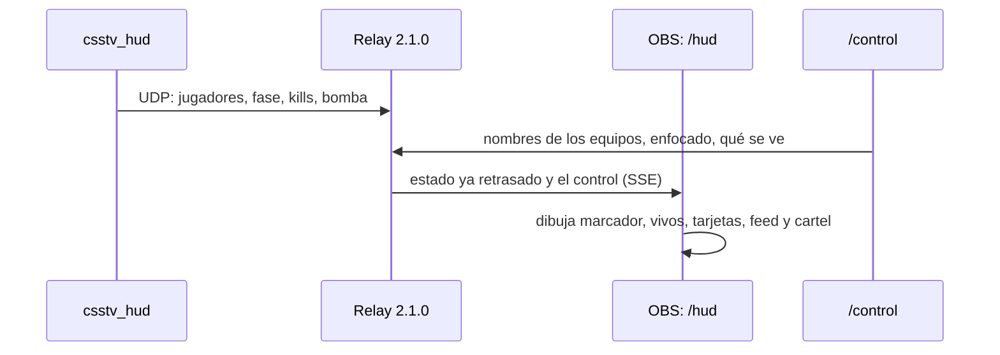
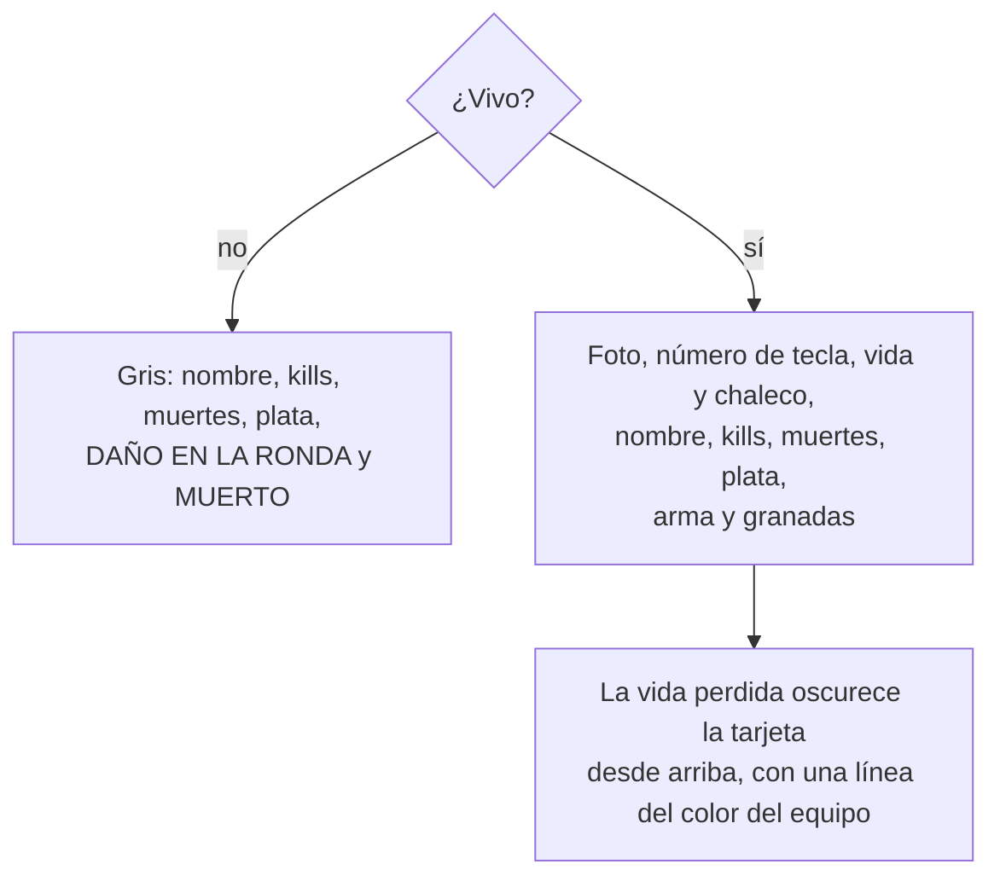

# HUD de observer, versión 2: documentación

## Qué hace

El HUD que se pone en OBS (`/hud` del relay) tiene el diseño de un torneo de CS2: el marcador arriba con los equipos, los vivos de cada lado, una tarjeta por jugador abajo con su foto, su número de tecla y la vida, y la tarjeta grande del jugador enfocado en el centro.

Solo cambió lo que dibuja el navegador. El plugin `csstv_hud`, el protocolo, el relay (salvo la versión, 2.1.0), la web y la base siguen igual: todos los datos ya llegaban.

## Partes de la pantalla (1920×1080)

| Parte | Dónde | Qué muestra | Se apaga con |
|---|---|---|---|
| Mapa | Arriba a la izquierda | "CMLEAGUE \| DE_DUST2" | Marcador |
| Marcador | Arriba al centro | "RONDA N", cada equipo con su sigla y nombre, los puntos (el que va ganando en amarillo) y el reloj con la fase | Marcador |
| Vivos | Arriba a la derecha | "4 VS 3" y el aviso "CLUTCH" | Marcador |
| Feed de kills | Derecha, debajo de la barra del espectador | Igual que antes, con los íconos de ClientMod | Kills |
| Cartel de fin de ronda | Debajo del marcador, 5 s | "<EQUIPO> GANA LA RONDA" y, si fue por la bomba, "La bomba explotó" o "Desactivaron la bomba" | No se apaga |
| Tarjetas | Abajo, CT a la izquierda y TT a la derecha | Ver más abajo | Jugadores |
| Tarjeta grande | Abajo al centro | El jugador enfocado en `/control` | Tarjeta grande |

### Reloj

| Fase | Texto | Aspecto |
|---|---|---|
| `freeze` | COMPRA | Texto en verde |
| `live` | RONDA EN JUEGO | Normal |
| `planted` | BOMBA PLANTADA | Fondo rojo con la C4 titilando |
| `over` | FIN DE RONDA | Sin reloj |

### Sigla del equipo

Sale del nombre que se escribe en `/control` (`teamTag` en `hud.js`): las iniciales si tiene varias palabras ("Kraken eSports" → "KE") y las tres primeras letras si es una ("Nómadas" → "NÓM"). Va en un cuadrado del color del lado, en lugar del logo.

### Clutch

Aparece si a un lado le queda un solo jugador vivo y al otro más de uno, y no se muestra en el fin de ronda.

## Tarjeta de cada jugador (128×236 px)

- **Foto:** la imagen que pasó Daniel ([`avatar.webp`](avatar.webp)), embebida en `hud.css` (`--avatar`). A los TT se les pasa el brillo azul a rojo con `hue-rotate(146deg)`.
- **Vida:** el cuerpo de la tarjeta son los 202 px de arriba. El color del equipo llena desde abajo según la vida, y la parte perdida se oscurece desde arriba, también sobre la foto, con una línea de 2 px del color del equipo en el límite. Con 25 o menos, el número se aclara.
- **Número de tecla:** 1 a 5 los CT y 6 a 9 y 0 los TT, en el mismo orden que los botones y las teclas de `/control`.
- **Arriba a la derecha:** la C4 si lleva la bomba y el kit si lo tiene.
- **Franja de abajo:** el arma principal (o la secundaria, o el cuchillo), apagada si tiene otra cosa en la mano, y las granadas, una por ícono.
- **Muerto:** sin foto ni color, con el daño que hizo en la ronda.
- **Enfocado:** borde blanco y 10 px más arriba.

## Tarjeta grande (420×164 px)

La foto sobre el color del equipo, el número de tecla y el nombre, el arma que tiene en la mano con su nombre, kills, muertes, daño de la ronda, plata, vida (en rojo con 25 o menos), chaleco, kit, C4, granadas y una barra de vida abajo. No se muestra si el enfocado está muerto.

## Daño en la ronda

Lo calcula `csstv_hud` (`g_iRoundDmg`):
- Suma el daño a jugadores del otro equipo, pero nunca más que la vida que le quedaba a la víctima. Es el mismo cálculo que el `!hp` del reporter: una kill limpia son 100.
- Vuelve a 0 en cada `round_start`.

## Íconos

| Qué | Fuente | Letra |
|---|---|---|
| Armas, cuchillo y granada en la mano | `clientmodkillfeed.ttf` | Las de `KILL_GLYPHS` en `common.js` |
| HE, flash y humo | `clientmodkillfeed.ttf` | `O`, `P` y `Q` |
| Chaleco y chaleco con casco | `clientmodkillfeed.ttf` | `p` y `E` |
| C4 y calavera (muertes) | `clientmodkillfeed.ttf` | `I` y `C` |
| Kit | `cs.ttf` | `E` |
| Mira (kills) y cruz (vida) | SVG en `hud.js` | No están en las fuentes |

- **Flash y humo:** una franja de color cruza la lata (del 46 % al 74 % del alto) y un contorno fino del mismo color la rodea: ámbar `#f2a91d` la flash y gris `#9a9d98` el humo. Reemplaza al borde solo de [`2026-10-23-hud-iconos-feed`](../2026-10-23-hud-iconos-feed/DOCUMENTACION.md).
- **Sin las fuentes** (el relay no encontró `gameDir`): los nombres de las armas en texto, las granadas como "H F×2 S", y "A", "A+H", "C4" y "KIT" en etiquetas.

## Dónde está cada cosa

| Qué | Archivo |
|---|---|
| Contenedores de la pantalla | `hud/relay/public/hud.html` |
| Estilos, colores y la foto | `hud/relay/public/hud.css` |
| Dibujo de cada parte | `hud/relay/public/hud.js` |
| Letras de los íconos y nombres de las armas | `hud/relay/public/common.js` (sin cambios) |
| Versión del relay | `hud/relay/src/main.ts` (`VERSION`) |
| Daño en la ronda | `server/addons/sourcemod/scripting/csstv_hud.sp` (`Event_PlayerHurt`) |
| Imagen original de la foto | `docs/bitacora/2026-10-30-hud-version-2/avatar.webp` |
