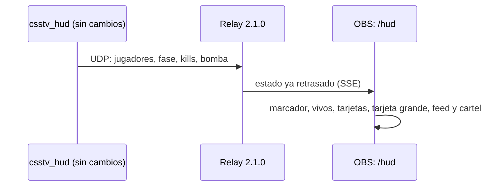

# Plan: HUD de observer, versión 2

> Planeación original. Estado: **aprobado por Daniel (2026-10-30)**: "dale, arma el plan e impleméntalo".

Daniel dejó en la raíz dos capturas del HUD de un torneo de CS2 (`hud_version2.png`, la barra de jugadores, y `hudversion_2arriba.png`, el marcador) y pidió que el nuestro se vea así. El diseño se aprobó en un artifact privado ("HUD CMLeague v2", 2026-10-30), con tres vueltas:

1. Primera versión con un avatar dibujado e íconos aproximados.
2. Avatar de referencia que pasó Daniel (`hudversion2 avatar.jpg`, que en realidad es WebP de 400×400) e íconos reales de ClientMod. Cuatro opciones para distinguir la flash del humo.
3. Elegidos: **la imagen tal cual** y **franja y borde**. Como con la imagen tal cual el relleno de la vida quedaba tapado, la vida perdida pasa a oscurecer la tarjeta desde arriba, con una línea del color del equipo en el límite.

## Decisiones tomadas

| Tema | Decisión | Por qué |
|---|---|---|
| Alcance | Solo el HUD de OBS (`hud/relay/public/hud.html`, `hud.css` y `hud.js`) | El plugin ya manda todo lo que el diseño usa. No cambian ni `csstv_hud`, ni el protocolo, ni la web, ni la base |
| Daño en la ronda | Se muestra en la tarjeta de los muertos y en la tarjeta grande | Ya llega: `g_iRoundDmg` de `csstv_hud.sp`, con el mismo cálculo que el `!hp` del reporter y vuelta a 0 en cada `round_start` |
| Avatar | La imagen de Daniel tal cual, embebida en `hud.css` como `data:image/webp` (unos 4,5 KB) | Así no hace falta servir archivos binarios: los assets del relay se leen como texto (`assets.ts`) y van en la SEA del `.exe` |
| Avatar de los TT | La misma imagen con `hue-rotate(146deg)`: el brillo azul pasa a rojo | Una sola imagen para los dos lados |
| Vida | La vida perdida oscurece la tarjeta desde arriba, sobre la foto, con una línea del color del equipo en el límite. Debajo de la foto, el color del equipo llena desde abajo | Con la foto tal cual, el relleno solo se veía debajo de ella |
| Colores | CT azul (`#2f6fc4`/`#4c8ee6`) y TT rojo (`#c4362f`/`#e5534b`), como en la captura | El HUD de hoy usa naranja para los TT |
| Flash y humo | Franja de color cruzando la lata y contorno fino del mismo color: ámbar `#f2a91d` y gris `#9a9d98` | Fue la que mejor se distinguió a tamaño real en el diseño. Reemplaza al borde solo, de `2026-10-23-hud-iconos-feed` |
| Número de tecla | 1 a 5 para los CT y 6 a 9 y 0 para los TT, en el mismo orden que `/control` (por equipo y `uid`) | Coincide con las teclas del panel de control |
| Sigla del equipo | Se saca del nombre que se carga en `/control`: las iniciales si tiene varias palabras y las tres primeras letras si es una | No hace falta agregar un campo al panel. Sin logos: un cuadrado con la sigla y el color del lado |
| Vivos y clutch | Arriba a la derecha, "4 VS 3". Si a un lado le queda uno solo y al otro más de uno, se suma el aviso "CLUTCH" | Se calcula con `alive` |
| Balas del arma | No van | El plugin no las manda. Queda como dato nuevo opcional |
| Sin las fuentes de ClientMod | Se mantiene lo de hoy: nombres de las armas y letras en lugar de íconos | El relay puede no encontrar `gameDir` |
| Versión | Relay 2.1.0 | Cambia solo lo que ve OBS |

## 1. El flujo completo

## 2. Pantalla (1920×1080)

- **Arriba al centro:** "RONDA N", y debajo una fila con el recuadro del equipo CT (sigla y nombre, franja azul hacia adentro), los dos puntajes en un recuadro oscuro (el que va ganando en amarillo) y el recuadro de los TT. Debajo, el reloj con la fase: "RONDA EN JUEGO", "COMPRA" (en verde) o "BOMBA PLANTADA" (fondo rojo con la C4 titilando).
- **Arriba a la izquierda:** "CMLEAGUE | <MAPA>".
- **Arriba a la derecha:** vivos de cada lado y el aviso de clutch.
- **Feed de kills:** como hoy, debajo de la barra del espectador (`top: 122px`), con el estilo del diseño.
- **Cartel de fin de ronda:** debajo del marcador, "<EQUIPO> GANA LA RONDA" y el motivo debajo ("La bomba explotó" o "Desactivaron la bomba").
- **Abajo:** cinco tarjetas CT a la izquierda y cinco TT a la derecha (128×236 px).
  - **Vivo:** avatar, número de tecla grande y transparente, vida con el ícono del chaleco o del casco, nombre, kills y muertes, plata en verde, y una franja oscura con el arma principal (o la secundaria) y las granadas, una por ícono. Arriba a la derecha, la C4 o el kit.
  - El arma se ve apagada si tiene otra cosa en la mano. Si la vida es 25 o menos, el número se aclara.
  - **Muerto:** gris, sin avatar, con nombre, kills, muertes, plata y "DAÑO EN LA RONDA".
  - **Enfocado** (el de la tarjeta grande): borde blanco, 10 px más arriba.
- **Abajo al centro:** la tarjeta grande del enfocado (420×164 px): avatar sobre el color del equipo, número y nombre, el arma en la mano con su nombre, kills, muertes, daño, plata, vida, chaleco, kit, C4, granadas y una barra de vida. Se oculta si el enfocado está muerto o no hay ninguno.
- Los interruptores de `/control` (`showScore`, `showPlayers`, `showFocus` y `showKills`) siguen funcionando igual.

## 3. Archivos

| Archivo | Cambio |
|---|---|
| `hud/relay/public/hud.html` | Contenedores nuevos: `#info` y `#alive` |
| `hud/relay/public/hud.css` | Reescrito con el diseño y el avatar embebido |
| `hud/relay/public/hud.js` | Tarjetas, tarjeta grande, marcador, vivos y cartel nuevos. El feed, la conexión y el reloj no cambian |
| `hud/relay/src/main.ts` | `VERSION` 2.1.0 |
| `docs/bitacora/2026-10-30-hud-version-2/` | Este plan, la documentación, la guía y el avatar original |

## 4. Requisitos antes de empezar

Ninguno. Para probar en local alcanzan el relay en modo local, `pnpm simular` y las fuentes de ClientMod de `C:\CSSv34_ClientMod`.

## 5. Orden de implementación

1. `hud.html`, `hud.css` y `hud.js`.
2. `pnpm typecheck` y `pnpm test`.
3. Relay en modo local con `pnpm simular`, y capturas con Edge sin ventana: en juego, compra, bomba plantada, fin de ronda, con y sin las fuentes.
4. Documentación, guía, fila en el README de la bitácora y `docs/PENDIENTES.md`.
5. **Despliegue en el VPS (`build:node` y `desplegar.sh`): solo cuando Daniel lo pida.** No toca los servidores de juego.
