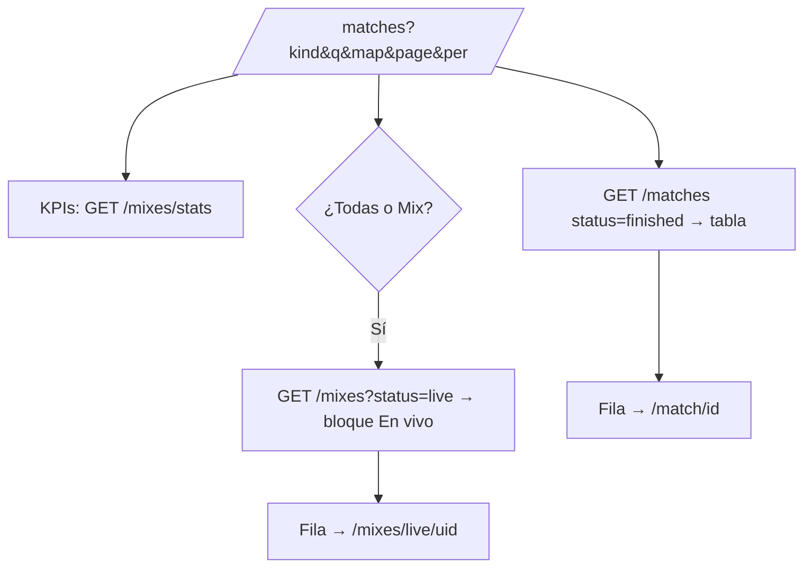

# Partidas y Mixes en un solo listado: documentación

## Qué es

`/matches` ("Partidas") es el único listado de partidas: mixes, PCW y partidos de torneo juntos. Reemplaza a la página de Mixes (`/mixes`) y a las dos páginas que estaban en blanco ("Partidas" y "Resultados"). El diseño se aprobó en el [artifact](https://claude.ai/artifact/QBYaxMcgkQyUy1zSvatuCZ) el 2026-10-30.

## Cómo se arma

| Parte | Qué muestra |
|---|---|
| KPIs | Los de Mixes: en vivo ahora (con "Ver"), jugadores en 30 días, mapa más jugado y promedio de rondas |
| Filtros | Todas, Mix, PCW y Torneo; búsqueda (equipo, bando o torneo); "Todos los mapas" (los activos del catálogo); "Solo donde jugué" y "Ocultar canceladas" deshabilitados con "Próximamente" |
| En vivo | Solo con Todas o Mix y si hay mixes en juego: una fila completa por mix con tipo, mapa, bandos, marcador, ronda, servidor, "Ver en TV" y la flecha |
| Tabla | Fecha, Tipo, Mapa (en una serie, el formato: "BO3"), Bando 1, Resultado, Bando 2, Detalle (torneo y fase; motivo si se canceló), Demo / TV. Alto de 8 filas |
| Vacíos | Con búsqueda o mapa, "Ninguna partida con esos filtros" y "Quitar filtros"; sin PCW, "Ir a PCW"; sin partidos de torneo, "Ir a Torneos" |

Todo el estado vive en la URL. Cambiar un filtro vuelve a la página 1 y no mueve el scroll.

## Rutas viejas

| Ruta | Ahora |
|---|---|
| `/mixes` | Redirige a `/matches?kind=mix`, con la búsqueda y el mapa del link viejo |
| `/matches/results` | Redirige a `/matches` |
| `/match/{id}` y `/mixes/live/{uid}` | Sin cambios. El breadcrumb es "Partidas › …" y el sidebar marca Partidas. "Volver" y "Ver mixes" llevan a `/matches?kind=mix` |

El sidebar ya no tiene "Mixes". El punto rojo de en vivo ya estaba en Partidas. ⌘K ya no tiene "Resultados".

## Detalles

- **Mapa:** el filtro manda el nombre sin `de_`/`cs_`, porque la base guarda los mapas así. El filtro de la página de Mixes mandaba `de_cache` y no encontraba nada.
- **Demo:** sin demo se ve solo "—", sin el punto de color.

## Lo que espera al backend

Pedidos E14 a E18 en `contrato-backend-equipo-torneos.md` (tercera tanda):

| Pedido | Hoy en el frontend |
|---|---|
| E14: varios estados en `status` | La tabla muestra solo las jugadas (`status=finished`); "Ocultar canceladas" deshabilitado |
| E15: `mine=true` | "Solo donde jugué" deshabilitado |
| E16: contadores por tipo | Chips sin número |
| E17: `mvp` en las filas de mix | Detalle vacío en los mixes |
| E18: búsqueda por nick | La búsqueda mira equipos, bandos y torneo |

Cuando llegue cada uno, hay que regenerar `src/api/schema.d.ts` y activar lo suyo. Son cambios chicos en `features/matches/` (`search.ts`, `MatchesList.tsx`).

## Archivos principales

Todos dentro de `web/frontend/src/`.

| Archivo | Qué tiene |
|---|---|
| `features/matches/MatchesList.tsx` | La página |
| `features/matches/search.ts` | Estado de la URL y parámetros de `GET /matches` |
| `features/matches/queries.ts` | La consulta, con el tipo de los bandos corregido |
| `features/mixes/queries.ts` | `liveMixesOptions` (los en vivo) |
| `routes/_app/matches.index.tsx`, `mixes.index.tsx`, `matches.results.tsx` | La página y los redirect |
