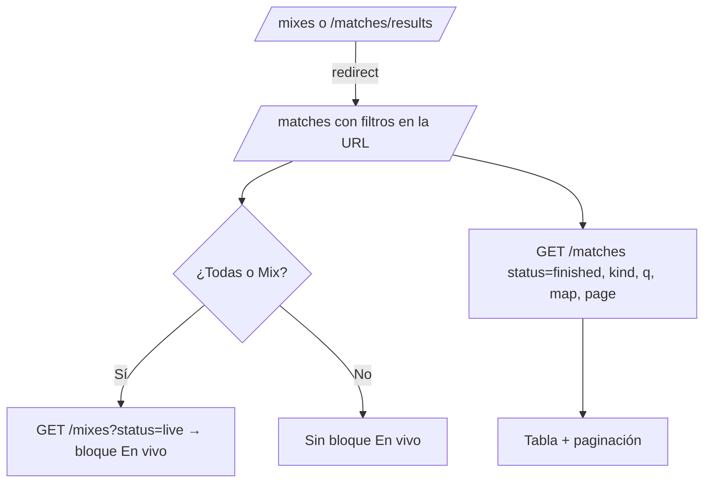

# Plan: Partidas y Mixes en un solo listado

> Planeación original. Estado: **aprobado** por Esteban el 2026-10-30, sobre el [artifact](https://claude.ai/artifact/QBYaxMcgkQyUy1zSvatuCZ) (versión 2).

## Decisiones tomadas

| Tema | Decisión | Por qué |
|---|---|---|
| Módulos | "Partidas" es el único listado: mixes, PCW y torneos. "Mixes" sale del sidebar | Hoy Partidas está en blanco y Mixes muestra solo una parte |
| Rutas viejas | `/mixes` redirige a `/matches?kind=mix` (con su búsqueda y mapa); `/matches/results` ("Resultados", en blanco) se borra y redirige a `/matches`. La sala del mix (`/match/{id}`, `/mixes/live/{uid}`) no cambia | Los links viejos siguen andando |
| Filtros | Todas, Mix, PCW y Torneo (como en el perfil público), búsqueda, "Todos los mapas", "Solo donde jugué" y "Ocultar canceladas" | Pedido de Esteban |
| En vivo | Bloque "En vivo · N" arriba de la tabla, con una fila completa por partida en juego (tipo, mapa, bandos, marcador, ronda, servidor, "Ver en TV"). Sale de `GET /mixes?status=live`; solo con Todas o Mix | `/matches` no trae los mixes en juego |
| Tabla | Fecha, Tipo, Mapa, Bando 1, Resultado, Bando 2, Detalle, Demo / TV. Bandos solo con texto (sin escudos), MVP sin nivel, "Demo / TV" como hoy en Mixes | Consistencia entre los tres tipos |
| Programadas | No van en Partidas (se ven en Torneos y en PCW) | Decisión de Esteban |
| Datos | La tabla sale de `GET /matches` con `status=finished` | Mientras `status` no acepte varios valores (E14), es la única forma de no traer las programadas |
| Lo que falta en la API | Pedidos E14 a E18 en `contrato-backend-equipo-torneos.md`. Mientras tanto: "Ocultar canceladas" y "Solo donde jugué" deshabilitados con "Próximamente"; chips sin número; Detalle de los mixes vacío; la búsqueda no encuentra nicks | Regla de "Próximamente" para lo que no tiene backend |
| Mapa | El filtro manda el nombre sin `de_`/`cs_` | La base guarda los mapas sin prefijo; hoy el filtro de Mixes manda `de_cache` y no encuentra nada |

## 1. El flujo

## 2. Frontend

- `features/matches/` (nuevo): `search.ts` (estado de la URL), `queries.ts` (`GET /matches`), `MatchesList.tsx` (KPIs, filtros, En vivo, tabla) y sus pruebas.
- Se reutiliza de `features/mixes/`: los KPIs (`mixStatsOptions`), `DemoStatus`, `WatchTvButton`, `CancelChip`, las etiquetas de fecha y motivo de cancelación.
- `MixesList.tsx` y su búsqueda se borran; `mixesSearchSchema` queda solo en lo que use la sala.
- `features/shell/nav.ts`: sin el ítem Mixes; la sala de un mix y `/mixes/live` marcan Partidas y su breadcrumb es "Partidas › …". `CommandMenu.tsx`: sin "Resultados".
- Los "Volver" y "Ver mixes" de la sala del mix llevan a `/matches?kind=mix`.

## 3. Requisitos

API local y Supabase en Docker para las e2e.

## 4. Orden de implementación

1. `features/matches/` con su búsqueda, consultas y página.
2. Rutas: `/matches`, redirect de `/mixes` y de `/matches/results`.
3. Navegación, ⌘K y los links de la sala.
4. Borrar `MixesList` y ajustar pruebas unitarias y e2e.
5. Verificación visual en claro y oscuro, de 375 a 1440 px.
6. `DOCUMENTACION.md`, `GUIA_IMPLEMENTACION.md` y la fila del `README.md`.
