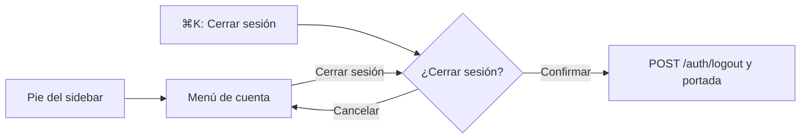

# Cerrar sesión visible y tabs del perfil público: documentación

## Qué es

Dos mejoras del frontend:

- **La cuenta en el pie del sidebar:** un menú con todo lo de la cuenta, incluido cerrar sesión, que antes solo estaba en Mi perfil → Cuenta.
- **El perfil público rehecho:** la página no se mueve al cambiar de pestaña, y cada pestaña tiene diseño propio con datos y sin datos.

El diseño se aprobó en el [artifact](https://claude.ai/artifact/EmneWs9px6xQa2B1ttv38S) el 2026-10-30.

## Menú de cuenta

El pie del sidebar (avatar, alias, rol y nivel) abre un menú hacia arriba. Con el sidebar colapsado, el menú se abre al costado.

| Ítem | Qué hace |
|---|---|
| Ver perfil público | Va a `/player/{nick}`. Solo aparece con un jugador vinculado |
| Editar perfil | Va a `/profile` |
| Cuenta | Va a `/profile/account` |
| Tema | Claro, Oscuro o Sistema; cambia sin cerrar el menú |
| Cerrar sesión | Pide confirmación y vuelve a la portada |

En la ficha propia, el pie queda marcado como activo. "Cerrar sesión" también está en ⌘K, con la misma confirmación.

## Scroll al cambiar de pestaña o de filtro

Las rutas que solo cambian la búsqueda de la URL navegan con `resetScroll: false`: el perfil público, el ranking (jugadores y equipos), los mixes, la partida, el comparador y los torneos (lista y pestañas). El panel de pestañas del perfil mide al menos una pantalla, así el navegador no recorta el scroll cuando la pestaña nueva es más corta o está cargando.

`ListPagination` sí vuelve al inicio de la lista al cambiar de página, si quedó arriba de la pantalla.

## Pestañas del perfil público

| Pestaña | Con datos | Sin datos |
|---|---|---|
| (fila de pestañas) | Contador en Mapas, Partidas, Equipos y Temporadas; queda fija bajo la barra de arriba al bajar; en el teléfono, degradado en el borde y la activa a la vista | — |
| Mapas | Los jugados primero (por mapas jugados), después los activos del catálogo sin partidas, atenuados y en cero. Un retirado aparece solo si se jugó, con "Retirado" | El catálogo completo en cero |
| Partidas | Tabla con alto de 8 filas | "Todavía no jugó partidas", o con filtros "Ninguna partida con esos filtros" y "Quitar filtros" |
| Equipos | Actuales como tarjetas (rol y líder) y anteriores en lista con la duración; "Antes de CM League" al pie | "Todavía no estuvo en un equipo"; en el perfil propio, "Buscar equipo" |
| Temporadas | Una tarjeta por temporada: medalla, puesto final, ELO final, pico, nivel y barra de victorias; la mejor, destacada | Estado vacío con tarjetas fantasma |
| Bio y torneos | La bio como cita con la ficha al costado; vitrina con Torneos (campeón y subcampeón) y Medallas, cada bloque solo si tiene algo | Vitrina con los huecos; en el perfil propio, "Escribir biografía" deshabilitado con "Próximamente" |

- **Mapas jugados:** cada versión jugada tiene su tarjeta, con el nombre como lo guarda la base (sin `de_`). Los no jugados usan el nombre del catálogo sin el prefijo.
- **"Mejor temporada":** el mejor puesto entre las temporadas en que clasificó. Solo aparece si jugó más de una.
- **Logros (`achievements`):** el perfil ya no los muestra. Los escribe un admin, y aparecían como "Escrito por el jugador".

## Archivos principales

Todos dentro de `web/frontend/src/`.

| Archivo | Qué tiene |
|---|---|
| `features/shell/AccountMenu.tsx` | Menú de cuenta, fila de tema y `LogoutDialog` |
| `features/shell/CommandMenu.tsx` | "Cerrar sesión" en ⌘K y el orden de los grupos según la coincidencia |
| `features/player/tabs.tsx` | Fila de pestañas y las seis pestañas |
| `features/player/labels.ts` | `mapCards`, `stintLength`, `bestSeasonId`, `fmtMonthShort` |
| `features/maps/queries.ts` | `mapEntryOf` (el mapa del catálogo de un mapa jugado) |
| `components/brand/EmptyState.tsx` | Estado vacío compartido |
| `components/brand/ListPagination.tsx` | Vuelve al inicio de la lista al cambiar de página |
