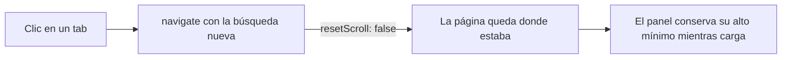

# Plan: cerrar sesión visible y tabs del perfil público

> Planeación original. Estado: **aprobado** el 2026-10-30. El scroll se arregla directo; lo visual se elige en un artifact y las opciones elegidas se anotan en la guía.

## Decisiones tomadas

| Tema | Decisión | Por qué |
|---|---|---|
| Scroll al cambiar de tab o filtro | `resetScroll: false` en los `navigate` que solo cambian la búsqueda dentro de la misma página (perfil público, ranking, mixes, partida, comparar) | El router tiene `scrollRestoration: true` y sube al inicio en cada navegación, aunque sea la misma página |
| Alto mínimo del panel | Alto común para el contenido de cada tab | Mientras carga, el panel se achica y el navegador recorta el scroll; además, vacío se ve "chiquito" |
| Cerrar sesión | Se proponen 3 opciones en el artifact. Recomendada: el pie del sidebar abre un menú de cuenta (perfil público, editar perfil, cuenta, tema, cerrar sesión) | Hoy solo está en Mi perfil → Cuenta |
| Mapas | Todo el catálogo activo; los jugados primero; los no jugados en cero; los retirados solo si se jugaron | Pedido de Esteban: ver todos los mapas |
| Partidas, Equipos, Temporadas, Bio y palmarés | Diseños nuevos en el artifact, cada uno con datos y sin datos | Regla de Esteban: lo visual primero en un artifact |
| Menú de tabs | Es viable; se proponen contadores, menú fijo al bajar y degradado en el borde en el teléfono | Funciona; las mejoras son opcionales |

## 1. El flujo

## 2. Arreglos sin cambio visual

- `routes/_app/player.$nick.tsx` y las otras rutas que filtran por la URL: `resetScroll: false`.
- e2e: bajar en el perfil, cambiar de tab y comprobar que el scroll se mantiene; lo mismo con un filtro del ranking.

## 3. Artifact de propuestas

Una sección por pedido, con los tokens reales en claro y oscuro:

1. Cerrar sesión (3 opciones), más "Cerrar sesión" en el buscador ⌘K.
2. Menú de tabs, el actual al lado del propuesto.
3. Mapas: catálogo completo, sin partidas atenuado y en cero.
4. Partidas: alto mínimo y estado vacío ilustrado (con filtros y sin filtros).
5. Equipos: línea de tiempo y estado vacío.
6. Temporadas: tarjetas por temporada con medalla, puesto, nivel, ELO y V–D.
7. Bio y palmarés: bio con la ficha al costado y vitrina de trofeos y medallas.

## 4. Implementación (después de elegir)

- `features/shell/AppSidebar.tsx` (o la topbar) y `shell/CommandMenu.tsx`: cerrar sesión, con `useLogout`.
- `features/player/tabs.tsx`: los tabs nuevos; la mezcla de mapas como función pura en `labels.ts`, con prueba.
- `components/illustrations/`: los estados vacíos.

## 5. Requisitos

API local y Supabase en Docker para las e2e.

## 6. Orden de implementación

1. Scroll y sus e2e.
2. Artifact y elección de Esteban.
3. Implementación de lo elegido, con unitarias y e2e.
4. `DOCUMENTACION.md`, `GUIA_IMPLEMENTACION.md` y la fila del `README.md`.
