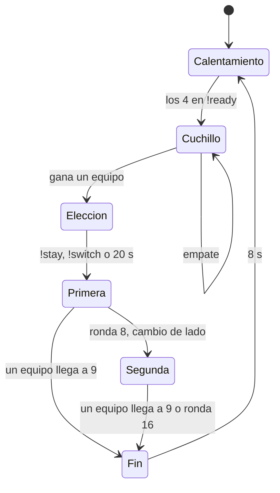

# Plugin 2v2 (Wingman): documentación

## Qué hace

`v34_wingman` es un modo 2v2 para CS:S v34 con las reglas de Wingman de CS2: un solo sitio, primero a 9 y máximo 16 rondas. Es un plugin separado de `csstv_reporter` y de `v34_retake`, sin licencia y sin envío a Supabase, con ranking propio en el servidor.

Está inactivo al cargar. Lo prende un admin con `sm_2v2 1` o desde `!admin`, o se prende solo con `sm_2v2_autostart 1`. No hay que tener prendido el 2v2 y el retake a la vez en un mismo servidor.

## Partida

| Regla | Valor | Cvar |
|---|---|---|
| Rondas para ganar | 9 | `sm_2v2_win_rounds` |
| Rondas por mitad | 8. Con 8-8 hay empate, sin prórroga | `sm_2v2_half_rounds` |
| Tiempo de ronda | 1:30 | `sm_2v2_round_time` |
| Bomba | 40 s | `sm_2v2_c4_time` |
| Freezetime | 10 s | `sm_2v2_freeze` |
| Tiempo de compra | 20 s, contando el freezetime | `sm_2v2_buy_time` |
| Plata inicial | $800, también al cambiar de lado | `sm_2v2_start_money` |
| Plata máxima | $8000 | `sm_2v2_max_money` |

**Calentamiento:** cada jugador elige equipo, máximo 2 por lado, con plata de sobra, reaparición y sin C4. El modelo se elige solo, sin abrir el menú. Con los 4 en `!ready` empieza el cuchillo. Un admin también puede empezar con `sm_2v2_start`, y cancelar con `sm_2v2_cancel`.

**Cuchillo:** solo cuchillo y sin compra. El equipo ganador elige con `!stay` o `!switch` en 20 s; si nadie elige, se queda.

**Durante la partida:** nadie cambia de equipo. El quinto jugador mira como espectador y puede entrar si falta alguien. Si falta un jugador por `sm_2v2_abandon_seconds` (2 minutos), la partida se cancela.

**Bonificación por derrota:** `sm_2v2_loss_bonus` suma un extra al equipo que viene perdiendo, según las derrotas seguidas. Está apagada (`"0 0 0 0"`). Ejemplo: `"0 300 600 800"`.

## Compra

Los spawns propios suelen quedar fuera de la zona de compra del mapa. Durante el tiempo de compra, el plugin marca `m_bInBuyZone` en `SDKHook_PostThinkPost`, justo después de que el juego lo recalcula. Por eso el plugin requiere SDK Hooks.

## Pausas

Las mismas reglas que los mixes (`csstv/qol.inc`). Alargan el freezetime con `m_fRoundStartTime`, y si se piden fuera del freezetime empiezan en la próxima ronda.

| Comando | Qué hace |
|---|---|
| `!pause` | Pausa del equipo: 2 por partida (`sm_2v2_pause_max`), 60 s (`sm_2v2_pause_time`) |
| `!unpause` | Termina la pausa cuando escriben los dos equipos, o cancela la pedida |
| `!forcepause` | Pausa de admin, sin tiempo |
| `!forceunpause` | Termina la pausa |

`sm_2v2_pause_mode`: 0 desactivadas, 1 con tiempo, 2 hasta `!unpause`, 3 con tiempo o `!unpause`. Con el modo apagado, esos comandos los sigue atendiendo el reporter.

## Mapa

Cada mapa tiene `configs/2v2/<mapa>.cfg`. Hacen falta el sitio y 2 spawns por equipo; si no, el modo no se prende. Las zonas son opcionales.

| Comando | Qué hace |
|---|---|
| `sm_2v2_site` | Marca el sitio que se juega. Hay que estar parado dentro de él |
| `sm_2v2_spawn <t\|ct>` | Guarda un spawn donde estás parado, mirando hacia donde mirás. Máximo 2 por equipo |
| `sm_2v2_delspawn` | Borra el spawn más cercano |
| `sm_2v2_zone1` | Marca la primera esquina de una zona prohibida |
| `sm_2v2_zone2` | Marca la esquina opuesta y guarda la zona |
| `sm_2v2_delzone` | Borra la zona en la que estás parado |
| `sm_2v2_show` | Muestra las cantidades y dibuja todo durante 30 s |

**Sitio:** el otro `func_bomb_target` se desactiva en cada ronda, y además el plugin no deja apretar el ataque con la C4 dentro de él.

**Zonas prohibidas:** son cajas que funcionan como paredes, también en el calentamiento. Quien toca una vuelve a su última posición válida, sin velocidad. Tienen en cuenta el ancho del jugador, así que una línea fina también frena. Se dibujan siempre con el modo prendido (`sm_2v2_zone_show`). Las balas y las granadas pasan, y para editarlas hay que apagar el modo.

## Cámara y voz

- **Cámara:** al morir en plena partida solo se mira al propio equipo (`mp_forcecamera 1`), y el plugin fuerza la primera persona (`m_iObserverMode 4`).
- **Voz:** con la partida en curso cada uno escucha a su equipo, vivo o muerto, y los espectadores solo a otros espectadores (`SetListenOverride`). En el calentamiento, como siempre.

## Ranking y avisos

Igual que el retake, en `data/sqlite/v34_wingman.sq3`: `!rank`, `!top`, puntos según la diferencia con el rival. Solo cuentan los duelos entre jugadores reales durante la partida (no el calentamiento ni el cuchillo). Mismos colores de chat, cuadro de aviso con ronda y marcador, y resumen de daño de `CMLeague`.

## `!admin`

Categoría **2v2**: prender o apagar, empezar, cancelar, pausa de admin, quitar pausa y ver sitio, spawns y zonas. Las opciones que no aplican se ven deshabilitadas.

## Dónde está cada cosa

| Qué | Archivo |
|---|---|
| Modo, partida, equipos, compra, zonas | `server/addons/sourcemod/scripting/v34_wingman.sp` |
| Sitio, spawns y zonas | `scripting/wingman/map.inc` |
| Pausas | `scripting/wingman/pause.inc` |
| Menú de admin | `scripting/wingman/menu.inc` |
| Ranking (copia adaptada de `retake/rank.inc`) | `scripting/wingman/rank.inc` |
| Colores del chat (compartido) | `scripting/retake/chat.inc` |
| Build de depuración | Compilar con `WINGMAN_DEBUG=`: agrega `WM_DBG` al log y comandos `wm_debug_*` |
