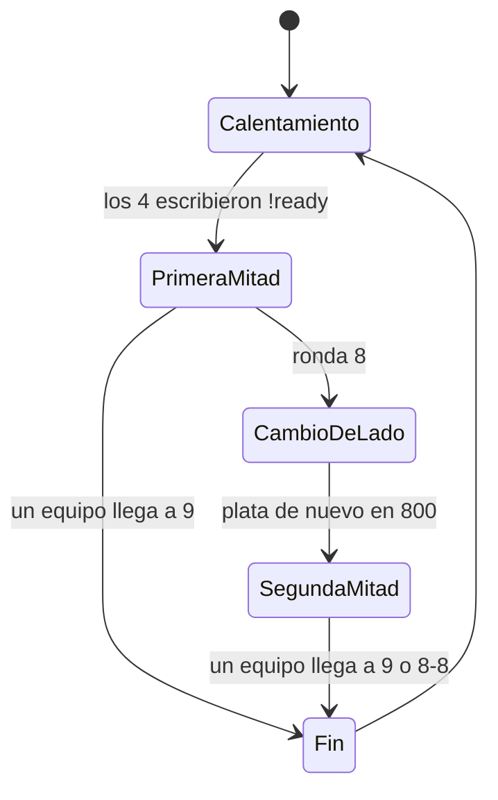

# Plan: plugin 2v2 (Wingman)

> Planeación original, aprobada por Kyan el 2026-10-30.

## Decisiones tomadas

| Tema | Decisión | Por qué |
|---|---|---|
| Plugin | `v34_wingman.sp`, separado de `csstv_reporter` y de `v34_retake` | Igual que el retake: un error no afecta a los mixes |
| Reglas | Las de Wingman de CS2 (sección 2), con valores en cvars | Lo pidió Kyan. Valve no las publica: salen de guías que leen los archivos del juego |
| Empate | 8-8 termina en empate, sin prórroga | Es lo que describen las guías de Wingman. Hay fuentes que se contradicen: revisar |
| Un solo sitio | Por mapa se elige qué sitio se juega; el otro se desactiva | Los mapas de CS:S tienen dos sitios y los de CS2 no |
| Licencia y Supabase | Sin licencia y sin envío, como el retake, con ranking local (`!rank`, `!top`) | Lo decidió Kyan |
| Límite del mapa | Zonas prohibidas: cajas definidas con dos comandos, parado en cada esquina opuesta | Lo decidió Kyan |
| Spawns | Exactamente 2 por equipo, cargados en el juego | Lo pidió Kyan |
| Mapas | `de_dust2_ob`: sitio A y medio/baranda. `de_inferno`: sitio A. Los demás, después | Lo pidió Kyan |
| Chat | Los mismos colores que el retake | Lo pidió Kyan |
| Bonificación por derrota | `sm_2v2_loss_bonus`, apagada al empezar (`"0 0 0 0"`) | Se activa si las partidas muestran que hace falta |
| Despliegue | Ninguno: solo `cssds` hasta cargar los spawns reales y probar con gente | Lo decidió Kyan |
| Activación | `sm_2v2 1` o `sm_2v2_autostart 1`, por defecto 0 | Mismo criterio que el retake |
| Pruebas | Obligatorias en `C:\Users\Agus\Downloads\cssds`. Lo que no se pueda con bots lo prueba un admin | Regla de Kyan |

## 1. El flujo completo

## 2. Reglas

| Regla | Valor |
|---|---|
| Jugadores | 2 contra 2 |
| Rondas | Máximo 16, gana el primero en llegar a 9 |
| Cambio de lado | Después de la ronda 8 |
| Empate | 8-8, sin prórroga |
| Tiempo de ronda | 1:30 |
| Bomba | 40 s |
| Freezetime | 10 s |
| Plata inicial | $800 |
| Plata máxima | $8000 |
| Sitios | Uno, según el mapa |

Fuentes: [gamertagmythras](https://gamertagmythras.com/blog/counter-strike-2/cs2-wingman-mode-explained), [csdb.gg: qué es Wingman](https://csdb.gg/guides/what-is-wingman-cs2/), [csdb.gg: rangos](https://csdb.gg/blog/guides/cs2-wingman-ranks), [playnews.gg](https://www.playnews.gg/en/guides/counter-strike-2-the-guide-to-the-three-wingman-maps-in-2026-poseidon-debris-and-el-dorado-and-the-2v2-format-valve-doesn-t-document).

**Lo que CS:S v34 no trae y hace el plugin:**
- La plata máxima de $8000: se recorta cada vez que cambia, porque el juego llega hasta $16000.
- El marcador, el cambio de lado y el fin de partida.
- El bloqueo de compra de lo que no exista en CS:S no aplica: se usa la tienda de v34 tal cual.

## 3. Un solo sitio

1. El mapa tiene un cfg en `configs/2v2/<mapa>.cfg` con el sitio que se juega.
2. El otro `func_bomb_target` se desactiva con la entrada `Disable`. **Hay que comprobarlo en v34**: si no funciona, se bloquea plantar ahí desde `OnPlayerRunCmd`, como se hizo con el plantado del retake.
3. Los T y los CT aparecen en spawns propios cerca del sitio, cargados en el juego igual que en el retake (`sm_2v2_spawn <t|ct>`), sin repetir punto.

## 4. Limitar el mapa

Los mapas de Wingman de CS2 están cerrados con paredes. En CS:S hay que hacer algo equivalente, porque si no los jugadores pueden irse a la otra punta del mapa.

| Opción | Cómo | A favor | En contra |
|---|---|---|---|
| A (propuesta) | Zonas prohibidas por mapa, marcadas en el juego: quien entra recibe un aviso y, si sigue, daño | No hay que tocar el mapa y se puede ajustar sin reiniciar | Se puede disparar a través de la zona; no hay una pared visible |
| B | Paredes reales con Stripper:Source | Se ven y bloquean | Hay que hacerlas a mano por mapa y necesita Stripper instalado en el server, y reinicio para cada ajuste |
| C | Sin límite | Nada que cargar | No se parece a Wingman |

## 5. Partida

- **Calentamiento:** los 4 eligen equipo y escriben `!ready`. Armas gratis y reaparición, como en un warmup.
- **Inicio:** reinicio de la partida, plata en 800 y marcador en 0.
- **Cambio de lado:** tras la ronda 8 se cambian los equipos de lado y la plata vuelve a 800.
- **Fin:** al llegar a 9, o en 8-8. Se anuncia el resultado y vuelve al calentamiento.
- **Equipos trabados:** nadie cambia de equipo durante la partida, y los que sobran quedan de espectadores.
- **Si se va alguien:** se espera 2 minutos para que vuelva o entre un reemplazo; si no, la partida se cancela.

## 6. Avisos

Se reusa lo del retake: colores de chat y cuadro de aviso con marcador y ronda. El resumen de daño de `CMLeague` al terminar la ronda se mantiene.

## 7. Pruebas

**Con bots:** carga, rondas, 9 a X, 8-8, cambio de lado, plata inicial y máxima, otro sitio desactivado, rechazo con un mix en curso.

**Con un admin:** `!ready`, equipos trabados, zonas prohibidas, abandono y reemplazo, y la sensación general.

## 8. Requisitos antes de empezar

Aprobado por Kyan el 2026-10-30, con la opción A de la sección 4. Falta definir en qué servidor corre. Los spawns y las zonas reales los carga un admin: mientras tanto se prueba con puntos de prueba.

## 9. Orden de implementación

1. Prueba corta en `cssds`: desactivar un `func_bomb_target` y recortar la plata máxima.
2. Partida: `!ready`, rondas, marcador, cambio de lado y fin.
3. Spawns y sitio por mapa.
4. Límite del mapa.
5. Avisos y resumen.
6. Pruebas con bots y lista para el admin.
7. Documentación, guía y changelog.
8. Despliegue, solo con pruebas aprobadas y permiso explícito.
