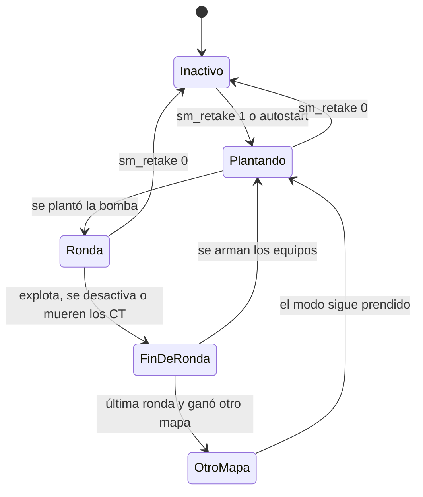

# Plugin de retake: documentación

## Qué hace

`v34_retake` es un modo de juego para CS:S v34. Cada ronda arranca con la bomba plantada en un sitio: los T la defienden desde adentro y los CT entran a desactivarla.

Es un plugin separado de `csstv_reporter`: no lleva licencia y no envía nada a Supabase. Está inactivo al cargar: lo prende un admin con `sm_retake 1`, o se prende solo en cada mapa con `sm_retake_autostart 1`, pensado para un servidor que es solo de retake.

## La bomba

v34 no permite crear `planted_c4` desde un plugin: la entidad queda sin temporizador y nunca explota. Por eso la bomba se planta de verdad:

1. Se elige el sitio al azar, sin repetir más de `sm_retake_site_streak` veces seguidas, y un punto de bomba al azar de ese sitio.
2. Un T al azar aparece en ese punto con la C4. Los demás quedan congelados.
3. El plugin le aprieta el ataque durante unos 3 segundos. No puede moverse, cambiar de arma ni soltar la C4.
4. Con `bomb_planted` se libera a todos.

Si a los 6 segundos no se plantó, la ronda termina en empate y queda un error en el log.

## Desactivación al instante

Si no quedan T vivos y un CT está desactivando, se calcula cuánto le queda a la bomba y cuánto tardaría: 5 s con kit y 10 s sin kit.

- **Si llega:** el plugin saca la bomba, cierra la barra de progreso, dispara `bomb_defused` y termina la ronda como desactivada.
- **Si no llega:** avisa en el chat y la bomba explota.

Se apaga con `sm_retake_instant_defuse 0`.

En v34 `m_flC4Blow` no cambia, `m_flDefuseCountDown` no afecta al juego y `m_hBombDefuser` no existe. Por eso el tiempo se calcula desde `bomb_planted` y quien desactiva se busca con `m_bIsDefusing` en los jugadores.

## Rondas y equipamiento

| | Pistola (rondas 1 a 5) | Full buy (desde la 6) |
|---|---|---|
| Armas | Solo pistola | Primaria y pistola |
| Chaleco | Sin casco | Con casco |
| Granadas | Ninguna | 1 flash y 1 smoke |
| Kit de cada CT | 50 % | 85 % |
| AWP | No | Ver abajo |

La plata queda en 0 durante el modo y la compra está bloqueada.

**`!guns`** se abre solo la primera vez y guarda la elección con `clientprefs`. Se aplica desde la ronda siguiente.

| Opción | T | CT |
|---|---|---|
| Primaria | AK-47, Galil, SG 552 | M4A1, FAMAS, AUG |
| Pistola | Glock, Deagle, P228, Dual Elites | USP, Deagle, P228, Five-SeveN |

**AWP**, por equipo y por ronda de full buy, entre quienes pusieron "Quiero AWP: Sí":

| Anotados | Resultado |
|---|---|
| Ninguno | Sin AWP |
| 1 | La recibe con `sm_retake_awp_solo_chance` % (30) |
| 2 o más | Se sortea y uno la recibe seguro |

## Equipos

Se juega con 40 % de T y un máximo de 5 por equipo. El tope manda sobre el porcentaje: con 10 jugadores son 5 y 5.

| Quién ganó | Qué pasa |
|---|---|
| T | Quedan iguales |
| T, por encima de `sm_retake_t_streak` victorias seguidas | Se mezclan todos al azar. Siempre cambia alguien |
| CT | Los CT con más daño pasan a T y los T pasan a CT, con un aviso en el chat |

- **Cola:** con más de 10 jugadores, los que sobran esperan como espectadores en orden de llegada, hasta que se libere un lugar.
- **VIP:** entra al terminar la ronda y saca a un no VIP al azar, que queda primero en la cola. Un VIP no saca a otro VIP.
- **Cómo se reconoce a un VIP:** por el override `retake_vip`, que por defecto es el flag `o` de SourceMod. El flag `z` también cuenta.
- **AFK:** quien no se mueve en `sm_retake_afk_rounds` rondas seguidas pasa a espectador.
- **Sin menú de modelos:** durante el modo se bloquea el mensaje `VGUIMenu` de los paneles `class_*` y el plugin elige el modelo.

`joinclass` hace caer el servidor si se usa en un bot, con cualquier modelo. Solo se le manda a jugadores reales.

## Spawns

Se cargan en el juego y se guardan al instante en `configs/retake/<mapa>.cfg`.

| Comando | Qué hace |
|---|---|
| `sm_retake_bomb <a\|b>` | Agrega un punto de bomba. Tiene que estar dentro de `func_bomb_target` |
| `sm_retake_spawn <a\|b> <t\|ct>` | Agrega un spawn donde estás parado, mirando hacia donde mirás |
| `sm_retake_delspawn` | Borra el punto más cercano, a menos de 128 unidades |
| `sm_retake_spawns` | Muestra las cantidades y dibuja los puntos durante 30 s |

Un punto a menos de 64 unidades de otro del mismo sitio se rechaza. Cada punto se entrega a un solo jugador: si faltan, el que sobra mira esa ronda y tiene prioridad en la siguiente.

## Ranking

Se guarda en `data/sqlite/v34_retake.sq3`, en cada servidor, por SteamID. Los rankings de distintos servidores no se comparten. En LAN, donde no hay SteamID, se usa la IP.

| Acción | Puntos |
|---|---|
| Inicio | 1000 |
| Baja | +6 × relación |
| Tiro a la cabeza | +2 |
| Muerte | −3 × relación |
| Bomba desactivada | +8 |

La relación es `puntos de la víctima / puntos del que mata`, limitada entre 0,5 y 2. Matar a alguien mejor da más y a él le quita más. El mínimo es 0. Solo cuentan los duelos entre jugadores reales con el modo prendido.

`!rank` abre un panel con tu puesto y tus estadísticas, y avisa en el chat. `!top` abre el ranking con páginas de 7 jugadores.

## Fin de la partida

La partida dura 30 rondas. En la ronda 25 se abre la votación de mapa, con la misma lista que el reporter: la sección `csstv` de `maplists.cfg` o, si no existe, el `mapcycle`. Solo entran los mapas con spawns cargados.

Al terminar la ronda 30 se cambia al mapa ganador y el modo sigue prendido. Sin otro mapa, empieza una partida nueva en el mismo. Durante el modo `mp_timelimit` queda en 0.

## Convivencia con `csstv_reporter`

No depende de él. El estado del mix se lee de la salida de `sm_csstv_status`, desde un timer: dentro de otro comando `ServerCommandEx` devuelve vacío. Si no se puede leer el estado, se asume que hay un mix y el modo no se prende.

Durante el modo se bloquean `sm_ready`, `sm_live`, `sm_rtv` y `sm_nominate`. `rtv` escrito en el chat lo atiende el reporter directamente y no se bloquea.

## Avisos

- **Chat:** `[Retake]` en verde y el texto en blanco. Sin ClientMod solo se ve el verde y el color normal.
- **Cuadro de aviso:** sitio, tipo, ronda y armas del jugador. Este cuadro no admite colores: muestra los códigos como texto.
- **Arriba de la mira:** `>>> SITIO A <<<` en naranja o `>>> SITIO B <<<` en azul.
- **Resumen de daño:** al terminar la ronda, `Dado: 116 (5) | Recibido: 0 (0) - nombre [MUERTO]`.
- **Oculto:** los avisos de "se une a la fuerza…" durante el modo.

## Cvars

Se crean en `cfg/sourcemod/v34_retake.cfg`.

| Cvar | Por defecto | Qué hace |
|---|---|---|
| `sm_retake_autostart` | 0 | Prender el modo solo en cada mapa |
| `sm_retake_site_streak` | 2 | Veces seguidas que puede salir un sitio |
| `sm_retake_instant_defuse` | 1 | Desactivación al instante |
| `sm_retake_awp_solo_chance` | 30 | % de AWP con un solo anotado |
| `sm_retake_c4_time` | 40 | Segundos de la bomba |
| `sm_retake_t_ratio` | 0.4 | Parte de los jugadores que juega de T |
| `sm_retake_min_players` | 2 | Jugadores mínimos |
| `sm_retake_max_per_team` | 5 | Máximo por equipo |
| `sm_retake_kit_pistol` | 50 | % de kit en pistola |
| `sm_retake_kit_fullbuy` | 85 | % de kit en full buy |
| `sm_retake_pistol_rounds` | 5 | Rondas de pistola |
| `sm_retake_t_streak` | 3 | Victorias seguidas de T que se toleran antes de mezclar |
| `sm_retake_max_rounds` | 30 | Rondas de la partida |
| `sm_retake_vote_round` | 25 | Ronda de la votación |
| `sm_retake_afk_rounds` | 2 | Rondas sin moverse para pasar a espectador |
| `sm_retake_rank_kill` | 6 | Puntos base por baja |
| `sm_retake_rank_headshot` | 2 | Puntos por tiro a la cabeza |
| `sm_retake_rank_death` | 3 | Puntos base por muerte |
| `sm_retake_rank_defuse` | 8 | Puntos por desactivar |

## Dónde está cada cosa

| Qué | Archivo / ubicación |
|---|---|
| Modo, rondas, equipos, cola, C4, avisos | `server/addons/sourcemod/scripting/v34_retake.sp` |
| Spawns | `scripting/retake/spawns.inc` |
| `!guns` y lista de armas | `scripting/retake/guns.inc` |
| Votación de mapa | `scripting/retake/vote.inc` |
| Ranking | `scripting/retake/rank.inc` |
| Colores del chat | `scripting/retake/chat.inc` |
| Spawns de `de_dust2_ob` | `server/addons/sourcemod/configs/retake/de_dust2_ob.cfg` |
| Build de depuración | Compilar con `RETAKE_DEBUG=`: agrega `RETAKE_DBG` al log y comandos `retake_debug_*` |
