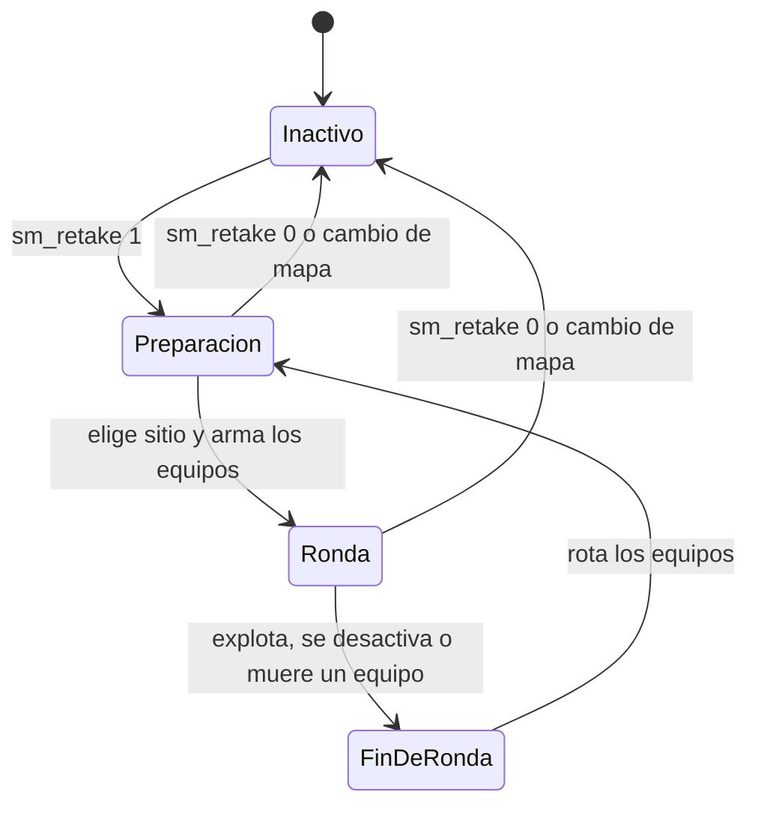

# Plan: plugin de retake

> Planeación original, aprobada por Kyan el 2026-10-30. Lo que cambió después está en la guía de implementación.

## Decisiones tomadas

| Tema | Decisión | Por qué |
|---|---|---|
| Repositorio | Este repo, en `server/addons/sourcemod/scripting/` | Mismo despliegue, misma bitácora y mismas convenciones |
| Plugin | `v34_retake.sp`, separado de `csstv_reporter` | Un error o una recarga del retake no afectan a los mixes |
| Alcance | Solo modo de juego: no envía nada a Supabase | Lo decidió Kyan |
| Licencia | Sin licencia: el mismo `.smx` para todos los servidores | Lo decidió Kyan. Es una excepción a la regla de RBK, que sigue valiendo para `csstv_reporter` |
| Activación | Inactivo al cargar. Un admin lo prende con `sm_retake 1` y se apaga solo al cambiar de mapa | Los servidores reales se usan para mixes |
| Mixes | `sm_retake 1` se rechaza si hay un mix en curso | Prender el modo cancelaría la partida. Cómo detectarlo se define en la sección 6 |
| Pruebas | Obligatorias en `C:\Users\Agus\Downloads\cssds` antes de producción | Regla de Kyan del 2026-10-30 |
| Posiciones | Se configuran en el juego con un comando que las guarda en el cfg al instante | Lo pidió Kyan. Reemplaza al generador desde `.bsp` y `.nav` |
| Spawns | Dos jugadores nunca aparecen en el mismo punto | Lo pidió Kyan |
| Tipos de ronda | Las primeras 5 son de pistola y las demás de full buy | Lo pidió Kyan |
| AWP | Máximo 1 por equipo, al azar entre quienes se anotaron | Lo pidió Kyan |

## 1. El flujo completo

Cada ronda arranca con la bomba plantada en un sitio al azar (A o B). Los T la defienden desde adentro del sitio y los CT entran desde afuera para desactivarla.

## 2. Reglas de la ronda

Todos los valores son cvars con estos valores iniciales.

| Regla | Valor inicial | Cvar |
|---|---|---|
| Tiempo de la bomba | 40 s | `sm_retake_c4_time` |
| Freezetime | 3 s | `sm_retake_freeze` |
| Proporción de T | 40 % de los jugadores, al menos 1 | `sm_retake_t_ratio` |
| Jugadores mínimos | 2 | `sm_retake_min_players` |
| Probabilidad de kit en pistola | 50 % | `sm_retake_kit_pistol` |
| Probabilidad de kit en full buy | 85 % | `sm_retake_kit_fullbuy` |
| Rondas de pistola | 5 | `sm_retake_pistol_rounds` |
| Victorias seguidas de T que se toleran antes de mezclar | 3 | `sm_retake_t_streak` |

**Tipos de ronda:** la cuenta empieza en 1 al prender el modo y al cambiar de mapa.

| | Pistola (rondas 1 a 5) | Full buy (ronda 6 en adelante) |
|---|---|---|
| Armas | Solo pistola | Primaria y pistola |
| Chaleco | Sin casco | Con casco |
| Granadas | Ninguna | 1 flash y 1 smoke por jugador |
| Kit de cada CT | 50 % | 85 % |
| AWP | No | Máximo 1 por equipo |

El kit se sortea aparte para cada CT, en cada ronda.

**Rotación de equipos:**
- Si ganan los T, quedan iguales, salvo que lleven más de 3 rondas seguidas ganadas: al ganar la cuarta se mezclan todos los jugadores al azar, con la misma proporción de T, y la racha vuelve a 0.
- Una victoria de los CT también pone la racha en 0.
- Si ganan los CT, los mejores CT de la ronda (por daño) pasan a T y los T pasan a CT.
- Los equipos se arman antes de reaparecer, para que el juego no los mate al cambiarlos.
- Los jugadores no pueden elegir equipo mientras el modo está prendido.

## 3. Armas

`!guns` abre un menú solo con las armas comunes de retake, no con todas. La elección se guarda con `clientprefs` y se aplica desde la ronda siguiente.

| Opción | T | CT |
|---|---|---|
| Primaria (full buy) | AK-47, Galil, SG 552 | M4A1, FAMAS, AUG |
| Pistola | Glock, Deagle, P228, Dual Elites | USP, Deagle, P228, Five-SeveN |
| Sin elección | AK-47 y Glock | M4A1 y USP |

**AWP:**
- El menú tiene la opción "Quiero AWP: Sí/No", que empieza en No.
- En cada ronda de full buy se sortea 1 AWP por equipo entre quienes pusieron Sí. Si nadie se anotó, ese equipo juega sin AWP.
- Quien la gana la recibe en lugar de su primaria y conserva su pistola.

Los nombres son los de v34: por ejemplo `weapon_usp`, no `weapon_usp_silencer`. La tienda queda desactivada durante el modo y la plata en 0.

El menú se abre solo la primera vez que un jugador entra con el modo prendido. Al iniciar cada ronda se le saca todo a cada jugador antes de darle lo suyo y se limpian las armas del piso. Una AWP levantada del piso durante la ronda está permitida: el máximo de 1 se aplica a lo que se reparte.

**Durante el modo:**
- Cada ronda se avisa en el chat y en pantalla con sitio, tipo y número (por ejemplo "Sitio B, full buy, ronda 7").
- Quien entra a mitad de ronda espera como espectador y juega desde la siguiente, en el equipo que necesite gente.
- Si alguien se va, se rebalancea al iniciar la ronda siguiente con la misma proporción de T.
- Quien no se mueve durante 2 rondas seguidas pasa a espectador.

**Fin de la partida y votación de mapa:**
- La partida dura 30 rondas como máximo (`sm_retake_max_rounds`).
- Al llegar a la ronda 25 (`sm_retake_vote_round`) se abre una votación entre los mapas de la lista de mapas del servidor.
- Al terminar la ronda 30 se cambia al mapa ganador. Los mapas sin puntos cargados no entran en la votación.
- No hay votación de sitio: sigue siendo al azar.

## 4. Posiciones por mapa

Se guardan en `configs/retake/<mapa>.cfg` (KeyValues): por cada sitio, el punto de la bomba y los puntos de T y de CT, con posición y hacia dónde mira el jugador.

**No se usan los archivos de `configs/retake/spawns/` que hay en `cssds`.** Tienen solo 2 puntos por lado y por sitio, y sus coordenadas (números redondos) no parecen salir del mapa, así que no se pueden dar por buenas. Tampoco se borran: no son parte de este trabajo.

**Comandos para admins, en el juego.** Cada cambio se escribe en el cfg al instante:

| Comando | Qué hace |
|---|---|
| `sm_retake_spawn <a\|b> <t\|ct>` | Guarda un spawn donde estás parado, mirando hacia donde mirás |
| `sm_retake_bomb <a\|b>` | Guarda el punto de la bomba del sitio |
| `sm_retake_delspawn` | Borra el punto más cercano a vos |
| `sm_retake_spawns` | Muestra los puntos del mapa en el juego y cuántos hay por sitio y lado |

**Un jugador por spawn:**
- En cada ronda los puntos del sitio se mezclan y cada uno se entrega a un solo jugador.
- Si un equipo tiene más jugadores que puntos, el que queda sin punto mira esa ronda como espectador, tiene prioridad en la siguiente y se avisa a los admins. Nunca se comparte un punto.
- Un punto nuevo a menos de 64 unidades de otro se rechaza, para que dos jugadores no aparezcan trabados.

`sm_retake 1` se rechaza con un mensaje si el mapa no tiene los dos sitios con su bomba y al menos un punto de T y uno de CT.

**Mapas:** cualquiera con los puntos cargados. Para la primera versión, `de_dust2` y `de_inferno`. Los cfg cargados en `cssds` se copian al repo (`server/addons/sourcemod/configs/retake/`). Al desplegar se suben solo si el servidor no tiene ese archivo, para no pisar lo que un admin haya configurado allá.

## 5. Bomba plantada

Es el mayor riesgo técnico. No se comprobó todavía si v34 permite crear la bomba plantada desde un plugin, así que el paso 1 de la implementación es una prueba corta para decidirlo:

| Opción | Cómo | Si no funciona |
|---|---|---|
| A (preferida) | Crear `planted_c4` en el punto del sitio y dejar que el juego cuente, explote y permita desactivar | Pasar a B |
| B | Un T aparece en el sitio con la C4 y tiene que plantarla en los primeros segundos | Es lo que hacen otros plugins de retake; la ronda arranca algo más lenta |

## 6. Convivencia con `csstv_reporter`

Sin tocar el reporter si es posible:

- Detectar un mix en curso. Primero se revisa qué expone hoy el reporter. Si no alcanza, se le agrega un native o un cvar público, y eso obliga a desplegar también su build licenciado a RBK.
- Comprobar en `cssds` qué hacen con el modo prendido `!ready`, el medio tiempo, los equipos bloqueados y los mensajes de `qol.inc`.
- `csstv_reporter` queda en `plugins/disabled/` durante las pruebas que no lo necesiten, porque en `cssds` tiene `csstv_send "1"`. Para probar la convivencia, se pone `csstv_send 0` y se revisa `data/csstv/queue/` antes de arrancar.

## 7. Pruebas

Todo en `cssds`, y nada va a producción sin esto.

Los comandos de posiciones necesitan a alguien parado en el mapa. Para las pruebas con bots, una build de depuración (como la de `csstv_reporter`) guarda puntos usando la posición de un bot, en cfg de prueba que no se commitean ni se despliegan.

**Con bots (las hago yo):**
- Carga sin errores, modo prendido y apagado, cambio de mapa.
- 20 rondas seguidas en `de_dust2` y `de_inferno`: sitio al azar, explosión, desactivación, muerte de un equipo, rotación.
- Equipos con 2, 5 y 10 jugadores. Rechazo de `sm_retake 1` con un mix en curso.
- Ningún punto repetido en una ronda, y espectador con prioridad cuando faltan puntos.
- Rondas 1 a 5 de pistola y full buy desde la 6, con la cuenta reiniciada al prender el modo.
- Máximo 1 AWP por equipo, solo entre anotados y nunca en ronda de pistola.
- Proporción de kits cercana a 50 % y 85 %, medida sobre muchas rondas.
- Mezcla de equipos al ganar los T la cuarta ronda seguida, y racha en 0 después de la mezcla o de una victoria de los CT.

**Con un admin (no se pueden con bots):**
- Cargar los puntos reales de `de_dust2` y `de_inferno` y comprobar que nadie queda atascado.
- Comandos de posiciones y que los puntos sigan después de cambiar de mapa.
- Menú `!guns`, opción de AWP y que la elección quede guardada al reconectar.
- Desactivar con y sin kit, y la sensación general de la ronda.

## 8. Requisitos antes de empezar

- Aprobación de este plan.
- Un admin disponible para las pruebas de la sección 7.

## 9. Orden de implementación

1. Prueba de la bomba plantada en `cssds` (sección 5).
2. Comandos de posiciones y lectura del cfg.
3. Plugin: modo, reparto de spawns, equipos y tipos de ronda.
4. Menú `!guns` y sorteo de AWP.
5. Convivencia con `csstv_reporter`.
6. Pruebas con bots, lista de pruebas para el admin y carga de los puntos reales.
7. Documentación, guía y changelog.
8. Despliegue, solo con pruebas aprobadas y permiso explícito: servidor real y RBK en la misma tanda, con el mismo `.smx`. La guía y `docs/PENDIENTES.md` nombran cada servidor.
