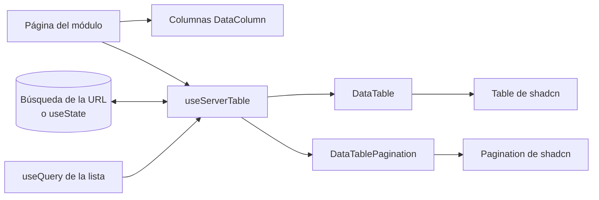
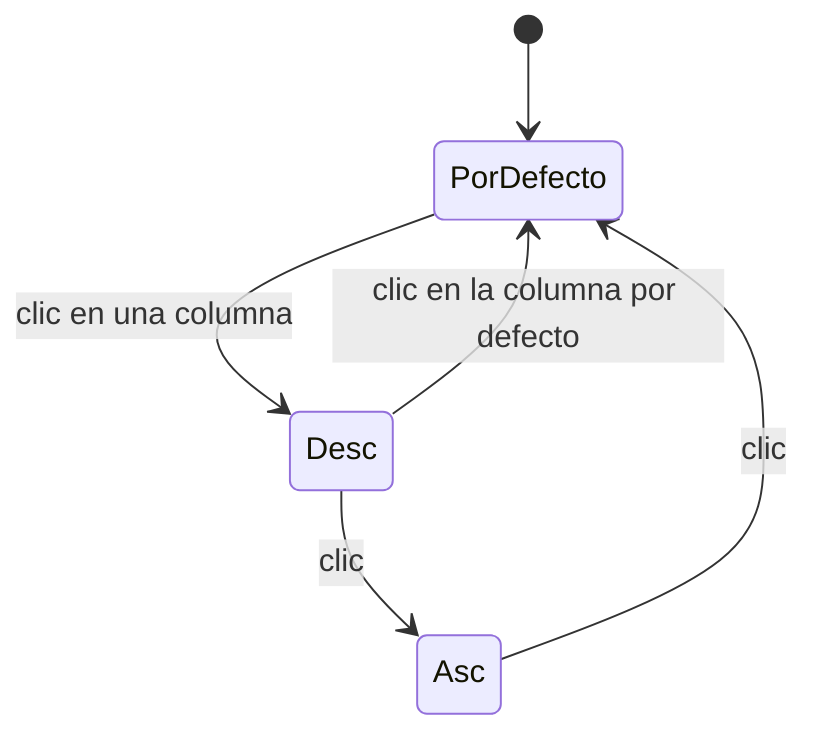

# shadcn, tablas con TanStack Table y carpetas por módulo: documentación

## Qué hace

Es un refactor del frontend (`web/frontend/src`) sin cambios visuales ni de comportamiento para el usuario. Hizo tres cosas:

1. **Ordenó cada módulo** de `src/features/` en las mismas carpetas: `api/`, `types/`, `components/`, `pages/` y `lib/`.
2. **Reemplazó lo hecho a mano por shadcn** (tarjetas, chips, filtros, pestañas, vacíos, barras, campos y diálogos de confirmación) y juntó lo que estaba repetido entre módulos en `src/components/brand/`.
3. **Pasó las 12 listas grandes a TanStack Table** con un módulo común, `src/components/data-table/`, que dibuja la tabla, la carga, el error, el vacío, el orden y la paginación.

## Carpetas de un módulo

| Carpeta | Qué va |
|---|---|
| `api/` | `queries.ts`: queryOptions, claves de caché y mutaciones |
| `types/` | `index.ts`: alias de `Schemas[...]` y tipos propios |
| `components/` | Piezas que usan las páginas (con subcarpetas si un grupo crece, como `player/components/tabs/`) |
| `pages/` | Lo que renderiza una ruta |
| `lib/` | Helpers puros, esquemas de la URL y hooks que no son componentes |

Reglas: las pruebas van al lado de su archivo; adentro del módulo los imports son relativos y entre módulos usan `@/`; `lib/` no importa de `api/`. Lo que usan varios módulos va en `src/components/brand/`. La convención quedó anotada en `web/frontend/CLAUDE.md`.

## Componentes de shadcn y ajustes

Las copias de `components/ui/` se ajustaron para que el aspecto quede igual que antes:

| Componente | Ajuste |
|---|---|
| `Badge` | Variantes de tono (`win`, `live`, `soft`, `muted`, `primary`, `danger`, `warn`, `vip`, `gold`…), forma (`pill`, `soft`, `tag`) y tamaño (`xs`, `sm`, `md`) |
| `Toggle` / `ToggleGroup` | Variantes `pill` (filtros) y `segment` (control segmentado) |
| `Card` | Variante `outline` (borde y sin relleno), prop `radius` (`xl`, `tile`, `hero`) y `asChild` |
| `Progress` | Prop `indicatorClassName` |
| `Field` | Escala del proyecto: separación de 6 px, etiqueta de 13 px, ayuda y error de 12 px |

El `cn` del proyecto no fusiona los radios propios (`rounded-tile`, `rounded-hero`) con los de Tailwind; por eso `Card` los recibe como variante y no por `className`.

Componentes comunes en `components/brand/`:

| Componente | Reemplaza |
|---|---|
| `FilterChips`, `Segmented` | Los grupos de botones con `aria-pressed` (ahora `role="radio"`) |
| `EmptyState` | Los vacíos hechos a mano (sobre `Empty`) |
| `StatTile` | Los 3 tiles de KPI repetidos (Partidas, perfil, vista previa de temporada) |
| `QueryState`, `QueryErrorMessage`, `RetryButton` | `Loaded`, `ListState` y los bloques de "Reintentar" copiados |
| `ConfirmDialog` | Los dos `ConfirmDialog` (admin y roster) y el de cerrar sesión, sobre `AlertDialog` |
| `PlayerAvatar`, `initialOf` | El `PlayerAvatar` del ranking, el `Initial` de equipos y las iniciales calculadas en 8 lugares |
| `KindBadge`, `KIND_LABEL` | Las 3 copias del tipo de partida |
| `TeamCrest`, `Soon`, `ErrorAlert`, `AuthField` | Piezas de `teams` y `auth` que importaban otros módulos |

## Tablas (`components/data-table/`)

| Archivo | Qué hace |
|---|---|
| `useServerTable.ts` | Arma la tabla con `rowPaginationFeature` y `rowSortingFeature`, en modo manual: la API ya devuelve la página ordenada. La página y el orden viven afuera (URL o `useState`) |
| `url.ts` | `urlPaging` y `urlSorting`: conectan la búsqueda de la URL, dejan fuera los valores por defecto y vuelven a la página 1 al cambiar el tamaño o el orden |
| `DataTable.tsx` | Cabecera con clase única (`HEAD_CELL`), filas de carga según la cantidad de columnas, error con "Reintentar", vacío, fila clicable (`rowLink`, con Enter) y fila elegida (`selection` + `SelectButton`) |
| `SortHeader.tsx` | Cabecera que ordena |
| `DataTablePagination.tsx` | Pie sobre la `Pagination` de shadcn: modo `full` ("Mostrando a–b de n", tamaño y números) o `compact` ("Página n de m") |

El orden sigue el ciclo de antes: descendente, ascendente y vuelta al orden por defecto. Si hay una columna por defecto (el ELO en el Histórico), se ve activa sin estar en la URL, y hacer clic en ella vuelve al orden por defecto.

Las 12 listas migradas: el ranking histórico, el de temporada y el de equipos; Partidas; las partidas del perfil; y en Administración, Baneos, Fichas, Cuentas, SteamID sin vincular, Demos, el historial de ajustes de ELO y la vista previa de temporada. Las de Administración usan `AdminTable` (`admin/components/ui.tsx`), que suma el skeleton en bloque, el error, el vacío punteado y la caja con el paginador compacto.

Quedan con la `Table` de shadcn: la tabla de un mix, las posiciones de un torneo y el catálogo de mapas, que es un borrador editable (este último ya usa la clase de cabecera común, `HEAD_CELL`).

## Dónde está cada cosa

| Qué | Archivo / ubicación |
|---|---|
| Convención de carpetas y componentes comunes | `web/frontend/CLAUDE.md` |
| Tablas | `web/frontend/src/components/data-table/` |
| Piezas comunes | `web/frontend/src/components/brand/` |
| Ajustes de shadcn | `web/frontend/src/components/ui/{badge,toggle,card,progress,field}.tsx` |
| Tabla de Administración | `web/frontend/src/features/admin/components/ui.tsx` (`AdminTable`) |
| Pruebas nuevas | `components/data-table/DataTable.test.tsx`, `components/brand/ConfirmDialog.test.tsx`, `components/brand/TeamCrest.test.ts` |
