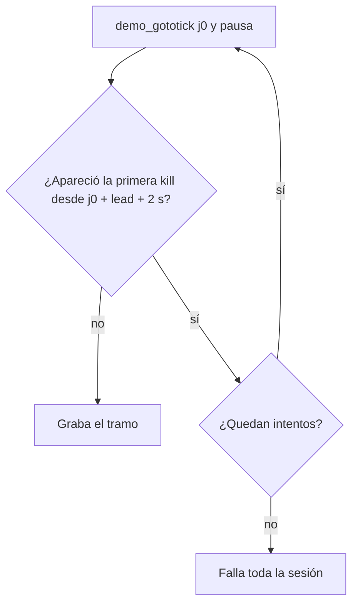

# El salto no se da por pasado de largo por una kill en sus primeros segundos: documentación

## Qué hace

Para grabar un tramo, `render_clip.record_session` salta con `demo_gototick` a `j0`, medio segundo (`lead`) antes del tramo, y pausa la demo. La pausa no es inmediata: la demo sigue unos segundos antes de quedarse quieta (en el portátil, hasta 3,5 s). Por eso, después del salto, el script revisa en la consola si apareció una kill que no debería haber pasado todavía. Si apareció, la demo "se pasó de largo": vuelve a saltar, hasta 3 veces (`SEEK_TRIES`), y si no lo logra, falla.

Hasta el 2026-10-30, esa kill era la primera de cualquier jugador desde `j0`. Si otro jugador mataba a alguien en los primeros segundos después del salto, la demo casi siempre llegaba a esa kill y los tres intentos fallaban igual. Como una sesión del juego graba todas las jugadas de una partida, ese tramo tumbaba la partida entera.

Ahora la kill que se mira es la primera desde `j0 + lead + SEEK_SLACK_SECONDS` (2 s). Pasarse hasta ese punto se tolera.

## Qué se pierde al tolerar el margen

El tramo empieza 3 s (`pre_seconds`) antes de la primera kill de la jugada, y FFmpeg descarta el `lead`. Si la demo se pasa X segundos, el video arranca X segundos más tarde y termina X segundos más tarde. Con X de hasta 2,5 s, quedan al menos 0,5 s antes de la primera kill. Si se pasa más, la kill que se mira ya es la de la jugada (o una anterior a ella), y se reintenta como antes.

| Caso | Antes | Ahora |
|---|---|---|
| Primera kill a 3,5 s o más del salto (lo normal) | Se mira esa kill | Igual |
| Kill de otro jugador en los primeros 2,5 s | Se mira esa kill: casi siempre falla | Se mira la siguiente |
| Demo que se pasa más de 2,5 s | Reintento | Reintento |

## Dónde está cada cosa

| Qué | Archivo / ubicación |
|---|---|
| `SEEK_SLACK_SECONDS` y `SEEK_TRIES` | `render/render_clip.py`, arriba |
| El control de "pasó de largo" | `render/render_clip.py`, `record_session` |
| Comparación antes/después sin el juego | `pruebas/comparar_salto.py` (con `pruebas/clips_nuke.json`) |
| Devolver los clips de nuke a la cola | `pruebas/reprocesar_nuke.sql` |
