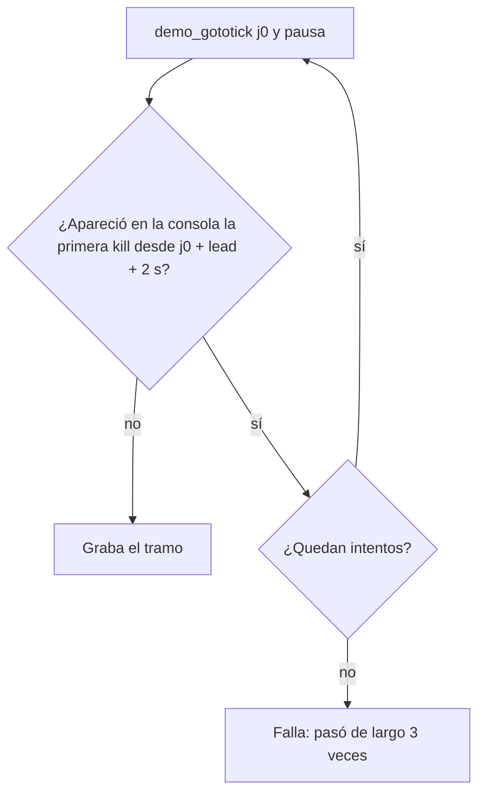

# Plan: el salto no se da por pasado de largo por una kill en sus primeros segundos

> Planeación original. Estado: **aprobado por Daniel (2026-10-30)**, por los 6 clips de nuke_old_blue_ep (`flow-20261029T210433-5ce4`) que quedaron `failed` con "la demo pasó de largo el tick 70272 (3 veces)".

## Decisiones tomadas

| Tema | Decisión | Por qué |
|---|---|---|
| Qué kill se mira | La primera kill desde `j0 + lead + 2 s` (`SEEK_SLACK_SECONDS = 2.0`), no la primera desde `j0` | Después del salto la demo sigue corriendo un poco antes de pausar (en el portátil, hasta 3,5 s, ver [`2026-10-24-render-portatil-ajustes`](../2026-10-24-render-portatil-ajustes/)). Con una kill de otro jugador 1,5 s después del salto, el control la ve siempre y los 3 reintentos fallan igual |
| Cuánto margen | 2 s más el `lead` (0,5 s) | El tramo empieza 3 s antes de la primera kill: pasarse hasta 2,5 s le quita parte de esos 3 s, pero la kill se ve |
| Partidas que hoy andan bien | Sin cambios | Su primera kill queda a 3,5 s o más del salto, así que la kill que se mira es la misma de antes |
| Clips de nuke | Vuelven a la cola cuando Daniel confirme | Daniel lo pidió así |

## 1. El flujo

## 2. Cambio en `render/render_clip.py`

- Constante `SEEK_SLACK_SECONDS = 2.0` junto a `SEEK_TRIES`.
- En `record_session`, `after` pasa a ser la primera kill con `tick >= j0 + lead_ticks + slack_ticks`.

## 3. Pruebas

- Sin el juego, con la demo de nuke: la kill que se mira en el tramo de `d8599f71` (j0 70272) pasa de la de Taiki Inomata (70421) a la de Old x roman (70622), y en los demás tramos de la partida no cambia.
- Con el juego: la próxima corrida del portátil con los 6 clips de vuelta en la cola.

## 4. Orden

1. Constante y cambio en `record_session`.
2. Prueba sin el juego (`pruebas/`).
3. Llevar `render/` al portátil (commit y `git pull` cuando Daniel lo pida).
4. Con la confirmación de Daniel, devolver los 6 clips a la cola (`pruebas/reprocesar_nuke.sql`).
