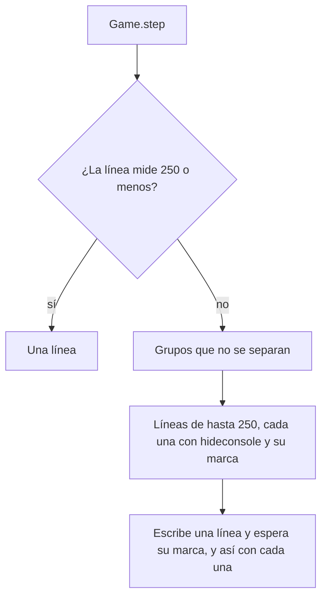

# Los pasos que no caben en una línea de la consola van en varias: documentación

## Qué hace

El render maneja el juego escribiendo en su consola: cada paso es una línea con los comandos y, al final, la marca `echo CML_PASO_n`, que el script espera ver en el log (`Game.step`). La consola corta la línea en unos 255 caracteres. Si el paso es más largo, la marca se pierde, el script la espera 60 s y la sesión falla con "no apareció 'CML_PASO_n' en el log en 60 s".

Un paso se alarga cuando la cámara tiene que llegar al jugador con `spec_next` desde otro de nombre largo: es el caso de los que tienen caracteres que no se pueden escribir, como «New™ CH1LI», al que se llegaba desde «GO TO KNOW musul    ^'-'^».

Desde el 2026-10-30, `console_lines` reparte los pasos de más de `CONSOLE_MAX` (250) caracteres en varias líneas. Cada una tiene su marca y el script las escribe de a una. Los pasos que caben siguen en una sola línea, igual que antes.

## Reglas al partir

| Regla | Por qué |
|---|---|
| Cada línea lleva `hideconsole` (al principio, si no lo tenía) | `console_command` abre la consola con su tecla, que la cierra si ya está abierta |
| `spec_player` y sus `spec_next` van juntos | Una línea se reenvía si a los 5 s no apareció su marca: con el `spec_player` delante, la cámara vuelve al mismo jugador |
| `startmovie` y `demo_resume` van juntos | Con la demo en pausa, `startmovie` grabaría cuadros quietos hasta la línea siguiente |
| `demo_pause` y `demo_gototick` van juntos | El salto se hace con la demo en pausa |
| `step_pos` se toma al principio del paso completo | `restarted()` y `wait_seek` buscan desde ahí |
| Si un grupo solo no cabe, falla con el texto de la línea | Mejor que esperar 60 s una marca que no va a llegar |

## Dónde está cada cosa

| Qué | Archivo / ubicación |
|---|---|
| `CONSOLE_MAX`, `console_line` y `console_lines` | `render/render_clip.py` |
| `Game.step` | `render/render_clip.py` |
| Prueba sin el juego | `pruebas/lineas_consola.py` (con `pruebas/clips_dust2.json`) |
| Devolver los clips de dust2 a la cola | `pruebas/reprocesar_dust2.sql` |
