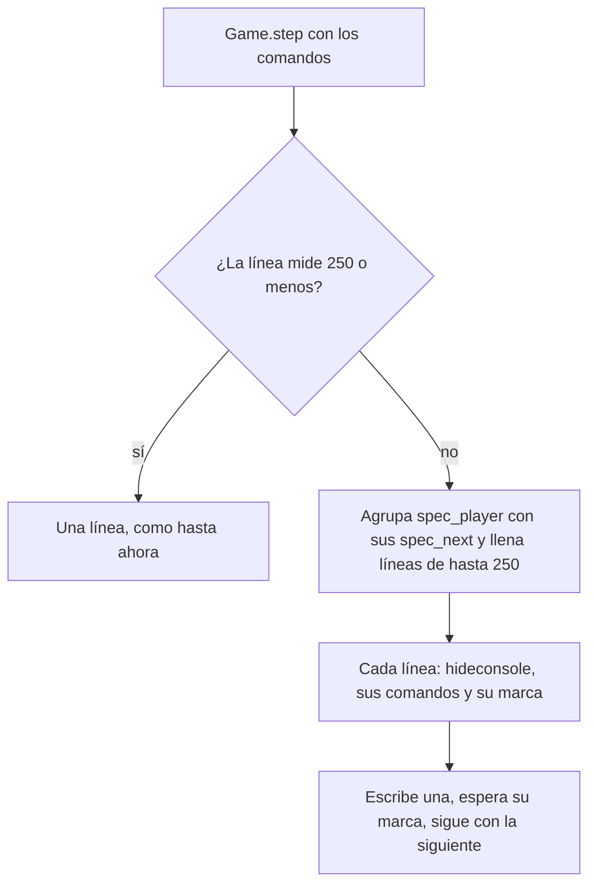

# Plan: los pasos que no caben en una línea de la consola van en varias

> Planeación original. Estado: **aprobado por Daniel (2026-10-30)**, por los 5 clips del mix de dust2_ob de GO TO KNOW contra New™ (`flow-20261029T234042-496d`) que fallaron dos veces con "no apareció 'CML_PASO_14' en el log en 60 s".

## Decisiones tomadas

| Tema | Decisión | Por qué |
|---|---|---|
| Causa | La consola del juego corta la línea en unos 255 caracteres y se pierde la marca `echo CML_PASO_n` del final | En el mix de dust2, el paso 14 mide 259 caracteres y falló 3 de 3 veces; el 13 (239, con el mismo `spec_player`) y otros de 249 pasaron. «New™ CH1LI» no se puede escribir y la cámara llega a él desde «GO TO KNOW musul    ^'-'^», un nombre largo |
| Límite | `CONSOLE_MAX = 250`, contando el `"; "` del principio y la marca | El paso más largo que ha pasado mide 249 |
| Qué se parte | Solo los pasos de más de 250 caracteres | Los que hoy funcionan quedan iguales |
| Cómo se parte | En varias líneas seguidas, cada una con su marca y con `hideconsole` (al principio, si no lo tiene) | `console_command` abre la consola con su tecla, que la cierra si ya está abierta: cada línea tiene que dejarla cerrada |
| `spec_player` y sus `spec_next` | Siempre en la misma línea | Si una línea se reenvía (pasa a los 5 s sin la marca), `spec_next` solo no es repetible: con su `spec_player` delante, la cámara vuelve al mismo jugador |
| `step_pos` | Se toma una vez, al principio del paso completo | `restarted()` y `wait_seek` buscan desde ahí lo que escribió el salto |
| Si un grupo solo no cabe | Falla con un mensaje claro | Mejor que esperar 60 s una marca que no va a llegar |

## 1. El flujo

## 2. Cambios en `render/render_clip.py`

- Constante `CONSOLE_MAX = 250`.
- Función `console_lines(commands, n)`: las líneas de un paso, con la regla de arriba.
- `Game.step`: toma `step_pos`, y por cada línea suma uno a `n`, la escribe y espera su marca.

## 3. Pruebas

- Sin el juego, con la demo de dust2 (`pruebas/`): todas las líneas de todos los pasos miden 250 o menos, los pasos que ya cabían no cambian, y ningún `spec_next` queda separado de su `spec_player`. Lo mismo con la demo de nuke (ningún paso se parte).
- Con el juego: la próxima corrida del portátil con los 5 clips de dust2 de vuelta en la cola.

## 4. Orden

1. Constante, `console_lines` y `Game.step`.
2. Prueba sin el juego.
3. Commit y `git pull` en el portátil cuando Daniel lo pida.
4. Con la confirmación de Daniel, devolver los 5 clips a la cola (`pruebas/reprocesar_dust2.sql`).
