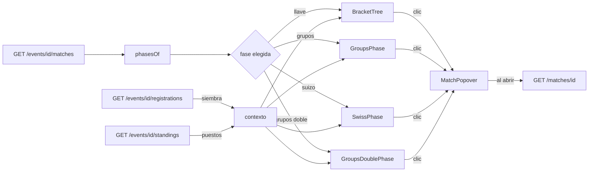

# Llave por formato y detalle resumido: documentación

## Qué hace

La pestaña **Llave** de un torneo dibuja cada fase de cada plantilla: las llaves de eliminación (directa y doble), la fase de grupos todos contra todos, las fases suizas y los grupos de doble eliminación. Arriba del lienzo hay un chip por fase, con un punto que indica su estado. La pestaña abre en la fase que se está jugando y guarda la elegida en la URL.

Al hacer clic en cualquier partida (una tarjeta de la llave, una partida del suizo o una celda de los cruces) se abre un **detalle resumido** junto a ella. En el teléfono aparece como hoja desde abajo. Muestra los equipos con su siembra, el marcador, la fase, el BO, el estado y el servidor. También los mapas con sus rondas, las alineaciones y, si falta un equipo, de dónde sale. Desde ahí, "Ver partida" (o "Ver en vivo") lleva a la página completa.

Se mantienen el zoom (50 a 150 %), el arrastre del lienzo y el camino del equipo bajo el cursor, que ahora funcionan en todas las fases. Diseño aprobado por Daniel en el [artifact "Llave por formato"](https://claude.ai/artifact/KVNcaxAUK9BPQWREvY5Huj) (versión 3).

## Fases por plantilla

| Plantilla | Chips | Etapas de la API (`stage`) | Se dibuja con |
|---|---|---|---|
| `single` | (sin chips: una sola fase) | `ko`, `third` | `BracketTree` |
| `double` | (sin chips) | `upper`, `lower`, `grand` | `BracketTree` |
| `groups` | Fase de grupos · Playoffs | `group` · `ko`, `third` | `GroupsPhase` · `BracketTree` |
| `swiss` | Fase suiza (1 a 3) · Playoffs | `swiss` por `phase` · `ko`, `third` | `SwissPhase` · `BracketTree` |
| `groups_double` | Grupos · Playoffs | `group_upper`, `group_lower` (con `grp`) · `ko`, `third` | `GroupsDoublePhase` · `BracketTree` |

- **Estado del chip:** en vivo (punto rojo) si tiene una partida `live`, terminada (verde) si todas están terminadas o canceladas, y por jugar (gris) en otro caso.
- **Fase por defecto:** la que está en vivo; si no, la primera con partidas por jugar; si no, la última con partidas.
- **URL:** `?tab=bracket&phase=groups` (también `playoffs`, `bracket` y `swiss-1`…). Una fase que no existe se ignora. Al cambiar de pestaña, la fase se olvida.
- **Fase sin partidas:** un aviso ("Los playoffs se arman cuando termina el suizo.", "Esta fase se arma cuando termina la anterior.").

## Llaves de eliminación (`BracketTree`)

- Secciones apiladas (upper y lower) y, a la derecha, la sección que termina en el campeón con el 3.er puesto debajo.
- **Conectores** en SVG entre rondas. Si la ronda siguiente tiene la mitad de partidas, la línea va a la posición `(pos + 1) / 2`; si tiene las mismas (rondas del lower), va a la misma fila. En doble eliminación, las finales del upper y del lower van a la gran final. Las líneas del camino del equipo bajo el cursor se pintan en naranja.
- **Tarjeta (`MatchCard`):** franja verde del ganador y roja tenue del perdedor, siembra (`#3`), hora si todavía no empezó, chip VIVO y borde punteado si no tiene equipos.
- **Origen de un lado sin equipo** (`originOf`): primero lo que mande el backend en `side.name`. Si no viene nada, en `ko`, `upper` y `group_upper` es "Ganador de <partida anterior>" (con número si la ronda tiene varias), y en el 3.er puesto "Perdedor de Semifinal N". En el lower y la gran final queda "Por definir" hasta el pedido E22.
- **Destino** (`destinationsOf`), junto al resultado:

| Marca | Cuándo |
|---|---|
| `↓ L2` | Perdió en el upper y ya aparece en la ronda 2 del lower |
| `→ GF` | Ganó la final del upper o del lower (doble eliminación) |
| `→ PO` | Clasificado a playoffs según las posiciones (grupos de doble eliminación) |
| `✕ 3.º` | Perdió en el lower y quedó eliminado; el puesto sale de las posiciones si lo hay |

## Fase de grupos (`GroupsPhase`)

- Una tarjeta por grupo con "N equipos · clasifican X · BOn" y el selector **Fechas / Cruces**, que abre en Fechas (Daniel, 2026-10-31).
- **Tabla corta:** #, Equipo, PJ, G-P, Rondas y Pts. La franja verde marca a los que clasifican (`qualifies`). La tabla completa sigue en Posiciones.
- **Fechas:** una columna por fecha con sus tarjetas.
- **Cruces:** todos contra todos en el orden de la tabla. Cada celda muestra el resultado desde el equipo de la fila (verde si ganó, rojo si perdió, borde rojo en vivo y punteado con la hora si no se jugó) y abre el detalle. Con ida y vuelta, la celda trae los dos partidos.

## Suizo (`SwissPhase`)

Como `formatosuizo1.png`:

- Una columna por ronda y un **recuadro por récord** (0:0, 1:0, 0:1…) con su BO. El fondo es verde suave si el récord tiene más victorias que derrotas, rojo suave si tiene más derrotas, y gris si están parejos.
- Cada partida muestra **solo los dos escudos**. El del ganador va sobre verde y el del perdedor, apagado, sobre rojo. Nombre, marcador y mapas están en el detalle.
- **Flechas** punteadas: una verde hacia el récord del que gana y otra roja hacia el del que pierde.
- **Franjas:** la verde de clasificados arriba (3:0, 3:1, 3:2) y la roja de eliminados abajo, cada récord alineado con la ronda en que se define. Se llenan con los escudos y los lugares vacíos van punteados.
- **Rondas que todavía no existen** (la base arma cada ronda cuando termina la anterior): se proyectan repartiendo por mitades los equipos de cada récord y se muestran como partidas por armar, con el BO que toca según la configuración (`bo` o `bo_decisive`).
- Funciona con 16 equipos a 3 victorias y con 8 a 2 (`wins` y `size` de la configuración).

`swissGrid` calcula el récord de cada partida repitiendo los resultados de las rondas terminadas en orden.

## Grupos de doble eliminación (`GroupsDoublePhase`)

Como `grupos1.png`: una tarjeta plegable por grupo con el upper arriba y el lower abajo (columnas "Ronda 1", "Final del upper"…) y las marcas de destino de cada resultado.

## Detalle resumido (`MatchPopover`)

- Escritorio: `Popover` de shadcn a la derecha de la tarjeta, de 340 px, que se acomoda si no entra. Teléfono (menos de 768 px): `Sheet` desde abajo.
- Se cierra con Esc, con un clic afuera o con la X (en la hoja).
- Pide `GET /matches/{id}` al abrir (reutiliza `matchDetailOptions` del shell). Mientras carga, muestra lo que ya trae la partida.
- Secciones: cabecera, línea de contexto, mapa de ventaja si lo hubo (`advantage_side`), "Quién juega" si falta un equipo, Mapas (`maps_detail` más el mapa en vivo de `live`), Alineaciones (`roster1` y `roster2`, sin rating hasta E21) y el botón a la partida.

## Pedidos al backend

En la cuarta tanda de `contrato-backend-equipo-torneos.md`:

- **E21:** rating de cada jugador en la serie (`series_players`).
- **E22:** `next_win`, `next_win_slot`, `next_lose` y `next_lose_slot` en `EventMatch` (la base ya los tiene), y nombrar `group_upper`/`group_lower` en la descripción de `stage`.

## Dónde está cada cosa

Todo dentro de `web/frontend/src/features/events/`.

| Qué | Archivo |
|---|---|
| Fases, origen, destino, suizo y grupos (funciones puras) | `lib/bracket.ts` (+ `bracket.test.ts`) |
| Secciones de las llaves y títulos de las etapas | `lib/model.ts` (`buildBracket`, `STAGE_TITLE`) |
| Pestaña: chips, zoom, arrastre y la fase elegida | `components/BracketTab.tsx` |
| Contexto compartido (partidas, siembra, destinos, camino) | `components/bracket/context.ts` |
| Llave, tarjeta, conectores | `components/bracket/BracketTree.tsx`, `MatchCard.tsx`, `Connectors.tsx` |
| Grupos, suizo y grupos de doble eliminación | `components/bracket/GroupsPhase.tsx`, `SwissPhase.tsx`, `GroupsDoublePhase.tsx` |
| Detalle resumido | `components/bracket/MatchPopover.tsx` |
| `?phase=` | `src/routes/_app/events.$id.tsx` y `pages/EventView.tsx` |
| Pruebas de punta a punta y datos simulados | `web/frontend/e2e/events.spec.ts` y `event-fixtures.ts` |
