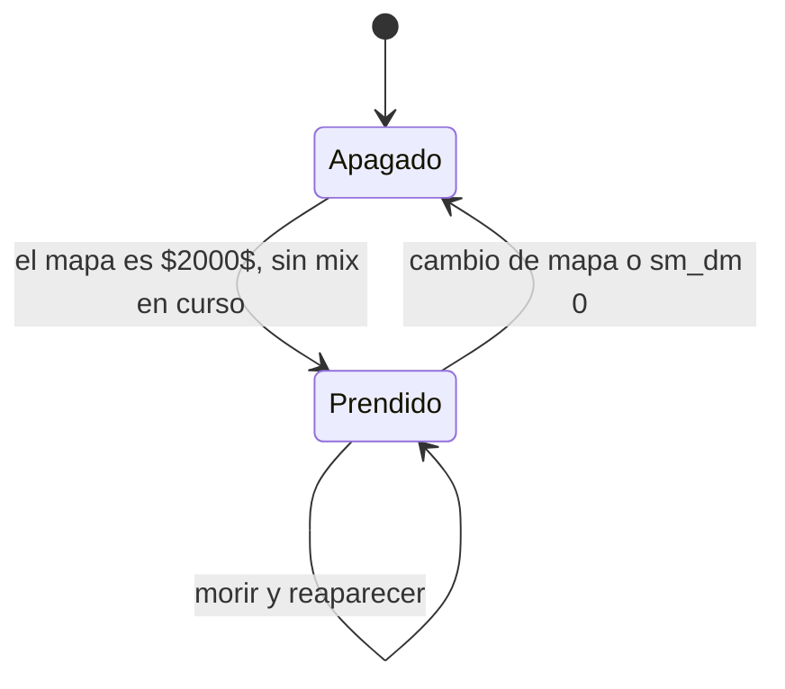

# Plugin de deathmatch: documentación

## Qué hace

`v34_dm` es un deathmatch T contra CT para CS:S v34. Solo funciona en el mapa de `sm_dm_map` (`$2000$`) y ahí se prende solo. A ese mapa se llega porque un admin lo cambia por comando: no va en la votación ni en la rotación. No hay rondas ni ganador: el juego sigue hasta que cambie el mapa. No lleva licencia y no envía nada a Supabase.

## Reglas

- **Reaparición:** a `sm_dm_respawn` (1 s) de morir, en el punto del equipo más lejos del rival vivo más cercano y a más de 64 unidades de cualquiera.
- **Protección:** `sm_dm_protect` (1,5 s) sin recibir daño, y translúcido. Termina al disparar.
- **Al matar:** `sm_dm_kill_hp` (15) de vida, hasta 100, y el arma en mano recargada.
- **Equipamiento:** cuchillo, arma principal, pistola, chaleco y casco. Sin C4, granadas, plata ni compra.
- **Sin rondas:** `CS_OnTerminateRound` bloquea todo fin de ronda, salvo el arranque de partida.
- **Armas tiradas:** se limpian cada 5 segundos.

## Comandos

| Comando | Qué hace |
|---|---|
| `!guns` | Elegir arma principal y pistola. Se guarda y se aplica al reaparecer |
| `!hs` | Solo cabeza para tus tiros. Se guarda |
| `!rank`, `!top` | Ranking propio en `data/sqlite/v34_dm.sq3` |
| `sm_dm <1\|0>` | Prender o apagar, solo en su mapa |
| `sm_dm_hs <1\|0>` | Solo cabeza para todos |
| `!admin` → Deathmatch | Prender o apagar, y solo cabeza para todos |

Armas: AK-47, M4A1, Galil, FAMAS, SG 552, AUG, AWP y Scout. Pistolas: Deagle, USP y Glock.

## Con los mixes

No se prende con un mix en curso. Con el modo prendido bloquea `!ready`, `!live`, `!rtv` y `!nominate`. Al salir del mapa se apaga y restaura los cvars que maneja, incluido `mp_timelimit`.

## Dónde está cada cosa

| Qué | Archivo |
|---|---|
| Plugin | `server/addons/sourcemod/scripting/v34_dm.sp` |
| Ranking (copia adaptada de `retake/rank.inc`) | `scripting/dm/rank.inc` |
| Colores del chat (compartido) | `scripting/retake/chat.inc` |
| Build de depuración | Compilar con `DM_DEBUG=`: agrega `dm_debug_stats` |
