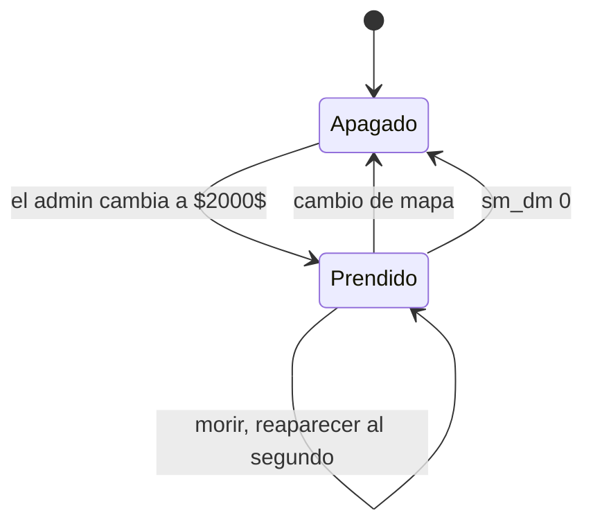

# Plan: plugin de deathmatch

> Planeación original, pedida por Kyan el 2026-10-31.

## Decisiones tomadas

| Tema | Decisión | Por qué |
|---|---|---|
| Plugin | `v34_dm.sp`, separado de `csstv_reporter` y de los otros modos | Un error no afecta a los mixes |
| Mapa | Solo funciona en `$2000$` (`sm_dm_map`). Ahí se prende solo y en otros mapas no hace nada | Lo pidió Kyan |
| Cómo se llega | Un admin cambia de mapa por comando. No va en la votación ni en la rotación | Es a propósito, según Kyan |
| Equipos | T contra CT | Lo pidió Kyan |
| Rondas | No se reinicia aunque muera todo un equipo. Sigue hasta que un admin cambie de mapa | Lo pidió Kyan |
| Solo cabeza | `!hs` por jugador y `sm_dm_hs 1` para todos | Lo pidió Kyan |
| Licencia y Supabase | Sin licencia ni envío, con ranking local (`!rank`, `!top`) | Igual que los otros modos |
| Servidor | Ethereal (`FLOW_SERVER`, `190.104.34.3`), que también juega mixes | Lo pidió Kyan |
| Pruebas | Obligatorias en `cssds` antes de subir | Regla de Kyan |

## 1. El flujo

## 2. Reglas

- **Reaparición:** 1 s después de morir, con 1,5 s de protección que termina al disparar.
- **Spawn:** entre los puntos del mapa para tu equipo, el más lejos del rival vivo más cercano.
- **Armas:** `!guns` con AK-47, M4A1, Galil, FAMAS, SG 552, AUG, AWP y Scout, y de pistolas Deagle, USP y Glock. La elección se guarda. Sin compra y sin plata.
- **Al matar:** +15 de vida (hasta 100) y arma recargada.
- **Equipamiento:** chaleco y casco, sin granadas ni C4.
- **Armas tiradas:** se limpian cada pocos segundos.

## 3. Solo cabeza

Con `!hs`, tus tiros solo hacen daño si pegan en la cabeza. Con `sm_dm_hs 1`, vale para todos. Se implementa con `SDKHook_TraceAttack`.

## 4. Fin de ronda

`CS_OnTerminateRound` bloquea cualquier fin de ronda salvo el arranque de partida. **Hay que comprobarlo en v34.**

## 5. Convivencia con los mixes

- No se prende si hay un mix en curso.
- Con el modo prendido se bloquean `!ready`, `!live`, `!rtv` y `!nominate`.
- Al salir de `$2000$` se apaga y restaura los cvars.

## 6. Pruebas

**Con bots:** rondas que no terminan, reaparición, solo cabeza global, armas, mapas distintos de `$2000$`.

**Con un jugador:** `!guns`, `!hs`, `!rank`, `!top`, `!admin`, protección al aparecer.

## 7. Orden

1. Plugin.
2. Pruebas en `cssds`.
3. Subir a ethereal, con permiso.
4. Documentación y changelog.
