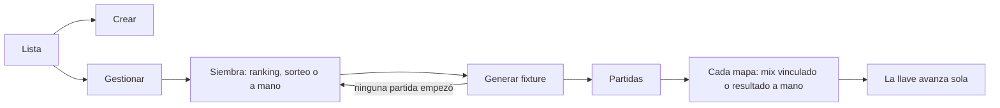

# Gestión de torneos: documentación

## Qué hace

Administración › Torneos deja crear y gestionar torneos de punta a punta: inscripciones, siembra, fixture, horarios y resultados. El diseño es el del [artifact aprobado](https://claude.ai/artifact/WMMQG4Kq6n9uu9cZToJuo8).

## Quién puede qué

| Rol | Torneos | Crear | Gestionar | Cancelar y borrar |
|---|---|---|---|---|
| Admin | Todos | Sí | Sí | Sí |
| Moderador | Todos | No | Sí | No |
| Organizador | Los suyos | Sí | Sí | Sí |

"Gestionar" incluye inscripciones, siembra, fixture, horarios, servidores, resultados, mixes, W.O., veto y empates. En la base: `can_manage_event` (admin, moderador u organizador dueño) y `can_own_event` (admin u organizador dueño). La API lo devuelve en `EventDetail.viewer` (`can_manage`, `can_own`).

## Siembra

- **Por ranking** (`POST /events/{id}/seeds/ranking`, `event_seed_ranking`): puntos totales del ranking de equipos (torneos y PCW; sin partidas cuenta 0), después el ELO promedio de los activos inscritos y después quién se inscribió antes.
- **Sorteo** (`POST /events/{id}/draw`) y **a mano** (`PUT /events/{id}/seeds`), como antes.
- **Etapas del suizo:** en un suizo de varias etapas, la siembra decide en qué etapa entra cada equipo. El trigger `events_seed_stages` parte la siembra en bloques de `size / 2`: el primero entra a la última etapa, el segundo a la anterior y el resto juega la 1.

| Formato | Etapa 3 | Etapa 2 | Etapa 1 |
|---|---|---|---|
| Major clásico (2 etapas de 16, 24 equipos) | — | Siembras 1 a 8 | 9 a 24 |
| Major expandido (3 etapas de 16, 32 equipos) | 1 a 8 | 9 a 16 | 17 a 32 |

- **Rehacer:** mientras no haya empezado ninguna partida, `POST /events/{id}/reset` vuelve el torneo a inscripciones con su siembra, y se puede volver a sembrar y generar. Desde que una partida arranca, queda fijo.

## Mapas de una serie

Cada mapa de una partida de torneo se completa de una de dos formas:

- **Mix vinculado:** un mix ya jugado en nuestros servidores. El mapa, las rondas y las stats de los jugadores salen del mix, que queda vinculado a la partida (`parent_match_id`, `parent_side1`), igual que con `!match`.
- **Resultado a mano:** el mapa y las rondas de cada equipo. No hay stats: la página de la partida dice "Sin detalle de la partida" en ese mapa (`maps_detail[].game_id` en `null`).

`GET /matches/{id}/games/candidates` (`match_game_candidates`) lista los mixes que se pueden vincular. Son los terminados en los últimos 14 días que no están vinculados a otra partida y que jugó al menos un inscrito. Primero van los ya vinculados y después los que tienen más inscritos. `side1` dice qué bando del mix fue el equipo 1, deducido por mayoría de inscritos (`match_game_side`).

`PUT /matches/{id}/maps` (`match_set_maps`) reemplaza la lista de mapas:

- Si la serie queda definida, la cierra con `event_set_result` y la llave avanza.
- Si no, la deja en curso (`live`) con esos mapas, o por jugar si la lista está vacía.
- Si la serie estaba cerrada y deja de estarlo, primero la reabre: deshace el avance, y el torneo pierde el campeón si era la final.
- Desvincula los mixes que salen de la lista.

No se puede usar un mix vinculado a otra partida (`409`). Tampoco el mismo mix en dos mapas, mapas empatados ni más mapas que el BO (`400`).

## Horarios

A mano, en cada partida (`PATCH /matches/{id}` con `starts_at`). No hay horarios automáticos.

## Dónde está cada cosa (backend)

| Qué | Archivo |
|---|---|
| Base | `supabase/replanteo/41_admin_torneos.sql` (inversa y pruebas en `docs/bitacora/2026-10-14-replanteo-modelo-datos/`) |
| Siembra por ranking y `viewer.can_own` | `web/backend/src/routes/events.ts`, `schemas/events.ts` (`SeedsResult`) |
| Candidatos y mapas de una serie | `web/backend/src/routes/matches.ts`, `schemas/matches.ts` (`GameCandidate`, `SeriesMap`, `SeriesMapsBody`) |
| Pruebas | `web/backend/test/integration/admin-torneos.test.ts` |
| Contrato | `docs/frontend/contrato/torneos.md`, `partidas.md` y `README.md` |
