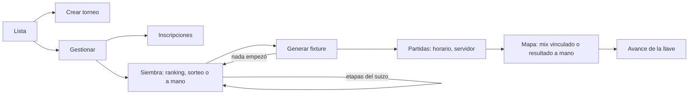

# Plan: gestión de torneos (Administración › Torneos)

> Planeación original. Estado: **aprobado por Daniel (2026-11-01)** sobre el [artifact "Admin de torneos"](https://claude.ai/artifact/WMMQG4Kq6n9uu9cZToJuo8) (versión 3).

La pestaña Torneos de Administración es hoy un marcador de lugar. La API ya crea y edita torneos, inscribe, siembra a mano, sortea, genera, reinicia, resuelve empates y carga resultados, horarios y servidores. Falta la pantalla y cuatro cosas de la API.

## Decisiones tomadas

| Tema | Decisión | Por qué |
|---|---|---|
| Quién | Admins, todo. **Moderadores**: operan todos los torneos (inscripciones, siembra, horarios, resultados, mixes, W.O. y empates), sin crear, borrar ni cancelar. **Organizadores**: solo los suyos | Daniel, 2026-11-01 |
| Siembra por ranking | Puntos totales del ranking de equipos (torneos y PCW); si empatan, ELO promedio de los activos inscritos; si siguen, quien se inscribió antes | Daniel: "cuentan también los PCW" |
| Etapas del suizo | La etapa de entrada sale de la siembra: los mejores entran a la etapa más avanzada (bloques de `size / 2`) | Daniel, 2026-11-01 |
| Rehacer | La siembra y el fixture se rehacen mientras no haya empezado ninguna partida | Daniel. `event_reset` ya lo cumple: la pantalla lo usa como "Volver a la siembra" |
| Horarios | A mano en cada partida (`PATCH /matches/{id}` con `starts_at`, ya existe). Sin horarios automáticos | Daniel |
| Mix o resultado a mano | Cada mapa de la serie se completa con un mix ya jugado en nuestros servidores (trae las stats) o con el **resultado a mano** (mapa y rondas). Sin mix, la página dice "Sin detalle de la partida" | Daniel |
| Vincular un mix | Cualquier mix terminado y sin vincular de los últimos 14 días; la lista los ordena por cuántos inscritos de los dos equipos jugaron. El bando se deduce por los inscritos y se puede invertir. Sin el control de `!match` (todos del plantel), porque lo decide una persona | Recuperar partidas ya jugadas |
| Diseño | El del artifact: lista con "Qué falta", crear con formato y resumen, gestionar con pestañas (Resumen, Inscripciones, Siembra, Partidas, Configuración) y el detalle de la partida mapa por mapa | Aprobado |

## 1. El flujo completo

## 2. Base de datos (replanteo `41_admin_torneos.sql`, con inversa y pruebas)

- `can_manage_event`: suma a los moderadores. Nueva `can_own_event` (admin u organizador dueño) para borrar y cancelar.
- Trigger `events_seed_stages`: al cambiar la siembra (o el formato), el `start_stage` de cada inscripción sale de su posición en un suizo de varias etapas.
- `event_seed_ranking(p_event)`: ordena la siembra por ranking.
- `match_game_candidates(p_match)`: mixes para vincular, con inscritos y bando deducido.
- `match_set_maps(p_match, p_maps)`: guarda los mapas de una serie, cada uno con `game_id` (vincula el mix) o con `map`, `r1` y `r2`. Con la serie definida, usa `event_set_result`; si no, la deja en curso con los mapas cargados. Desvincula los mixes que se sacan.

## 3. API

- `POST /events/{id}/seeds/ranking` → la siembra nueva.
- `GET /matches/{id}/games/candidates` y `PUT /matches/{id}/maps`.
- `EventDetail.viewer` suma `can_own`.
- Contrato del frontend.

## 4. Frontend

- `features/admin/events/`: lista, crear y editar (el mismo formulario), gestionar con sus pestañas, siembra con arrastre (y ▲ ▼ con teclado) y el detalle de partida para el organizador.
- La página de la partida: "Sin detalle de la partida" en los mapas sin mix.
- El menú de Administración muestra Torneos a moderadores y organizadores.

## 5. Requisitos

- Commit del replanteo `40` (hecho, `07069ef8`).

## 6. Orden

1. `41`, pruebas e inversa.
2. API, tipos, pruebas de integración y contrato; commit.
3. Merge en `feat/frontend-fase-1` (junto con la `40`).
4. Frontend del equipo al instante y de la gestión de torneos; pruebas; commits.
