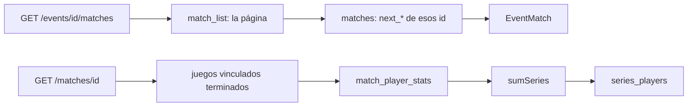

# Rating de la serie y enlaces de la llave en la API (E21 y E22): documentación

## Qué hace

Dos datos nuevos para la pestaña Llave de un torneo y su detalle resumido ([bitácora del frontend](../2026-10-31-llave-por-formato/)):

- **E22.** Cada partida de `GET /api/v1/events/{id}/matches` dice a qué partida pasa el ganador (`next_win`) y el perdedor (`next_lose`), y en qué lado (`next_win_slot`, `next_lose_slot`: 1 o 2). Con eso, el frontend escribe "Ganador de Semifinal 1" o "Perdedor de la final del upper" en los lados que todavía no tienen equipo, y marca "↓ L2" antes de que se juegue el cruce.
- **E21.** `GET /api/v1/matches/{id}` de una partida de torneo o PCW trae `series_players`: las stats de cada jugador sumadas sobre los juegos vinculados con `!match`, en los lados de la serie y con el rating ponderado por rondas.

No hay migración: los enlaces ya estaban en `matches` y las stats en `match_player_stats`.

## E22: enlaces de la llave

| Campo | Tipo | Qué es |
|---|---|---|
| `next_win` | uuid o `null` | Partida a la que pasa el ganador. `null` en la final, la gran final, el 3.er puesto y las partidas que no siguen en una llave (grupos, suizo) |
| `next_win_slot` | 1, 2 o `null` | Lado que ocupa el ganador en `next_win` |
| `next_lose` | uuid o `null` | Partida a la que pasa el perdedor: el lower en doble eliminación o el 3.er puesto en una semifinal. `null` si queda eliminado |
| `next_lose_slot` | 1, 2 o `null` | Lado que ocupa el perdedor en `next_lose` |

- Se leen de `matches` con una sola consulta por página (`id in (…)`), después de la de `match_list`. El orden y la paginación no cambian.
- `stage` documenta también `group_upper` y `group_lower` (grupos de doble eliminación), y el filtro `?stage=` los acepta.

## E21: stats de la serie

- **Qué juegos:** los vinculados a la partida (`parent_match_id`) con estado `finished`. El que está en vivo o cancelado no suma.
- **Lado:** el de la serie. Si el juego tiene los bandos invertidos (`parent_side1 = 2`), el lado 1 del juego es el 2 de la serie. Es el mismo criterio que ya usaba `games`.
- **Suma (`sumSeries`, en `services/matches.ts`):** por jugador (`player_id`, o `steam_id` si no tiene ficha) y lado, se suman kills, muertes, asistencias, headshots, daño, rondas, multikills, duelos de entrada, plantadas y desactivaciones. El rating es el promedio ponderado por rondas, con dos decimales.
- **Lo que no aplica:** `elo_delta` y `clutches` van en `null`: la serie no mueve el ELO y los clutches no se suman.
- **Resto de la línea:** igual que `players` del mix: alias si tiene ficha, SteamID64 si no, y ELO y nivel actuales.
- **Orden:** por lado y, dentro de cada lado, por rating de mayor a menor.
- **Vacío** en los mixes y en una serie sin juegos terminados.

## Dónde está cada cosa

| Qué | Archivo |
|---|---|
| Esquema de `EventMatch` y filtro `stage` | `web/backend/src/schemas/events.ts` |
| Enlaces en el listado | `web/backend/src/routes/events.ts` (`eventMatches`) |
| Esquema de `series_players` | `web/backend/src/schemas/matches.ts` (`MatchDetail`) |
| Suma de la serie | `web/backend/src/services/matches.ts` (`sumSeries`, `StatRow`) |
| Detalle de la partida | `web/backend/src/routes/matches.ts` (`detail`) |
| Pruebas | `test/unit/tournament-services.test.ts` (`sumSeries`) y `test/integration/llave-serie.test.ts` |
| Contrato del frontend | `docs/frontend/contrato/README.md`, `torneos.md` y `partidas.md` |
