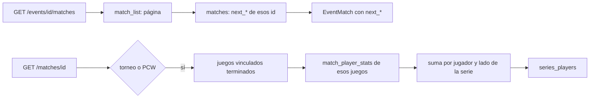

# Plan: rating de la serie y enlaces de la llave en la API (E21 y E22)

> Planeación original. Estado: **aprobado por Daniel (2026-11-01)**: backend y frontend, cada uno con su commit, y el backend llevado al frontend con merge.

Son los dos pedidos de la cuarta tanda de `contrato-backend-equipo-torneos.md` (Llave por formato, [bitácora del frontend](../2026-10-31-llave-por-formato/)). En el frontend se llamaron E19 y E20; se renumeraron como E21 y E22 porque esos números ya estaban en `pendientes-backend-cmleague.md`.

## Decisiones tomadas

| Tema | Decisión | Por qué |
|---|---|---|
| Base de datos | Sin migración: `next_*` se lee de `matches` y las stats de `match_player_stats` | Los datos ya están; `match_list` no se toca |
| E22: dónde | `EventMatch` (`GET /events/{id}/matches`) suma `next_win`, `next_win_slot`, `next_lose` y `next_lose_slot` | Con eso el frontend arma el origen y el destino en todas las llaves |
| E22: cómo | Una consulta a `matches` con los `id` de la página | No cambia la vista ni el orden |
| E22: `stage` | La descripción y el filtro `stage` suman `group_upper` y `group_lower` | La API ya los devuelve |
| E21: dónde | `MatchDetail.series_players` en torneo y PCW; vacío en los mixes y si no hubo juegos | Las stats viven en cada juego vinculado con `!match` |
| E21: forma | Las mismas columnas que `PlayerLine` (las de `players`) | El frontend reutiliza la tabla |
| E21: qué juegos | Los vinculados con estado `finished` | Uno en vivo o cancelado daría números a medias |
| E21: suma | Totales sumados; `rating` ponderado por rondas; `elo_delta` y `clutches` en `null` | El ELO no se mueve por la serie y los clutches no se suman |
| E21: lado | El de la serie, no el del juego: si `parent_side1 = 2`, se invierte | Mismo criterio que `games` |

## 1. El flujo completo

## 2. E22: enlaces de la llave

- `schemas/events.ts`: `EventMatch` suma los cuatro campos (uuid o null, slot 1 o 2 o null) con su descripción; `stage` nombra `group_upper` y `group_lower` en la descripción y en `EventMatchQuery`.
- `routes/events.ts`: después de `runList`, `select('id, next_win, next_win_slot, next_lose, next_lose_slot').in('id', ids)` y se mezcla en cada fila.

## 3. E21: rating de la serie

- `schemas/matches.ts`: `series_players: z.array(PlayerLine)` en `MatchDetail`.
- `routes/matches.ts`: la consulta de `games` suma `status`; con los terminados se piden sus `match_player_stats`, se agrupan por `player_id` (o `steam_id` sin ficha) y lado de la serie, y se arman con la misma función que `players` (alias, SteamID sin ficha, ELO y nivel actuales).

## 4. Frontend (después del merge)

- `pnpm gen:api`.
- Detalle resumido: columna de rating en las alineaciones con `series_players`.
- Llave: origen ("Ganador de…", "Perdedor de…") y destino (`↓ L2`, `→ GF`) desde `next_*`, con lo deducido como respaldo.

## 5. Pruebas

- Integración: `next_*` en una llave doble (upper → lower y gran final), y `series_players` en una serie BO3 con dos juegos vinculados (uno con los bandos invertidos), con el rating ponderado.
- Unitarias de la suma si queda como función pura.
- Frontend: Vitest de la lógica nueva y las e2e de torneos.

## 6. Requisitos antes de empezar

- Commit del trabajo pendiente del backend (`2026-10-30-api-pendientes-frontend`): hecho el 2026-11-01 (`d1430a95`).
- Supabase local levantada (`pnpm db:start`).

## 7. Orden de implementación

1. E22 en el backend.
2. E21 en el backend.
3. Pruebas, `pnpm db:types` si hace falta, contrato y bitácora; commit en `feat/backend-api-fase-1`.
4. Merge de `feat/backend-api-fase-1` en `feat/frontend-fase-1`.
5. Frontend: `gen:api`, rating y enlaces; pruebas; commit.
