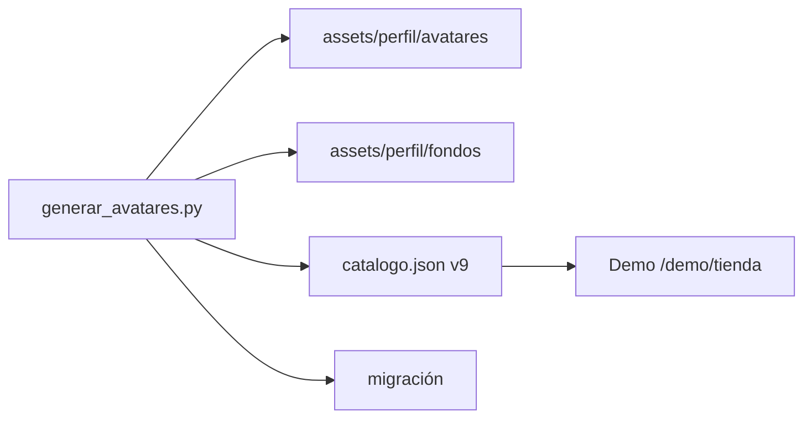

# Plan: avatares de la tienda y más fondos

> Planeación original. Estado: **aprobado por Kyan** el 2026-11-01 (eligió avatares nuevos y fondos, originales en SVG).

## Qué se pide

Kyan pasó tres fotos de perfil de ejemplo (dos caras de anime y un gato con lentes) y pidió más artículos para la tienda: **avatares nuevos y fondos**.

## Decisiones

- **Tipo nuevo `avatar`:** se compra y se equipa como los demás. Reemplaza la foto de perfil mientras esté puesto.
- **Originales en SVG:** los ejemplos son referencia de estilo. Ningún personaje, logo o símbolo ajeno, como pide la regla del catálogo. Dibujados por código, quedan más simples que una ilustración.
- **Cantidad:** 24 avatares y 12 fondos, mitad para todos y mitad VIP, como el resto del catálogo.
- **Precios:** avatar 1000 pts o 1000 monedas VIP. Fondo: 800 pts o 1000 monedas VIP.

## Pasos

1. Generador en `pruebas/`: escribe los SVG, los suma al catálogo y genera la carga de la migración.
2. Migración `20261101120000_avatares_fondos.sql`: `avatar` en `shop_items.kind`, `user_cosmetics.avatar`, `set_my_cosmetics`, `player_cosmetics_public` y `admin_item_revoke`.
3. Demo del frontend nuevo (`repo-mm-ejemplo`, `kyan/ejemplo-matchmaking`): pestaña Avatares, vista previa, miniperfil y perfil.
4. Bitácora, changelog y `docs/PENDIENTES.md`.

## Fuera de alcance

- `index.html`: la tienda vieja no recibe el tipo nuevo.
- Rutas de la API y el backend real.
- No toca el plugin: no hay nada que subir a ningún servidor.
