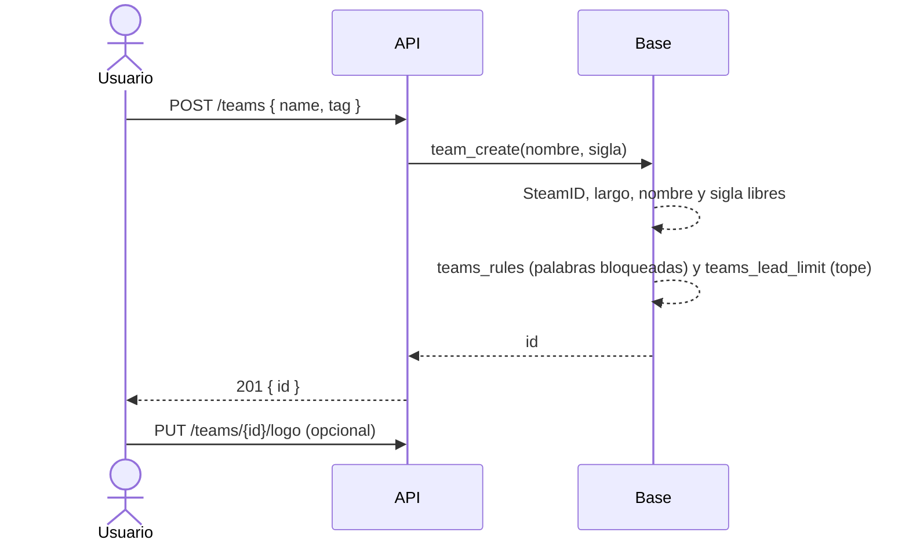

# Crear un equipo al instante: documentación

## Qué hace

Cualquier usuario con el SteamID vinculado crea su equipo y queda creado en el acto, sin que un admin lo apruebe. Quien lo crea queda como dueño, capitán y primer miembro. Lo que el equipo puede hacer depende de cuántos jugadores tiene:

- **Para qué es apto:** la ficha del equipo dice, por cada modo de juego, cuántos jugadores le faltan ("Apto para 1v1 · 2v2", "Faltan 3 para 5v5").
- **Torneos:** como antes, la inscripción exige los activos del modo del torneo.
- **Ranking de equipos:** solo aparecen los equipos con 5 o más jugadores o suplentes activos.
- **Buscar equipo:** aparecen todos, también los incompletos.

Una persona puede ser miembro de varios equipos, pero capitán de hasta `max_led` equipos activos (lo fija el admin; 1 por defecto).

## Reglas

| Regla | Qué pasa si no se cumple |
|---|---|
| SteamID vinculado | `400` "Para crear un equipo tenés que tener tu SteamID vinculado" |
| Nombre de 2 a 40 y sigla de 1 a 6 (se guarda en mayúsculas) | `400` |
| Sin palabras bloqueadas (`teams_rules`) | `400` |
| Nombre y sigla libres entre los equipos oficiales activos, sin distinguir mayúsculas | `409 CONFLICT`, `details.reason` `name_taken` o `tag_taken` |
| Capitán de menos de `max_led` equipos activos | `409 CONFLICT`, `details.reason: lead_limit` y `details.max_led` |

- El tope (`teams_lead_limit`) vale al crear y al **pasar la capitanía**: no se le puede ceder un equipo a quien ya está en el tope. Un equipo disuelto no cuenta. El admin no tiene tope.
- Bajar `max_led` no saca a nadie de la capitanía: solo frena las próximas.

## Jugadores que cuentan

`team_players(equipo)` cuenta los miembros activos con rol `player` o `sub`; el `coach` no juega. Sobre eso:

- `team_eligible_modes(equipo)`: por cada modo activo de `game_modes`, `missing` = jugadores que faltan (0 = apto). La API lo devuelve en `TeamDetail.eligible_modes` (vacío en los bandos de PCW).
- `team_rankable(equipo)`: llega al mínimo de 5v5 (5 si el modo no existe). La vista `team_ranking` filtra con esto, ahora y hace 30 días, así que las posiciones se calculan sin los incompletos. Los resultados no se pierden: cuando el equipo se completa, vuelve con sus puntos.

## Solicitudes viejas

- Al aplicar la `40`, cada solicitud pendiente se resolvió sola: si se podía, se creó el equipo (con su logo) y quedó **aprobada**; si no, quedó **rechazada** con el motivo (sin SteamID, ya es capitán, nombre o sigla tomados). El usuario recibe el aviso `team_request_answered` de siempre.
- `team_requests` queda como historial: `GET /api/v1/me/team-request` la sigue mostrando. Ya no se pueden mandar ni editar (se borraron sus políticas), ni aprobar, rechazar o cancelar (se borraron las funciones y las rutas).

## Configuración

`GET`/`PUT /api/v1/admin/teams/config`: `{ max_members, max_led }`. `set_team_config(p_max_members, p_max_led)`; sin `p_max_led` deja el que estaba.

## Dónde está cada cosa

| Qué | Archivo |
|---|---|
| Base | `supabase/replanteo/40_equipo_al_instante.sql` (inversa y pruebas en `docs/bitacora/2026-10-14-replanteo-modelo-datos/`) |
| Crear equipo y aptitud | `web/backend/src/routes/teams.ts`, `schemas/teams.ts` (`TeamCreateBody`, `EligibleMode`) |
| Configuración | `web/backend/src/routes/admin-teams.ts`, `schemas/teams.ts` (`TeamConfig`) |
| Solicitud vieja | `web/backend/src/routes/account.ts` (solo `GET`) |
| Contrato del frontend | `docs/frontend/contrato/equipos.md`, `admin.md`, `api.md` y `README.md` |
